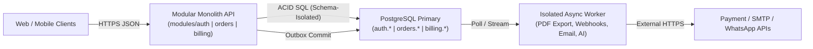

# 01 — Topology Selection: Monolith vs Modular Monolith vs Workers vs Microservices

## 1. Purpose & Activation Conditions
Select the **right-sized deployment and code topology** matching actual team size, domain consistency requirements, scaling bottlenecks, and operational maturity — defaulting to a **Modular Monolith (+ Async Worker)** and preventing "distributed monolith" traps. Activate at SDLC Stage 2 (post-`/shadow-discovery`) or whenever evaluating whether to split a service or extract a worker.

## 2. Prerequisites
- Functional & non-functional requirements from `/shadow-discovery` (expected DAU/RPS, latency SLOs, compliance isolation, team count & deployment autonomy).
- For brownfield systems: current codebase convention snapshot (`04-brownfield-convention-preservation-and-official-first.md`).

## 3. Technical Principles & Constraints
- **Boundary Discipline Before Distribution:** Putting HTTP/gRPC network hops between tightly coupled modules that share database tables produces a **Distributed Monolith** — all the latency, partial failures, and operational complexity of microservices with ZERO independent deployability!
- **Default to a Modular Monolith:** Clean in-process module boundaries (`modules/<domain>/public.ts` facade + owned DB schema/table prefix) deliver `80%` of organizational autonomy, sub-millisecond calls, real ACID transactions, and 1 simple CI/deploy pipeline at `10%` of microservices Ops cost!
- **4 Evidence-Based Extraction Triggers (Only Split When Proven):**
  1. **Heterogeneous Compute / Resource Bulkhead:** Heavy PDF/video/AI/export workers needing separate RAM/GPU scaling or OOM isolation from interactive web APIs -> extract an **Async Worker** first (sharing repo/outbox, zero distributed API churn!).
  2. **Autonomous Multi-Team Release Contention (`25+` engineers):** Independent domain teams continuously blocking each other's release train despite clean module facades.
  3. **Divergent Scaling Ratio (`> 10x`):** One read-heavy public catalog or telemetry ingest endpoint scales `10–50x` independently of core billing/admin.
  4. **Strict Regulatory / Blast-Radius Tenancy:** PCI-DSS cardholder vault or sovereign security boundary legally requiring separate VPC/DB credentials.
- **Scale Deliverables to Decision Scope (`test_boundary_levels.py`):** Reversible module-local choices get concise inline reasoning (precedent, TX boundary, coupling, rollback); shared-contract / deployment-boundary / data-owner changes require comparing coordination cost & failure isolation with an explicit ADR (`02`).

## 4. Architecture & Implementation

### Topology Selection Decision Matrix

| Topology | Team & Scale Fit | Data & Transaction Model | Pick When | Avoid When |
| :--- | :--- | :--- | :--- | :--- |
| **Simple Layered Monolith** | `1–4` devs, single deploy unit | Shared relational DB + ACID TX | Early MVP, cohesive CRUD/internal portal | Rapidly growing multi-domain teams colliding on files |
| **Modular Monolith (Default Enterprise)** | `4–25` devs, clear domain slices | Owned schema/tables per module; cross-module calls ONLY via typed `public.ts` facade | Strong domain boundaries + strict ACID consistency + fast local tests | Heterogeneous GPU/heavy batch workloads need process isolation |
| **Modular Monolith + Async Worker** | `4–40` devs with batch/PDF/AI/email jobs | Same DB + Transactional Outbox / Queue (`PG SKIP LOCKED` / `BullMQ`) | Long-running I/O (`> 2s`), external webhooks, or bulkheads without full microservice split | Simple pure request/response CRUD with no async jobs |
| **Bounded Microservices** | `25+` devs, autonomous teams & SRE | Database-per-service + Saga / Outbox eventual consistency | Proven independent scaling, hardware, or regulatory isolation | Small teams (`< 15` devs) lacking distributed tracing & SRE maturity |

## 5. Platform/Vendor Variations
- **Single-VPS / Mid-Enterprise Budget (Indonesia B2B / Gov):** A Modular Monolith + Async Worker + PostgreSQL (+ optional Redis only when measured!) runs effortlessly for `100,000+` DAU on 2 modest containers (`shadow-ops`), keeping infra cost predictable and maintenance sustainable for small internal IT teams (`/shadow-handover`).
- **Cloud-Native / Kubernetes Fleets:** Even on Kubernetes, deploying 1 Modular Monolith Deployment + 1 Worker Deployment scales horizontally cleanly via HPA (`shadow-perf` Little's Law sizing) without needing an Istio service mesh!

## 6. Decision Matrix & Trade-Offs

| Architectural Dimension | Modular Monolith + Worker | Microservices (8 Services) |
| :--- | :--- | :--- |
| **Cross-Domain Data Consistency** | Native ACID Transaction (simple, exact) | Distributed Saga / Outbox + compensating actions |
| **Local Developer Onboarding** | `1` command (`docker compose up` + `npm run dev`) | Complex multi-repo orchestration / heavy RAM |
| **Debugging & Tracing** | Single stack trace + simple wide event | Mandatory distributed OTel collector + correlation |
| **Network Partial Failures** | Only at external 3rd-party edges | Between every internal domain hop! |
| **Future Extraction Cost** | **Low** (if `public.ts` facades & schema ownership enforced!) | High re-merging cost if boundaries were guessed wrong early |

## 7. Real Production Scenario
A 5-engineer fintech startup split its product into 6 microservices (`auth`, `users`, `wallets`, `orders`, `notifications`, `reports`) + RabbitMQ before launch. Every simple checkout feature required coordinated PRs across 4 repos, local dev consumed 14GB RAM, and a partial failure between `orders` and `wallets` created orphan debits. Consolidating `auth`/`users`/`wallets`/`orders` into a single **Modular Monolith** with strict `public.ts` facades + 1 isolated **Async Worker** for `notifications` and `reports` cut feature delivery cycle time by 3x and eliminated cross-service partial-debit bugs immediately.

## 8. Failure Modes & Edge Cases
- **WRONG:** Splitting a brand-new product into microservices before domain boundaries are even understood (guessing wrong boundaries locks expensive network APIs in place!).
  **RIGHT:** Start as a **Modular Monolith** where refactoring a misplaced domain boundary is a cheap compile-time move, and extract ONLY after real scaling/team evidence justifies it.
- **WRONG:** Sharing the same database tables directly across two "microservices" (`Service B` writing directly to `Service A`'s tables).
  **RIGHT:** Every module or service MUST have a single exclusive **data write owner** (`03`).

## 9. Testing & Verification
- Run `python -m unittest discover -s shadow-architect/tests -v` (`test_boundary_levels.py`).
- Practice calibrated topology & extraction trade-offs via `evals/decision-trials.md`.

## 10. Operational Considerations
- Revisit topology decisions annually (or when team size / peak RPS crosses `5x` initial capacity assumptions) via a fresh superseding ADR rather than ad-hoc drift.

## 11. Authoritative References
- Sam Newman — *Building Microservices (2nd Ed.)* & *Monolith to Microservices*.
- Martin Fowler — *MonolithFirst* (martinfowler.com/bliki/MonolithFirst.html).
- Kamil Grzybek — *Modular Monolith Architectural Patterns*.

## 12. Limitations & When NOT to Use
- Do NOT use `shadow-architect` for multi-application enterprise portfolios, TOGAF ADM, or 6-Domain SPBE blueprints — route enterprise portfolio architecture to `/shadow-ea`.
- Do NOT use `shadow-architect` to rewrite an existing healthy brownfield architecture unrequested (`04`).
