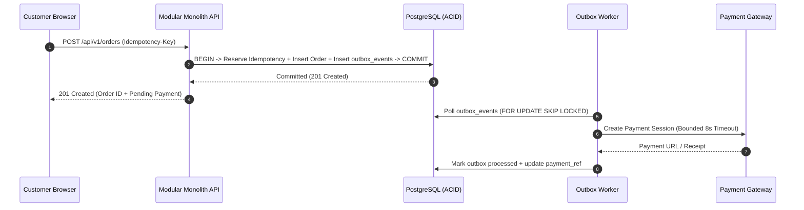

# 02 — C4 Diagrams (Strict Mermaid), ADRs & Distributed Consistency Models

## 1. Purpose & Activation Conditions
Communicate system boundaries, runtime containers, critical flows, **explicit consistency & failure assumptions**, and consequential trade-offs using **strict Mermaid C4 diagrams** and concise **Architecture Decision Records (ADRs)**. Activate when proposing a new system design, modifying shared contracts/data ownership, or documenting major technical choices.

## 2. Prerequisites
- Confirmed decision scope (`01`): reversible module-local changes are answered inline; cross-module contracts, data ownership, and deployment boundaries warrant formal C4/ADR artifacts.

## 3. Technical Principles & Constraints
- **3-Level C4 Diagram Set (Valid Mermaid Syntax Only):**
  1. **Level 1 — System Context (`flowchart LR`):** Application box, human actor personas, and external systems (Payment Gateway, SSO IdP, SMTP/WhatsApp, Government APIs).
  2. **Level 2 — Container Diagram (`flowchart LR`):** Deployable units (Web SPA, Reverse Proxy, API Server, Async Worker, Primary DB, Redis, Object Storage) with exact protocols (`HTTPS JSON`, `SQL TLS`, `Redis RESP`).
  3. **Level 3 — Critical Flow Sequence (`sequenceDiagram`):** Exact step-by-step trust boundaries & failure branches for Authentication, Payment/Approval, or Webhook Ingestion.
  - **Mermaid Syntax Hygiene:** Use ONLY supported diagram types (`flowchart`, `sequenceDiagram`, `stateDiagram-v2`, `erDiagram`), quote node labels containing parentheses/brackets (`api["API Server (Node 22)"]`), and avoid raw HTML tags inside labels.
- **Explicit Consistency & Distributed Failure Model:** Every architecture document MUST declare per domain entity:
  - **Strict Serializability / ACID Required:** Financial ledgers, wallet balances, finite stock locks, unique invoice numbering, authorization/revocation grants.
  - **Eventual Consistency Acceptable (With Explicit Staleness Bound):** Search index updates (`< 5s` via CDC/Outbox), analytics/BI dashboards (`< 5m`), email/WhatsApp dispatch, CDN public catalog (`< 60s`).
  - **Failure Assumptions Documented Explicitly:** What happens under network partition, external vendor 30s timeout, split-brain worker lock expiry, or wall-clock skew (`monotonic` vs NTP wall clock)?
- **Immutable ADR Discipline (`docs/adr/ADR-XXX-slug.md`):** Never silently delete an old ADR when circumstances change — write a new ADR marking the old one `Superseded by ADR-012` so future engineers understand *why* past constraints existed!

## 4. Architecture & Implementation

### Strict Mermaid C4 Level 2 Container + Level 3 Sequence Example


### Canonical Compact ADR Template (`docs/adr/ADR-001-*.md`)
```markdown
# ADR-001: Keep Orders & Billing in a Modular Monolith + Transactional Outbox Worker
- **Status:** Accepted (2026-11-22) | **Deciders:** Engineering Lead, Architect
- **Scope:** Shared data ownership & deployment boundary

## Context & Problem Statement
A 6-engineer team is launching B2B procurement + invoicing requiring strict ACID consistency between order approval and invoice numbering, while PDF rendering and WhatsApp receipts can spike up to 10s per request.

## Options Considered
1. **Option A — 2 Separate Microservices + HTTP Saga:** Independent deploy pipelines, but requires compensating transactions, dual CI/CD, and distributed tracing overhead for 6 engineers.
2. **Option B — Modular Monolith + Async Outbox Worker (Chosen):** Single ACID PostgreSQL instance with module schema prefixes (`orders.*`, `billing.*`), typed `public.ts` facades, and an isolated worker container consuming `outbox_events`.

## Decision & Consistency Model
- Choose **Option B**.
- **ACID / Strong Consistency:** Order approval, stock reservation, invoice sequence generation.
- **Eventual Consistency (`< 60s` SLA):** PDF rendering, WhatsApp/email notifications, search index updates.

## Consequences & Reversibility
- **Pros:** Fast local integration tests, zero distributed transactions, simple VPS/K8s ops.
- **Trade-offs:** Requires ESLint/CI fitness checks enforcing `public.ts` boundaries so modules stay cleanly extractable if Billing scales `> 10x` independently later.
```

## 5. Platform/Vendor Variations
- **Event-Driven / CQRS Decisions:** Introduce CQRS read models ONLY when read and write shapes/loads diverge dramatically (e.g., complex multi-join reporting dashboard over 50M rows) — never wrap simple CRUD screens in Command/Query/EventBus boilerplate!
- **Clock Skew Safety:** Never use client browser timestamps or unsynchronized multi-node `Date.now()` for strict ordering or distributed lease expiry — use database `now()`, monotonic database sequences, or fencing tokens (`/shadow-concurrency`).

## 6. Decision Matrix & Trade-Offs

| Consistency Requirement | Mechanism | Failure Behavior | Right For |
| :--- | :--- | :--- | :--- |
| **Strict ACID / Linearizable** | PostgreSQL TX + row locks / `UNIQUE` / `SERIALIZABLE` | Rejects cleanly (`409`/`503`) if primary unavailable | Money, stock, auth, invoice numbers |
| **At-Least-Once Eventual (Durable)** | Transactional Outbox + Idempotent Consumer | Queues safely during outage; drains upon recovery | Webhooks, emails, search index sync, BI ETL |
| **Best-Effort Ephemeral** | Redis Pub/Sub / in-memory metrics | Drops gracefully under overload (`stale: true`) | Typing indicators, live cursors, cache warmers |

## 7. Real Production Scenario
A procurement system processed vendor approvals via an asynchronous message broker between two services without documenting consistency guarantees. Under a 30-second broker lag, an admin clicked "Approve" and immediately clicked "Download Signed PO PDF," hitting a `404` because the PDF service hadn't received the event yet. Writing an explicit C4 Sequence Diagram + Consistency Matrix moved invoice/PO header creation into the synchronous ACID commit and kept only slow PDF rendering asynchronous (`202 Accepted` UI tracker), eliminating the race condition permanently.

## 8. Failure Modes & Edge Cases
- **WRONG:** Writing an ADR that lists only the chosen option with zero alternatives, zero failure assumptions, and zero reversibility discussion (justifies a pre-decided preference rather than recording engineering trade-offs!).
  **RIGHT:** Always evaluate `>= 2` credible options, state failure & consistency assumptions explicitly, and note what evidence would trigger revisiting the decision.
- **WRONG:** Drawing decorative Mermaid diagrams with broken syntax (unquoted parentheses like `A[Auth (JWT)]`) or hiding external third-party dependencies.
  **RIGHT:** Quote special-character labels (`A["Auth (JWT)"]`) and explicitly model every external network hop and datastore.

## 9. Testing & Verification
- Review every ADR against NFRs from `/shadow-discovery` (availability, peak RPS, RPO/RTO, UU PDP residency) confirming every NFR maps to a concrete mechanism.
- Verify Mermaid diagrams parse cleanly without syntax errors.

## 10. Operational Considerations
- Store ADRs directly alongside code in `docs/adr/` (versioned in Git, reviewed in PRs) so architecture decisions stay attached to the exact commits implementing them.

## 11. Authoritative References
- Simon Brown — *The C4 Model for Visualising Software Architecture* (c4model.com).
- Michael Nygard — *Documenting Architecture Decisions (ADR)* (2011).
- Martin Kleppmann — *Designing Data-Intensive Applications* (Consistency & Failure Models).

## 12. Limitations & When NOT to Use
- Do NOT write formal ADRs for trivial local variable naming, minor CSS tweaks, or single-file helper extractions — reserve ADRs for decisions that are costly to reverse or cross team/contract boundaries (`test_boundary_levels.py`).
