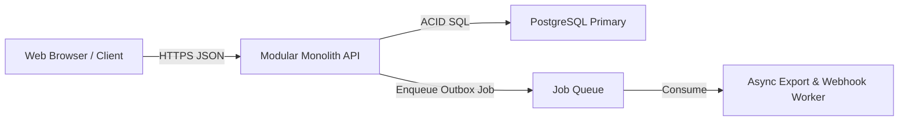

# Topology Selection, Module Boundaries & ADR Playbook

> Use this playbook when choosing application topology (Monolith vs Modular Monolith vs Worker vs Microservices), designing C4 diagrams, enforcing clean module boundaries, or authoring Architecture Decision Records (ADRs).

## 1. Core Concepts
Architecture is about controlling coupling and failure domains, not maximizing moving parts:
- **Boundary Discipline Before Distribution:** Tightly coupled database joins inside a network-split microservice fleet produce a *distributed monolith* with higher latency and partial-failure bugs. Clean in-process **module public facades** give 80% of the organizational isolation at 10% of the operational cost.
- **Evidence-Based Extraction:** Only extract a separate deployable service when backed by measured scaling divergence, independent deploy cadence across autonomous teams, hardware/runtime isolation (e.g., GPU inference), or strict regulatory tenancy separation.

## 2. Technical Rules & Decision Matrix

| Topology | Team & Scale Fit | Data & Transaction Model | Pick When |
| :--- | :--- | :--- | :--- |
| **Simple Monolith** | `1–4` devs, single deploy unit | Shared relational schema + ACID transactions | Early MVP, cohesive workflows, simple CRUD/reporting |
| **Modular Monolith** (Default Enterprise) | `4–25` devs, clear domain teams | Logically isolated schemas/tables; cross-module calls ONLY via typed public facade | Strong domain boundaries + strict ACID consistency + single CI/deploy pipeline |
| **Modular Monolith + Async Worker** | Any team with batch/PDF/AI/email jobs | Same DB + Transactional Outbox / Queue (`BullMQ`, Redis/Postgres) | Long-running I/O (`> 2s`) or spikes needing bulkhead isolation without splitting every domain |
| **Bounded Microservices** | `25+` devs, independent deploy & SLOs | Database-per-service + Saga / Outbox eventual consistency | Proven independent scaling/security/compliance isolation justifying distributed tracing & Ops |

## 3. Implementation Examples

### Strict-TS Module Public Contract Facade (Zero Cross-Module DB Joins)
```ts
// modules/billing/public.ts — ONLY file other modules may import
export interface InvoiceSummary {
  readonly id: string;
  readonly tenantId: string;
  readonly amountMinor: number;
  readonly status: "DRAFT" | "ISSUED" | "PAID";
}

export interface BillingPort {
  getInvoiceForOrder(tenantId: string, orderId: string): Promise<InvoiceSummary | null>;
}

// modules/orders/checkout.ts — imports ONLY modules/billing/public.ts, NEVER modules/billing/internal/*
import type { BillingPort } from "../billing/public.js";

export async function finalizeOrderView(billing: BillingPort, tenantId: string, orderId: string) {
  const invoice = await billing.getInvoiceForOrder(tenantId, orderId);
  return { orderId, billedStatus: invoice?.status ?? "UNBILLED" };
}
```

### Valid Mermaid C4 Container & Compact ADR Template

```markdown
## ADR-001: Keep Billing & Orders in a Modular Monolith + Outbox Worker
- **Status:** Accepted (YYYY-MM-DD) | **Owners:** Backend Lead
- **Context:** 6 engineers shipping checkout + invoicing; strict ACID ledger consistency required.
- **Options Considered:** (A) 2 Microservices + HTTP Saga; (B) Modular Monolith + Async Worker.
- **Decision:** Option B — strict `public.ts` facade + DB schema ownership; async PDF/webhooks offloaded via Outbox.
- **Consequences & Reversibility:** Fast local integration tests & zero distributed tx; if Billing throughput diverges `10x`, extract `modules/billing` cleanly behind `BillingPort`.
```

## 4. Best Practices
- Document back-of-the-envelope capacity math (peak RPS, storage growth/year, DB connection budget) and emit the 8-field **Official-First Decision Record** (`OFFICIAL-FIRST-DEPENDENCY-POLICY.md`) before introducing Redis, Kafka, or new runtimes.
- Keep cross-module interactions acyclic: depend inward on stable abstractions or emit domain events via Outbox after commit.

## 5. Anti-Patterns (`WRONG` vs `RIGHT`)
- **WRONG (Resume-driven microservices & cross-module SQL joins):** Splitting a 3-developer SaaS into 6 microservices + Kafka on day one, or writing `JOIN billing_invoices ON orders.id = billing_invoices.order_id` directly inside `modules/orders`.
  **RIGHT:** Start with a **Modular Monolith + Async Worker**, enforce module `public.ts` facades with ESLint rules, and use events/facades across boundaries.
- **WRONG (Introducing unapproved infra silently):** Adding Docker + Redis + ElasticSearch for a simple admin app without sizing justification or Monarch approval.
  **RIGHT:** Exhaust Postgres built-ins (indexes, FTS, `SKIP LOCKED`) first; propose extra infra with clear trade-offs and Official-First Decision Record.

## 6. Production Considerations
- **Failure Isolation:** Put external webhooks, exports, and LLM calls on separate worker pools/queues (`/shadow-resilience`) so slow third parties never exhaust HTTP request threads or primary DB connections.
- **Brownfield Fidelity:** Read existing codebase conventions (`docs/engineering/CODEBASE_CONVENTIONS.md`) before proposing structural shifts.
