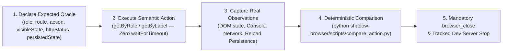

# 01 — Playwright Semantic Locators, Auth `storageState` & Action Oracle Contracts

## 1. Purpose & Activation Conditions
Design resilient, non-flaky browser verification and Playwright E2E flows anchored on **accessible semantic locators**, **reusable authenticated `storageState`**, **pre-declared action oracles (`compare_action.py`)**, and **strict host/credential isolation**. Activate when writing Playwright tests, inspecting live web apps via Playwright MCP, or reviewing browser QA evidence.

## 2. Prerequisites
- Running local or explicitly allowlisted sandbox URL (`http://127.0.0.1:...` / `http://localhost:...`) — NEVER run unapproved mutating browser flows against production hosts (`test_auth_and_host_boundaries.py`).
- Brownfield check first: reuse the project's existing E2E runner (**Playwright**, **Cypress**, or **Puppeteer**) and test conventions before adding a new framework.

## 3. Technical Principles & Constraints
- **Semantic Locator Priority (Mirrors How Real Users & Screen Readers Interact):**
  1. `page.getByRole('button', { name: 'Submit Order' })` (BEST — verifies accessible role + name simultaneously!).
  2. `page.getByLabel('Email Address')` (verifies programmatic form label association!).
  3. `page.getByPlaceholder(...)` / `page.getByText(...)` (only when role/label doesn't apply).
  4. `page.getByTestId('order-row-17')` (fallback strictly for complex visual canvases or repeated disambiguated rows).
  - **NEVER** use fragile generated CSS classes (`.css-1f8a2x`), deep XPath, or positional `div > button:nth-child(3)`.
- **Pre-Declared Action Oracles (`compare_action.py`):** Before clicking or submitting anything, declare the expected `role`, `route`, `action`, `visibleState`, and (where applicable) `httpStatus`, `sessionPresent`, `focusedControl`, and `persistedState` after reload!
  - Example: On invalid credentials, `httpStatus: 401` + accessible error banner + `sessionPresent: false` is a **PASS**. Conversely, `httpStatus: 200` on a blank white screen is a **FAIL**!
  - If the target server is unreachable, mark the scenario **`BLOCKED`** (`environment: "unreachable"`) recording only the sanitized URL (NEVER guess or pass!).
- **Authenticate Once via `storageState` (Speed + Zero Auth-Rate-Limit Flakes):** Run a dedicated auth setup project logging in once per role (`admin.json`, `member.json`) stored in a gitignored `.auth/` folder so 80 feature tests start already authenticated in `50ms`, while keeping a separate isolated spec testing login, invalid-credential `401`, CSRF/cookie flags, and logout!
- **Zero Secrets in Evidence Artifacts:** Keep raw passwords, session cookies, JWTs, and personal PII out of `expected.json`/`observed.json`, screenshots, and committed traces (`test_auth_and_host_boundaries.py`).

## 4. Architecture & Implementation



### Repeatable Single-Action Oracle Verification (`compare_action.py`)
```json
// expected.json (declared BEFORE running the action; zero raw credentials or tokens)
{
  "role": "tenant_member",
  "route": "/orders/new",
  "action": "submit_valid_order",
  "httpStatus": 201,
  "sessionPresent": true,
  "visibleState": "Order created confirmation banner visible",
  "persistedState": "Order appears in /orders list after full page reload"
}
```

```powershell
# Compare pre-declared expectation against real browser observation (L1)
python shadow-browser/scripts/compare_action.py expected.json observed.json
python -m unittest discover -s shadow-browser/tests -v
```

### Strict TypeScript Playwright Auth Setup & Host Guard Pattern
```ts
// Strict TypeScript Allowlisted Host & Semantic Locator Helper (0 any, 0 casts)
const ALLOWED_LOCAL_HOSTS = new Set<string>(['localhost', '127.0.0.1', '[::1]'])

export function assertSafeBrowserTarget(rawUrl: string, allowlistedStagingHost?: string): URL {
  const parsed = new URL(rawUrl)
  if (parsed.protocol !== 'http:' && parsed.protocol !== 'https:') {
    throw new Error(`UNSUPPORTED_PROTOCOL: ${parsed.protocol}`)
  }
  const allowed =
    ALLOWED_LOCAL_HOSTS.has(parsed.hostname) ||
    (allowlistedStagingHost !== undefined && parsed.hostname === allowlistedStagingHost)
  if (!allowed) {
    throw new Error(`BLOCKED_HOST: refusing unapproved browser E2E target '${parsed.hostname}'`)
  }
  return parsed
}
```

## 5. Platform/Vendor Variations
- **Playwright MCP Live Sessions (`browser_navigate`, `browser_snapshot`, `browser_click`):** Always inspect `browser_snapshot` (accessibility tree!) before clicking elements, test real interactions (`antislop` R-26), inspect `browser_console_messages` and `browser_network_requests`, and ALWAYS call `browser_close` when done!
- **Cypress / Puppeteer Brownfield Repos:** Apply the identical semantic selector strategy (`cy.findByRole` via `@testing-library/cypress`), host allowlisting, and session caching (`cy.session()`).
- **Multi-Tenant Roles:** Use separate `storageState` files per role/tenant (`tenantA.json`, `tenantB.json`) to test cross-tenant UI isolation directly (assert Tenant A navigating to `/tenants/B/settings` receives `403`/redirect without rendering Tenant B's heading!).

## 6. Decision Matrix & Trade-Offs

| Locator / Auth Pattern | Resilience to Refactors | Catches A11y Regressions? | Execution Speed | Recommendation |
| :--- | :--- | :--- | :--- | :--- |
| **`getByRole` / `getByLabel`** | Very High | **Yes!** | Fast | **Default primary locator** |
| **`getByTestId`** | High | No | Fast | Fallback for complex/repeated widgets |
| **CSS `.class > div:nth-child(3)`** | Very Low (breaks constantly) | No | Fast | **FORBIDDEN** |
| **`storageState` Setup Fixture** | High | N/A | **10x Faster** | Default for authenticated feature suites |
| **UI Login Inside Every `beforeEach`** | Medium | Tests login repeatedly | Slow + trips auth rate limits | Restrict to dedicated auth spec only |

## 7. Real Production Scenario
A team had 45 Playwright tests that broke every sprint whenever Tailwind classes or wrapper `<div>`s shifted, AND took 11 minutes because every test typed credentials into `/login` (frequently tripping the staging `429` login rate limiter!). Migrating to `getByRole`/`getByLabel`, shared `storageState` per role, and pre-declared `compare_action.py` oracles cut suite runtime from 11 minutes to 75 seconds, dropped locator-caused CI failures to zero, and immediately exposed 3 icon-only buttons that had no accessible name!

## 8. Failure Modes & Edge Cases
- **WRONG:** Committing `.auth/admin.json` (`storageState` containing live session cookies/JWTs) into Git!
  **RIGHT:** Add `.auth/` and `playwright-report/` to `.gitignore` and generate ephemeral local auth states per run using test-only accounts.
- **WRONG:** Clicking a submit button and only checking that the modal closed without verifying **reload persistence** (`page.reload()`).
  **RIGHT:** For state-mutating UI flows, verify persistence after `page.reload()` (or inspect the real API response + updated list) so optimistic-only bugs that failed to persist to DB are caught!
- **WRONG:** Ignoring an unreachable target server by marking tests "skipped/passed."
  **RIGHT:** Mark unreachable targets strictly **`BLOCKED`** with the sanitized URL and report clearly.

## 9. Testing & Verification
- Run `python -m unittest discover -s shadow-browser/tests -v` (verifies `test_auth_and_host_boundaries.py` AND `test_compare_action.py`).
- Verify every new E2E test passes 5 consecutive times without `waitForTimeout`.

## 10. Operational Considerations
- Keep Playwright traces (`trace: 'on-first-retry'`) and failure screenshots sanitized of credentials and cleaned up after CI retention windows.

## 11. Authoritative References
- Playwright Official Documentation — *Locators, Web-First Assertions & Authentication (`storageState`)*.
- `shadow-browser/scripts/compare_action.py` & `tests/test_auth_and_host_boundaries.py`.

## 12. Limitations & When NOT to Use
- Do NOT use `shadow-browser` for native iOS/Android mobile store gates (use `/shadow-mobile` with Maestro/Detox) or for backend SQL/math permutations better covered in `5ms` by `/shadow-test`.
