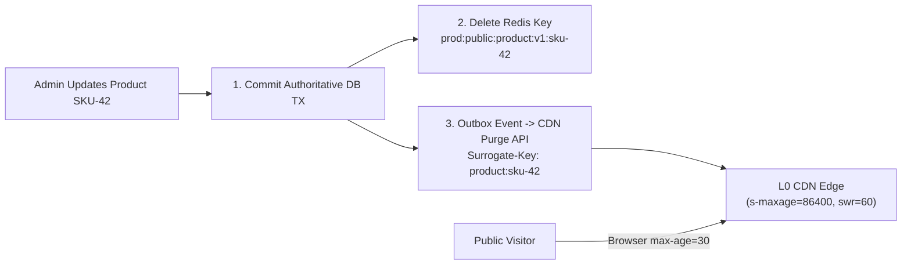

# 01 — HTTP/CDN Edge Caching, `Cache-Control`, `ETag` & `Surrogate-Key` Invalidation

## 1. Purpose & Activation Conditions
Design safe, high-hit-ratio **L0 Browser & CDN Edge caching** using standards-compliant `Cache-Control`, `ETag`/`If-None-Match`, `Vary`, `stale-while-revalidate`, and tag-based **`Surrogate-Key` / `Cache-Tag`** purging — with zero risk of leaking authenticated/PII responses across shared proxies. Activate when tuning public catalog/CMS edge caching, fixing stale CDN pages after admin updates, or auditing response caching headers on authenticated APIs.

## 2. Prerequisites
- Clear route classification inventory: **Public Immutable Static** (hashed assets), **Public Mutable Content** (product catalogs, blog/SEO pages), vs **Authenticated / Tenant / PII Routes** (orders, profile, invoices, admin APIs).
- CDN capabilities check (Cloudflare `Cache-Tag` / `CDN-Cache-Control`, Fastly `Surrogate-Key` / `Surrogate-Control`, CloudFront invalidation, or Nginx `proxy_cache`).

## 3. Technical Principles & Constraints
- **Hard Privacy Floor (`private, no-store`):** ANY endpoint reading `Authorization`, session `Cookie`, API key, or returning tenant/user-specific or UU PDP personal data MUST emit `Cache-Control: private, no-store` (or `private, no-cache` + `ETag` strictly when browser-local conditional revalidation is desired without storing in shared CDNs). **NEVER** emit `public` or `s-maxage` on authenticated/PII routes!
- **Decouple Browser TTL From CDN Edge TTL:** Use short browser `max-age` (`30–60s`) with longer CDN `s-maxage` (`3600–86400s`, or `CDN-Cache-Control` / `Surrogate-Control`) + `stale-while-revalidate=60` + `stale-if-error=3600`. Why? You can purge your own CDN edge in `< 500ms` via API, whereas you can **never** remotely purge 100,000 customers' browsers!
- **Tag-Based Invalidation (`Surrogate-Key` / `Cache-Tag`):** Attach bounded domain tags to public responses (e.g., `Surrogate-Key: catalog product:sku-42 category:shoes`). When an admin edits `sku-42`, commit the database transaction FIRST, then purge `product:sku-42` and `catalog` — clearing every affected PDP, PLP, and sitemap edge entry without wiping unrelated cache keys.
- **Strict `Vary` Hygiene:** Include ONLY low-cardinality negotiation headers (`Vary: Accept-Encoding`, and `Accept-Language` only if normalized at edge). NEVER put `Vary: User-Agent` or `Vary: Cookie` on public CDN routes (destroys hit ratio to `< 1%`).

## 4. Architecture & Implementation



```ts
// Strict TypeScript Route Cache-Control & Surrogate-Key Header Builder (0 any, 0 casts)
export type RouteCacheClass =
  | { readonly kind: 'immutable_asset' }
  | { readonly kind: 'public_mutable'; readonly browserMaxAgeSec: number; readonly edgeMaxAgeSec: number; readonly surrogateKeys: readonly string[]; readonly etag?: string }
  | { readonly kind: 'authenticated_no_store' }
  | { readonly kind: 'authenticated_revalidate'; readonly etag: string }

export function buildHttpCacheHeaders(policy: RouteCacheClass): Record<string, string> {
  switch (policy.kind) {
    case 'immutable_asset':
      return {
        'Cache-Control': 'public, max-age=31536000, immutable',
        Vary: 'Accept-Encoding',
      }
    case 'public_mutable': {
      const headers: Record<string, string> = {
        'Cache-Control': `public, max-age=${policy.browserMaxAgeSec}, s-maxage=${policy.edgeMaxAgeSec}, stale-while-revalidate=60, stale-if-error=3600`,
        Vary: 'Accept-Encoding',
      }
      if (policy.surrogateKeys.length > 0) {
        headers['Surrogate-Key'] = policy.surrogateKeys.join(' ')
        headers['Cache-Tag'] = policy.surrogateKeys.join(',')
      }
      if (policy.etag) {
        headers.ETag = policy.etag
      }
      return headers
    }
    case 'authenticated_no_store':
      return {
        'Cache-Control': 'private, no-store, max-age=0',
        Pragma: 'no-cache',
        Vary: 'Authorization, Cookie',
      }
    case 'authenticated_revalidate':
      return {
        'Cache-Control': 'private, no-cache',
        ETag: policy.etag,
        Vary: 'Authorization, Cookie',
      }
  }
}
```

### Conditional Revalidation (`ETag` + `304 Not Modified`)
For authenticated read-heavy endpoints where payload size is large (e.g., user permissions bundle, tenant config JSON), emit `Cache-Control: private, no-cache` + strong or weak `ETag: W/"<configVersion>-<hash>"`. The browser always revalidates with `If-None-Match`, the server checks authorization FIRST, and returns `304 Not Modified` (`0` response body bytes) when unchanged — saving bandwidth without risking shared CDN leaks.

## 5. Platform/Vendor Variations
- **Cloudflare:** Honors `CDN-Cache-Control` / `Cloudflare-CDN-Cache-Control` independently of `Cache-Control`, supports `Cache-Tag` purging (Enterprise) or explicit URL/prefix purges on Pro/Business; strip `Set-Cookie` on public cacheable responses or Cloudflare bypasses cache automatically.
- **Fastly / Varnish:** Native `Surrogate-Control` + `Surrogate-Key` headers (stripped automatically before forwarding to browsers so internal tags never leak externally).
- **Next.js App Router / Vercel:** `revalidateTag('product:sku-42')` maps directly to tag-based edge/ISR invalidation; verify route handlers touching `cookies()` or `headers()` force dynamic uncached rendering (`private, no-store`) so user responses never bake into shared ISR cache.

## 6. Decision Matrix & Trade-Offs

| Route Class | `Cache-Control` Directive | Edge Cached? | Invalidation Mechanism | Risk If Misconfigured |
| :--- | :--- | :--- | :--- | :--- |
| **Hashed JS/CSS/Images** | `public, max-age=31536000, immutable` | Yes (1 year) | Filename content hash (`app.8f2a1c.js`) | None if filenames always change on edit |
| **Public Catalog / Docs / SEO** | `public, max-age=30, s-maxage=86400, stale-while-revalidate=60` | Yes (24h edge, 30s browser) | `Surrogate-Key` / `Cache-Tag` purge on DB commit | Stale prices for 24h if `max-age=86400` used instead of `s-maxage` |
| **Authenticated User/Tenant API** | `private, no-store` | **NEVER** | N/A (server L2 Redis + client TanStack Query) | **CRITICAL:** Cross-user PII/financial leak if `public` set! |
| **Large Authenticated Settings** | `private, no-cache` + `ETag` | **NEVER** (browser only) | Auth check + `If-None-Match` -> `304` | Leaks stale data if `304` runs before auth/revocation check |

## 7. Real Production Scenario
An e-commerce marketplace set `Cache-Control: public, max-age=86400` on `/products/:slug` to survive campaign traffic. When sellers updated flash-sale stock to `0` or corrected a typo price (`Rp 10.000` instead of `Rp 1.000.000`), shoppers' browsers kept rendering the cached price for up to 24 hours even after Cloudflare was purged. Switching to `public, max-age=30, s-maxage=86400, stale-while-revalidate=60` with `Cache-Tag: product:<id>` purged from the DB commit outbox cut stale visibility to `< 30s` while preserving a `97.4%` CDN cache hit ratio.

## 8. Failure Modes & Edge Cases
- **WRONG:** Setting `Cache-Control: public, max-age=86400` on a mutable product/article page (locks stale content inside users' browsers with no way to purge).
  **RIGHT:** Keep browser `max-age` short (`0–60s`), put long TTL strictly on `s-maxage` / `CDN-Cache-Control`, and trigger `Surrogate-Key` purges after DB commit.
- **WRONG:** Returning `304 Not Modified` on an `ETag` match *before* verifying that the caller's session/JWT is still valid and authorized for that tenant.
  **RIGHT:** Always execute authentication and tenant/RBAC authorization BEFORE checking `If-None-Match`.
- **WRONG:** Emitting `Set-Cookie` (e.g., anonymous tracking cookie) on public CDN-cacheable responses (either disables CDN caching completely or, worse on misconfigured proxies, caches User A's `Set-Cookie` and hands User A's session to User B!).
  **RIGHT:** Strip all `Set-Cookie` headers on `public` cached routes and configure proxies to never cache responses carrying `Set-Cookie`.

## 9. Testing & Verification
- Run `python shadow-cache/scripts/cache_policy_verifier.py --check-cache-config cache_policy.json` in CI to catch `public`/`s-maxage` on authenticated/PII routes and uninvalidated long-TTL public routes.
- Write HTTP contract tests verifying `GET /api/v1/me/*` emits `Cache-Control: private, no-store` and NEVER emits `public` or `s-maxage`.

## 10. Operational Considerations
- Strip internal `Surrogate-Key` headers at the CDN edge so internal taxonomy/IDs are not exposed to public browsers.
- Monitor CDN cache hit ratio (`CF-Cache-Status: HIT/MISS/BYPASS/REVALIDATED`) and purge API rate limits (`stale-if-error=3600` shields users if origin briefly fails).

## 11. Authoritative References
- RFC 9111 — *HTTP Caching* (`Cache-Control`, `Age`, `Vary`, shared vs private caches).
- RFC 5861 — *HTTP Cache-Control Extensions for Stale Content* (`stale-while-revalidate`, `stale-if-error`).
- RFC 9213 — *Targeted HTTP Cache Control* (`CDN-Cache-Control`).

## 12. Limitations & When NOT to Use
- Do NOT rely on CDN edge caching for real-time inventory decrements, bank balances, or seat availability — serve volatile transactional state dynamically or via short-TTL tenant-scoped Redis (`02`) + optimistic/realtime sync (`04`, `/shadow-realtime`).
- Do NOT use `shadow-cache` for SEO crawl-budget/canonical rules — route search indexing metadata to `/shadow-seo`.
