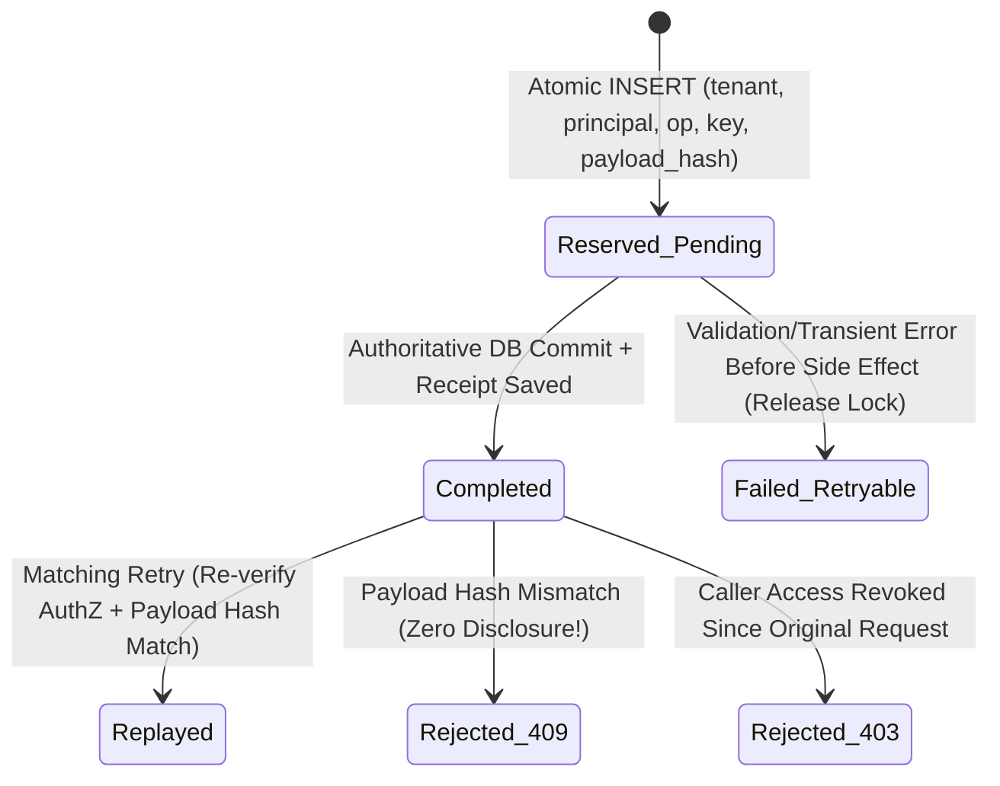

# 04 — Client Server-State (`TanStack Query`/`SWR`), Optimistic Rollback & `Idempotency-Key` Contracts

## 1. Purpose & Activation Conditions
Coordinate client-side server-state caching (**TanStack Query** / **SWR**), hierarchical query-key factories, safe optimistic UI updates with deterministic rollback, and backend **`Idempotency-Key`** contracts for state-mutating endpoints (payments, orders, approvals, webhooks) so neither client retries nor duplicate clicks corrupt business state or show stale balances. Activate when implementing frontend data fetching/mutations, fixing stale UI after writes, or engineering idempotent write APIs.

## 2. Prerequisites
- Defined REST/GraphQL/RPC contracts with explicit tenant/principal scoping.
- Backend transactional database (PostgreSQL/MySQL) for durable idempotency record reservation (`test_idempotency.py`).

## 3. Technical Principles & Constraints
- **Zero Server-State Duplication in `Zustand`/`Redux`:** Keep global client stores (`Zustand`, `Context`, `Pinia`) strictly for ephemeral **UI state** (sidebar collapsed, active modal, local wizard draft). Let `TanStack Query` / `SWR` own server responses, background refetching, deduplication, garbage collection, and cache invalidation.
- **Typed Hierarchical Query-Key Factories Scoped by `tenantId`:** Never scatter magic string arrays (`['orders']`) across components, and NEVER omit `tenantId` when users can switch organizations/workspaces — switching Tenant A -> Tenant B without `tenantId` in the query key (or `queryClient.clear()` on tenant/auth switch!) flashes Tenant A's cached data inside Tenant B's UI!
- **Deterministic Optimistic UI (`cancel -> snapshot -> patch -> rollback on error -> invalidate on settled`):** Always `cancelQueries` before mutating cache (prevents in-flight background fetches from overwriting your optimistic patch!), snapshot previous cache state for exact `onError` rollback, and invalidate affected keys in `onSettled` so server truth always reconciles.
- **Strict `Idempotency-Key` Contract for State-Mutating Endpoints:**
  1. **Scope to Principal + Tenant + Operation:** Key uniqueness is `(tenant_id, principal_id, operation, idempotency_key)` — NEVER global across users/tenants!
  2. **Bind to Canonical Request Fingerprint (SHA-256 of Validated Business Inputs):** Reusing the same `Idempotency-Key` with a *different* amount/payload MUST reject (`409 Conflict` / `422`) WITHOUT disclosing the previous response!
  3. **Recheck Authorization Before Replay:** If the caller's role or tenant membership was revoked between attempt #1 and retry #2, reject (`403`) instead of replaying the cached response!
  4. **Atomic Reservation + Pending Handling:** Atomically insert the `(scope, key, fingerprint, status='pending')` row first (`UNIQUE` constraint). Concurrent matching retries receive the agreed pending status (`409 Conflict` / `202 Accepted` with `Retry-After`) rather than running double side effects.
  5. **Crash/Lost-Reply & External Side-Effect Reconciliation:** Tie completion strictly to the durable DB commit or provider receipt. If the server crashes between charging a payment gateway and committing local acknowledgment, reconcile by stable `operation_id` before blindly retrying (`/shadow-integrate`, `/shadow-concurrency`).

## 4. Architecture & Implementation

```ts
// Strict TypeScript Tenant-Scoped TanStack Query Key Factory & Optimistic Rollback Contract (0 any, 0 casts)
export interface OrderFilterDto {
  readonly status?: 'pending' | 'paid' | 'cancelled'
  readonly page?: number
}

export interface OrderSummary {
  readonly id: string
  readonly status: 'pending' | 'paid' | 'cancelled'
  readonly totalCents: number
}

export const orderKeys = {
  all: (tenantId: string) => ['tenant', tenantId, 'orders'] as const,
  lists: (tenantId: string) => [...orderKeys.all(tenantId), 'list'] as const,
  list: (tenantId: string, filters: OrderFilterDto) => [...orderKeys.lists(tenantId), filters] as const,
  details: (tenantId: string) => [...orderKeys.all(tenantId), 'detail'] as const,
  detail: (tenantId: string, orderId: string) => [...orderKeys.details(tenantId), orderId] as const,
}

export interface QueryClientSubset {
  cancelQueries(opts: { readonly queryKey: readonly unknown[] }): Promise<void>
  getQueryData<T>(queryKey: readonly unknown[]): T | undefined
  setQueryData<T>(queryKey: readonly unknown[], updater: T | ((prev: T | undefined) => T | undefined)): void
  invalidateQueries(opts: { readonly queryKey: readonly unknown[] }): Promise<void>
}

export interface OptimisticContext {
  readonly previousDetail: OrderSummary | undefined
}

export function createOrderCancelHandlers(queryClient: QueryClientSubset, tenantId: string, orderId: string) {
  const detailKey = orderKeys.detail(tenantId, orderId)
  return {
    async onMutate(): Promise<OptimisticContext> {
      await queryClient.cancelQueries({ queryKey: detailKey })
      const previousDetail = queryClient.getQueryData<OrderSummary>(detailKey)
      if (previousDetail) {
        queryClient.setQueryData<OrderSummary>(detailKey, { ...previousDetail, status: 'cancelled' })
      }
      return { previousDetail }
    },
    onError(_err: unknown, _vars: unknown, ctx: OptimisticContext | undefined): void {
      if (ctx?.previousDetail) {
        queryClient.setQueryData<OrderSummary>(detailKey, ctx.previousDetail)
      }
    },
    async onSettled(): Promise<void> {
      await queryClient.invalidateQueries({ queryKey: orderKeys.lists(tenantId) })
      await queryClient.invalidateQueries({ queryKey: detailKey })
    },
  }
}
```

### Transactional `Idempotency-Key` State Machine


## 5. Platform/Vendor Variations
- **TanStack Query v5 (`@tanstack/react-query`):** Set sane defaults (`staleTime: 30_000`, `gcTime: 300_000`, `refetchOnWindowFocus: true` for dashboards, `false` for long form pages); ALWAYS call `queryClient.clear()` inside logout AND tenant/workspace switch handlers!
- **SWR / RTK Query / Apollo Client:** Apply the identical tenant-key prefixing, `mutate(..., { optimisticData, rollbackOnError: true })`, and cache clear on auth/tenant change.
- **Stripe / SNAP BI / Midtrans / IETF `Idempotency-Key` Draft:** Derive idempotency key retention (e.g., `24h–72h`) from business retry windows and upstream provider deduplication guarantees — never keep idempotency rows for `5 seconds` when payment retries span `24 hours`, and never keep them forever without TTL/partition pruning (`shadow-data`).

## 6. Decision Matrix & Trade-Offs

| Mutation UX Pattern | Perceived Speed | Complexity | Safe For | Unsafe For |
| :--- | :--- | :--- | :--- | :--- |
| **Pessimistic + Invalidate (`onSuccess`)** | Standard (`100–400ms` spinner) | Low | Payments, irreversible approvals, bank transfers | Fast toggles (like/star/checkbox) |
| **Optimistic Update + Snapshot Rollback** | Instant (`0ms`) | Medium | Status toggles, todo/kanban drags, bookmarking | Irreversible money movement without server confirmation |
| **Backend `Idempotency-Key` (Scoped + Hash)** | Transparent on retry | Medium | **MANDATORY** on POST payments, orders, webhooks, approvals | Read-only `GET` endpoints |
| **Client-Only Debounce / Disabled Button** | Good UX, **ZERO safety** | Trivial | Double-click UX polish ONLY | Network timeout retries or malicious API replays |

## 7. Real Production Scenario
A B2B procurement web app disabled the "Approve & Pay" button in React to stop duplicate payments, and cached `/orders` in `Zustand` via `useEffect`. Under shaky 4G connections, the browser timed out after 30s while the backend succeeded; the mobile app retried automatically and charged the company's virtual account twice (`Rp 85.000.000 x 2`). Meanwhile, users switching subsidiaries briefly saw the previous company's cached orders. Implementing scoped transactional `Idempotency-Key` reservation + payload fingerprinting (verified with `test_idempotency.py`), removing server state from `Zustand`, prefixing TanStack Query keys with `tenantId`, and clearing `queryClient` on logout/switch eliminated duplicate charges and cross-tenant UI flashes.

## 8. Failure Modes & Edge Cases
- **WRONG:** Scoping `Idempotency-Key` globally without `(tenant_id, principal_id, operation)` or skipping payload fingerprint checks (User B guesses/reuses key `"order-1"` and receives User A's cached invoice, or User A retries `"order-1"` with `amount: 500000` and silently gets the `amount: 5000` receipt!).
  **RIGHT:** Key uniqueness includes `(tenant_id, principal_id, operation, idempotency_key)`, hashes canonical business payload inputs, rejects mismatches without leaking old results, and re-verifies caller authorization before every replay.
- **WRONG:** Forgetting `queryClient.clear()` on user logout or organization switcher in a shared workstation / kiosk browser.
  **RIGHT:** Always clear the client query cache atomically on logout, session expiry, and active tenant change.
- **WRONG:** Running optimistic updates without `await queryClient.cancelQueries(...)` first.
  **RIGHT:** Cancel in-flight refetches in `onMutate` so stale responses cannot race and revert the optimistic state prematurely.

## 9. Testing & Verification
- Run `python -m unittest discover -s shadow-cache/tests -v` — exercises `test_idempotency.py` (competing connections, changed payload fingerprint, tenant/principal isolation, revoked access before replay, interrupted commit, and lost reply) AND `test_cache_policy_verifier.py`!
- Add frontend integration tests (Vitest + MSW) verifying optimistic rollback on HTTP `500`, `queryClient.clear()` on tenant switch, and exact `Idempotency-Key` header stability across retries of the same logical submission (and fresh key generation for a *new* edited submission).

## 10. Operational Considerations
- For external side effects (payment gateway, SMS, email), combine local `Idempotency-Key` reservation with provider-level reconciliation tests (`/shadow-integrate`, `/shadow-concurrency`) so crashes between external provider success and local DB commit are recovered deterministically.
- Prune expired `idempotency_keys` rows via time-based partitioning or batched background deletion (`shadow-data`) to avoid table bloat.

## 11. Authoritative References
- IETF Draft (`draft-ietf-httpapi-idempotency-key-header`) — *The Idempotency-Key HTTP Header Field*.
- TanStack Query v5 Official Documentation — *Query Keys, Optimistic Updates & Invalidation*.
- Shadow Cache Transactional Idempotency Suite — `shadow-cache/tests/test_idempotency.py`.

## 12. Limitations & When NOT to Use
- Do NOT rely solely on `shadow-cache` for durable multi-step saga orchestration, outbox relays, or WebSocket live-event push synchronization — coordinate durable async queues with `/shadow-concurrency` and live streaming reconnection with `/shadow-realtime`.
- Do NOT apply optimistic UI updates to irreversible compliance or financial execution states without clearly labeling "Submitting..." until the server confirms durable commit.
