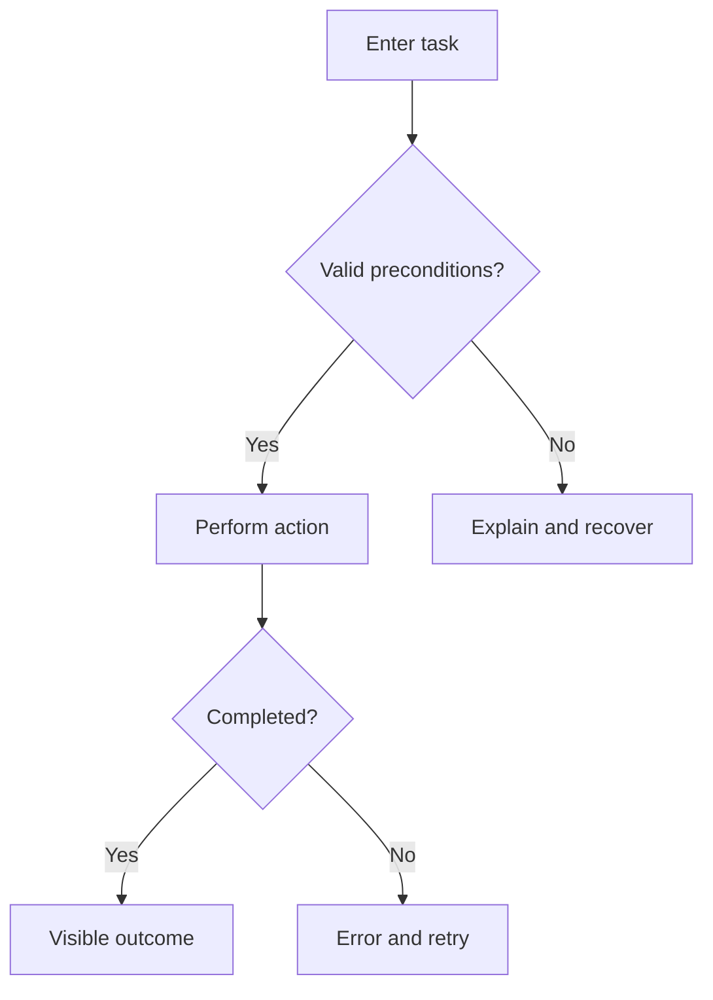

# Feature design — [title]
Status: PROPOSED | Version: [version] | Date: [YYYY-MM-DD]

## Goal and evidence
- User/job:
- Problem and success metric:
- Evidence:
- Assumptions + validation plan:

## User stories
| Story ID | As a/I want/so that | Priority | Acceptance criteria IDs |
|---|---|---|---|

## Flow

## Screen inventory
| Screen ID | User task | Main CTA | Data | Loading/empty/error/denied | Mobile | Accessibility |
|---|---|---|---|---|---|---|

## State machine
| State | Event | Guard | Next | Feedback | Recovery |
|---|---|---|---|---|---|

## Role matrix
| Role | Resource | Read | Create | Edit | Delete | Approval |
|---|---|---|---|---|---|---|

## Edge cases
| Test ID | Scenario | Expected behavior | Severity | Status |
|---|---|---|---|---|

## Handoff
- Existing patterns/components reused:
- New components (justification):
- API and async assumptions:
- Analytics events and privacy:
- Tradeoffs / alternatives rejected:
- Residual risks, owner, validation:
