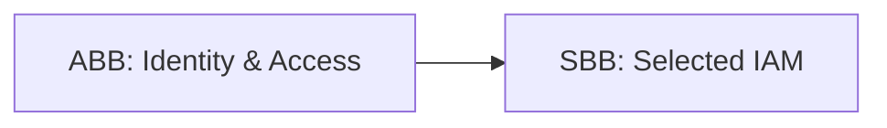

# TEMPLATE — Enterprise & Solution Architecture Report

> **TEMPLATE ORISINAL | DRAFT | Disesuaikan dengan TOGAF 10 ADM / 6-Domain SPBE.**

| Metadata | Nilai |
|---|---|
| Document ID | `[PROJECT-EA-001]` |
| Konteks | `[ENTERPRISE / GOVERNMENT_SPBE]` |
| Revisi dokumen | `0.1-DRAFT` |
| Status | `DRAFT` |

## 1. Architecture Context & Domain Coverage

[ISI cakupan domain TOGAF / 6 Domain SPBE & Satu Data Indonesia.]

## 2. TIME Portfolio Rationalization & Duplicate Capabilities

| System ID | System Name | Business Value | Tech Health | TIME Quadrant | Action |
|---|---|---|---|---|---|
| `[SYS-001]` | `[ISI]` | `[ISI]` | `[ISI]` | `[INVEST/TOLERATE/MIGRATE/ELIMINATE]` | `[ISI]` |

## 3. ABB to SBB Mapping & Integration Diagram

