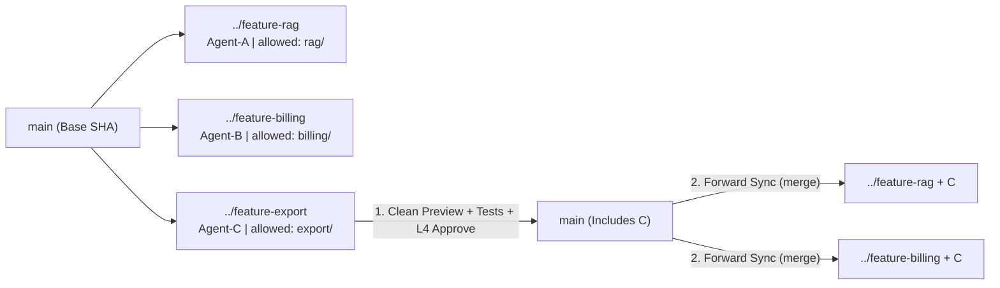

# 02 — Git Worktrees, Parallel Multi-Agent Isolation & Path-Ownership Contracts

## 1. Purpose & Activation Conditions
Enable multiple developers or AI agents to build independent features concurrently **without `.git/index.lock` collisions, accidental branch switches, or cross-feature contamination** using isolated **Git Worktrees**, an ownership manifest (`.git/shadow-worktrees/agents_registry.json`), disjoint path partitioning, and deterministic sequential integration. Activate whenever spawning parallel worktrees or coordinating multi-agent feature branches.

## 2. Prerequisites
- Main repository checkout cleanly tracking target base (`main` or `develop`).
- Explicit task breakdown (`/shadow-plan`) identifying disjoint file ownership and branch dependencies (`depends_on_branches`).

## 3. Technical Principles & Constraints
- **One Worktree Per Agent / Feature (`FR-02`, `FR-03`):** Never let two parallel agents edit or run `git checkout` inside the same directory! Create sibling worktrees (`../feature-rag`, `../feature-billing`, `../feature-export`) via `git_orchestrator.py worktree-create`, which automatically blocks if a branch is already checked out elsewhere or if the target path is non-empty!
- **Explicit Disjoint Path-Ownership Invariant:**
  - Before spawning parallel worktrees, partition modified directories so each worktree owns a **disjoint** set of paths (`--allowed-paths rag/`, `--allowed-paths billing/`).
  - **Shared Contracts Must Be Serialized!** Never let 2 parallel feature worktrees edit shared root contracts concurrently (`openapi.yaml`, `schema.prisma`, `package.json`, shared router registries, migration indexes) — assign shared contract changes to a prerequisite base branch or serialized coordinator integration step!
  - Verify continuously with `git_orchestrator.py check-parallel-scope --base main` to catch scope leaks or overlapping shared files BEFORE merge day!
- **Independent Feature Integration (`FR-04`):** When Branch C (`feature-export`) finishes while A (`feature-rag`) and B (`feature-sitaba`) are still in progress:
  1. Run read-only preview: `integrate-feature --branch feature-export --target main` verifying clean worktree (`0` uncommitted/untracked), all `depends_on_branches` already merged, and `0` Git conflicts.
  2. Re-resolve BOTH commit SHAs + merge-base immediately before integrating — if either moved since preview, repeat preview & contract checks against the new pair (`test_worktree_semantic_order.py`)!
  3. Run `/shadow-test` and `/shadow-sec` inside Branch C's worktree.
  4. Obtain explicit Monarch `L4` approval -> integrate C (`--approve` or PR) -> forward-sync updated `main` into A and B (`sync-from-main --strategy merge`).
- **Session Pause Continuity (`/handoff`):** When pausing work inside a worktree, persist `worktree_path`, `branch`, `task_id`, and `untestedSurfaces` via `shadow_handoff` MCP so a resumed agent picks up the exact worktree cleanly.

## 4. Architecture & Implementation



### Parallel Multi-Agent Worktree Lifecycle Commands
```powershell
# 1. Create isolated sibling worktree with explicit agent ownership & disjoint path scope
python "shadow-git/scripts/git_orchestrator.py" --repo . worktree-create `
  --branch feature-rag `
  --path ../feature-rag `
  --base main `
  --agent Agent-RAG `
  --task TASK-01 `
  --allowed-paths rag/

# 2. Detect cross-worktree path overlaps & out-of-scope edits (L0 read-only)
python "shadow-git/scripts/git_orchestrator.py" --repo . check-parallel-scope --base main

# 3. Preview independent integration of completed Branch C (L0 read-only; add --approve ONLY after L4!)
python "shadow-git/scripts/git_orchestrator.py" --repo . integrate-feature --branch feature-export --target main
```

### Ownership Manifest Schema (`.git/shadow-worktrees/agents_registry.json`)
| Field | Purpose | Enforced By |
| :--- | :--- | :--- |
| `branch` & `worktree_path` | Exact branch <-> folder lock | `worktree-create` & `safe-cleanup` |
| `agent_id` & `task_id` | Links worktree to `/shadow-plan` `TASK-*` | `health` & `safe-cleanup` (`ACTIVE_AGENT_OWNERSHIP`) |
| `allowed_paths` | Disjoint directory prefixes owned by this agent | `check-parallel-scope` |
| `depends_on_branches` | Prerequisite branches that must land in `main` first | `integrate-feature` ordering gate |

## 5. Platform/Vendor Variations
- **Node/Python Dependencies Inside Sibling Worktrees:** Git worktrees share `.git` objects (`0` history duplication!) while keeping separate working files — remember `node_modules/` and `.venv/` are untracked, so run `pnpm install --frozen-lockfile` (fast hardlinks from pnpm store!) or `uv sync --frozen` inside each worktree before running local tests!
- **Windows Long Path & Lock Considerations:** Keep sibling worktree paths short (`../wt-rag` instead of deeply nested paths) and close editors/dev servers inside a worktree BEFORE calling `safe-cleanup` so Windows file handles don't block directory removal.

## 6. Decision Matrix & Trade-Offs

| Parallel Isolation Option | Disk Overhead | `.git/index.lock` Collision? | Shared-Object Speed | Best Fit |
| :--- | :--- | :---: | :---: | :--- |
| **Single Working Directory** | Minimal | **YES (Breaks parallel agents!)** | N/A | Strictly 1 sequential agent/task |
| **Git Worktrees (`worktree-create`)** | Tiny (shared `.git`) | **Zero** | Instant local branch refs | **Default** for parallel multi-agent / multi-branch dev |
| **Separate Full `git clone`s** | High (duplicates history) | Zero | Slow cross-repo fetches | Only when total repo isolation is mandated |

## 7. Real Production Scenario
Two parallel coding subagents worked inside the same repository directory on `feature-auth` and `feature-reports`. Agent 1 ran `git checkout feature-auth` mid-test while Agent 2 was writing files, committing half of `reports/` onto `feature-auth` and hitting `.git/index.lock` crashes! Moving to sibling Git worktrees via `git_orchestrator.py worktree-create` with disjoint `allowed_paths` (`auth/` vs `reports/`) and `check-parallel-scope` completely eliminated cross-contamination and allowed independent integration into `main`.

## 8. Failure Modes & Edge Cases
- **WRONG:** Letting Agent A and Agent B both edit `prisma/schema.prisma` and `openapi.yaml` simultaneously in two parallel worktrees, causing gnarly schema drift at merge time.
  **RIGHT:** Serialize shared contract/schema edits into a prerequisite base commit or dedicated coordinator branch before fanning out parallel feature worktrees.
- **WRONG:** Integrating a previewed branch 2 hours later after `main` moved forward by 5 commits without re-running `predict-conflicts` and contract tests against the new `(source_sha, target_sha)` pair!
  **RIGHT:** Record both SHAs + merge base with every preview and re-resolve immediately before integration (`test_worktree_semantic_order.py`).

## 9. Testing & Verification
- Run `python -m unittest discover -s shadow-git/tests -v` (`test_worktree_semantic_order.py`).
- Run cross-boundary producer/consumer contract tests (`typecheck`, `openapi` validation, integration suite) on the **combined integrated tree** even when touched paths were disjoint!

## 10. Operational Considerations
- Pair `worktree-create` with `health --stale-days 14` weekly so abandoned feature worktrees don't linger silently holding branch locks.

## 11. Authoritative References
- Git Official Documentation — `git-worktree(1)`.
- `shadow-git/scripts/git_orchestrator.py` & `tests/test_worktree_semantic_order.py`.

## 12. Limitations & When NOT to Use
- Git prohibits checking out the exact same branch name simultaneously in two worktrees — always give each worktree its own distinct feature branch.
- Do NOT spawn worktrees for trivial 1-file single-agent edits where normal single-branch workflow is simpler.
