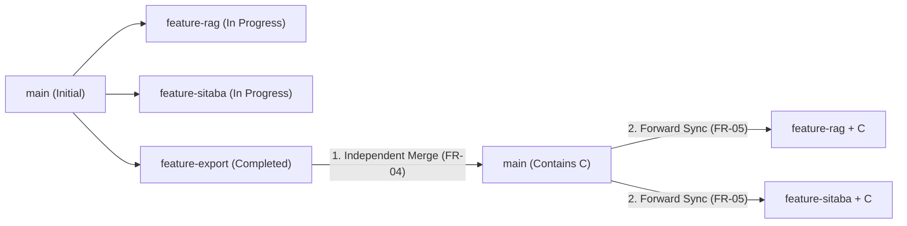

# Git Branching, Worktrees & Parallel Multi-Agent Reference (`/shadow-git` v2.0)

## Primary Technical References (Official Documentation & Standards)
- **[Git Official Documentation — `git-worktree(1)`](https://git-scm.com/docs/git-worktree)**: Manage multiple working trees attached to the same repository.
- **[Git Official Documentation — `git-merge-tree(1)`](https://git-scm.com/docs/git-merge-tree)**: Perform merge without touching index or working tree (`--write-tree`, Git 2.38+).
- **[Git Official Documentation — `git-rebase(1)` & The Perils of Rebasing](https://git-scm.com/book/en/v2/Git-Branching-Rebasing#_rebase_peril)**: Never rebase commits that have been pushed to a shared/public branch.
- **ISO/IEC/IEEE 12207:2017 & NIST SSDF (SP 800-218)**: Configuration management, provenance, and pre-merge verification gates.

---

## 1. Branching Strategy Taxonomy (`FR-01`)

`/shadow-git` never assumes every repository uses Git Flow. Before proposing or executing any merge/sync, run `git_orchestrator.py detect-strategy` to classify the repository:

| Strategy | Indicators | Primary Integration Target | Sync Policy into Feature Branches |
| :--- | :--- | :--- | :--- |
| **Trunk-Based Development** | Single `main`/`trunk` branch, very short-lived branches (`< 1-2 days`) or feature flags | `main` | Fast-forward or merge `main`; rebase allowed only on strictly local unpushed commits |
| **Short-Lived Feature Branches (GitHub Flow)** | `main` + `feature/*` / `fix/*` branches merged via PR | `main` | `git merge --no-ff main` (or local rebase if unshared) |
| **Long-Lived Feature / Research Branches** | Multi-week `feature-*` or `research/*` branches collaborating across agents/devs | `main` (or `develop`) | **Always `git merge main`** (never rebase shared history) |
| **Release & Hotfix Branching** | `main` + `release/v*` + `hotfix/*` | `main` & active `release/*` | Merge hotfixes into `main` and cherry-pick/merge into `release/*` |
| **Git Flow** | Both `main` and `develop` + `feature/*`, `release/*`, `hotfix/*` | `develop` (features) / `main` (releases) | Sync `develop` into `feature/*` via `merge` |

---

## 2. Parallel Multi-Agent Worktree Architecture (`FR-02`, `FR-03`)

When multiple Shadow Army agents (or developers) work in parallel on distinct features, sharing a single working directory causes index lock contention (`.git/index.lock`), branch-switching collisions, and cross-feature contamination.

### Standard Sibling Worktree Layout
```text
Tejas/
├── main/               # Primary integration worktree (branch: main)
├── feature-rag/        # Agent-Alpha worktree (branch: feature-rag, scope: rag/*)
├── feature-sitaba/     # Agent-Beta worktree  (branch: feature-sitaba, scope: sitaba/*)
└── feature-export/     # Agent-Gamma worktree (branch: feature-export, scope: export/*)
```

### Worktree Ownership & Scope Manifest (`.git/shadow-worktrees/agents_registry.json`)
Every worktree created via `git_orchestrator.py worktree-create` records:
- `branch`: Checked-out branch name.
- `worktree_path`: Absolute path on disk.
- `agent_id`: Owning agent/subagent identifier.
- `task_id`: Linked `/shadow-plan` task ID (`TASK-*`).
- `allowed_paths`: Allowed directory/file prefixes so `check-parallel-scope` detects out-of-scope edits or overlapping shared-module modifications early.
- `depends_on_branches`: Upstream branches that must be merged before this branch can integrate into `main`.

---

## 3. Independent Feature Integration & Forward Sync (`FR-04`, `FR-05`)



### Independent Feature Integration Checklist (`FR-04`)
When Branch C (`feature-export`) finishes while A (`feature-rag`) and B (`feature-sitaba`) are still in progress:
1. Verify Branch C's worktree is clean (`0` staged, `0` unstaged, `0` untracked).
2. Verify all `depends_on_branches` for Branch C are already merged into `main`.
3. Run `predict-conflicts --source feature-export --target main` (`0` Git conflicts, review any semantic risks).
4. Run `/shadow-test` (unit/integration tests) and `/shadow-sec` (secret & ASVS checks) inside `Tejas/feature-export`.
5. Request explicit **Monarch** approval, then integrate C into `main` (`integrate-feature --branch feature-export --target main --approve`).

### Forward Integration Decision Matrix: `merge` vs `rebase` (`FR-05`)
After C is merged into `main`, bring `main` into unfinished branches A and B:
- **Use `merge` (Default & Safe)**: Whenever the branch has been pushed to `origin`, is shared with another developer/agent, or is a long-lived feature/research branch. Preserves exact commit SHAs and never requires `--force`.
- **Use `rebase` (Restricted)**: Only when the branch is strictly local (never pushed, `has_upstream == false`), owned by a single agent, and the project explicitly prefers linear history.

---

## 4. Conflict Taxonomy: Hard Git Conflicts vs Semantic Integration Risks (`FR-06`)

A clean `git merge-tree` (`exit code 0`) does **not** guarantee the merged application builds or runs safely. `predict-conflicts` separates:

1. **Hard Git Merge Conflicts (Block Merge Immediately)**:
   - **Content Conflicts**: Overlapping line edits in the same file.
   - **Rename / Modify-Delete Conflicts**: File renamed on one side and deleted/modified on the other.
   - **File Mode Conflicts**: Executable bit (`100644` vs `100755`) changed conflictingly.
2. **Semantic Integration Risks (Require Post-Sync Build/Test Gate)**:
   - **`PARALLEL_SCHEMA_MIGRATIONS` (`HIGH`)**: Both `main` and the feature branch added database migration files (`migrations/`, `prisma/migrations/`, `alembic/`). Risk: duplicate sequence numbers or conflicting table alterations (`/shadow-data`).
   - **`API_CONTRACT_MODIFICATION` (`MEDIUM`)**: Changes to `openapi.yaml`, routes, controllers, GraphQL schemas, or Protobuf definitions (`/shadow-api` & `/shadow-compat`).
   - **`SHARED_CONFIGURATION_CHANGE` (`MEDIUM`)**: Modifications to `.env.example`, `package.json`, `tsconfig.json`, `docker-compose.yml`.
   - **`LOCKFILE_DIVERGENCE` (`MEDIUM`)**: Concurrent updates to `package-lock.json`, `pnpm-lock.yaml`, `cargo.lock`, `poetry.lock`, or `go.sum`.

---

## 5. Recovery & Troubleshooting Playbook

| Scenario | Safe Recovery Procedure |
| :--- | :--- |
| **Interrupted Merge in Worktree (`MERGE_IN_PROGRESS`)** | Inspect with `git status`. To abort cleanly and restore pre-merge state: `git merge --abort`. |
| **Interrupted Rebase (`REBASE_IN_PROGRESS`)** | Never delete `.git/rebase-merge` manually. Run `git rebase --abort` inside the affected worktree. |
| **Branch Checked Out in Stale/Deleted Folder** | Run `git worktree list` to verify path; if the folder was deleted externally, run `git worktree prune --verbose`. |
| **Stash Pop Conflict (`UU` after `git stash pop`)** | Git retains the stash entry in `git stash list` when `pop` conflicts. Resolve the file markers, run `git diff --check`, and do **not** run `git stash drop` until verified. |
| **Accidental Commit to Wrong Feature Worktree** | Create a branch/cherry-pick to the target worktree before resetting; never run `git reset --hard` with uncommitted changes. |
