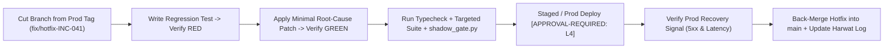

# 02. Surgical Hotfixes, Red-Before-Green Regression Gates & Post-Hotfix Sync

## 1. Purpose & Activation Conditions
Use this playbook when authoring, verifying, and shipping an emergency production hotfix (`SEV1`/`SEV2`) or scoped patch (`SEV3`) after containment. Under production pressure, teams often bundle opportunistic cleanups or skip regression tests—creating a second incident immediately after the first. This playbook enforces **Hotfix Minimalism**, **Red-Before-Green Regression Proof**, and **Post-Hotfix Branch & Contract Reconciliation**.

Activate this playbook when:
- Fixing a confirmed root cause from `/shadow-debug` on an active production release branch.
- Reviewing an emergency hotfix PR to ensure smallest-correct-change discipline and zero unverified side effects.
- Reconciling a hotfix commit back into `main`, API docs, and Staging RTM records after stability returns.

## 2. Prerequisites
- Active service stabilized or contained via [`01-severity-sla-triage-and-containment.md`](01-severity-sla-triage-and-containment.md).
- Confirmed causal root cause (not a guess) isolated via `/shadow-debug` using `requestId` traces and minimal reproduction.
- Clean hotfix branch cut from the exact deployed production tag (`fix/hotfix-<incident-id>`), never from an unverified in-progress feature branch!

## 3. Technical Principles & Constraints
1. **Hotfix Minimalism Law**: A hotfix diff MUST contain ONLY:
   - (a) The automated regression test reproducing the exact production failure mode, and
   - (b) The smallest surgical code/config patch fixing that verified root cause.
   **Zero** unrelated refactors, formatting sweeps, dependency upgrades, or speculative feature tweaks inside a hotfix PR!
2. **Mandatory Red-Before-Green Regression Proof**: Execute the new regression test BEFORE applying the patch to prove it fails on the exact production symptom (`RED`), then apply the minimal patch and prove it passes alongside the targeted suite (`GREEN`). Without red-before-green proof, a passing test may not actually exercise the broken code path.
3. **Zero Relaxed Safety Gates**: Even during `SEV1`, never disable strict TypeScript typing (`0 any`, `0 as Type`), bypass server-side authorization checks, suppress lint/security scans, or leak ephemeral test containers (`shadow_gate.py --check-docker-leaks`).
4. **Authorized Release & Back-Merge Discipline**: Shipping the hotfix to Production remains an explicit `L4` action (`/shadow-release`). Immediately after production recovery, cherry-pick or merge the hotfix back into `main` / development branches so the next regular release cannot reintroduce the exact same bug!
5. **Post-Hotfix Contract & RTM Backfill**: If the hotfix altered an API error code, validation edge case, or business invariant, backfill OpenAPI docs (`/shadow-api`), SRS/RTM (`/shadow-uat`), and Maintenance Logs (`/shadow-doc`) once service is green.

## 4. Architecture & Implementation
### Surgical Hotfix Execution Checklist


### Typed Hotfix Gate Auditor
```typescript
export interface HotfixVerificationRecord {
  readonly incidentId: string;
  readonly baseTag: string;
  readonly branchName: string;
  readonly changedSourceFiles: readonly string[];
  readonly regressionTestAdded: boolean;
  readonly observedRedBeforeFix: boolean;
  readonly observedGreenAfterFix: boolean;
  readonly unrelatedRefactorDetected: boolean;
  readonly backMergePlanned: boolean;
}

export function evaluateHotfixReadiness(
  record: HotfixVerificationRecord,
): { readonly approvedForRelease: boolean; readonly blockers: readonly string[] } {
  const blockers: string[] = [];

  if (!record.branchName.startsWith('fix/hotfix-')) {
    blockers.push('Hotfix must live on a dedicated fix/hotfix-<id> branch cut from the deployed prod tag.');
  }
  if (!record.regressionTestAdded || !record.observedRedBeforeFix || !record.observedGreenAfterFix) {
    blockers.push('Missing Red-Before-Green automated regression test proving exact failure reproduction.');
  }
  if (record.unrelatedRefactorDetected) {
    blockers.push('Unrelated refactoring detected; split cleanups out of the emergency hotfix diff.');
  }
  if (!record.backMergePlanned) {
    blockers.push('Must record back-merge plan into main to prevent regression on next release.');
  }

  return {
    approvedForRelease: blockers.length === 0,
    blockers,
  };
}
```

## 5. Platform / Vendor Variations
- **Monorepo / Full-Stack Services**: Isolate the hotfix strictly to the affected workspace package so CI builds only the impacted deployable artifact and rolls out rapidly.
- **Database Hotfixes**: Prefer application-level defensive fixes or safe online index creation (`CREATE INDEX CONCURRENTLY` with `lock_timeout`) over blocking table rewrites (`/shadow-data`). Never execute manual ad-hoc `UPDATE`/`DELETE` on production tables without a verified dry-run count, backup snapshot, transaction wrapper, and `L4` approval.
- **Mobile Apps (App Store / Google Play)**: Mobile binaries cannot roll back instantly due to store review windows; mitigate server-side first (API compatibility / remote feature flag) while preparing a patch release (`/shadow-mobile`).

## 6. Decision Matrix & Trade-Offs
| Emergency Patch Option | Blast Radius | Verification Bar | When to Choose |
| :--- | :--- | :--- | :--- |
| **Config / Feature-Flag Override** | Very low | Staging smoke + instant rollback | Broken new feature or misconfigured timeout/pool limit |
| **Minimal Code Hotfix (`< 50 LOC` + regression test)** | Low | Red->Green test + typecheck + `shadow_gate.py` | Confirmed code defect in critical path |
| **Multi-File Architectural Refactor** | **High** | Full UAT + integration suite | **NEVER during hotfix** — defer to post-RCA `/shadow-refactor` sprint |

## 7. Real Production Scenario
**Context:** A `SEV2` bug rejected legitimate Indonesian customer names containing apostrophes (e.g., `Ma'ruf`) during invoice submission due to an overly strict regex.
**Anti-Pattern Avoided:** A developer started upgrading the validation library and rewriting 14 form validators inside the hotfix branch, risking unrelated regressions across checkout.
**Surgical Resolution:** Stripping the PR down to (1) a regression test asserting `"Ma'ruf"` passes while SQL/HTML injection payloads still fail (`RED -> GREEN`), and (2) a 3-line regex allowlist fix let the patch deploy safely in 18 minutes, back-merge cleanly into `main`, and close with zero side effects.

## 8. Failure Modes & Edge Cases
- **WRONG (Cutting a hotfix from `main` carrying half-finished Sprint 5 features):** Deploying an emergency fix that accidentally ships unreviewed, untested upcoming features into Production.
  **RIGHT:** Always branch `fix/hotfix-<id>` directly from the exact currently deployed production tag/SHA, then cherry-pick/back-merge to `main` afterward.
- **WRONG (Shipping a "quick 1-line hotfix" with no regression test and no back-merge):** The emergency patch fixes production today, then gets silently overwritten 4 days later when the next regular release deploys from `main`—causing a repeat `SEV1`.
  **RIGHT:** Require a red-before-green regression test AND back-merge to `main` as part of closing the hotfix ticket.

## 9. Testing & Verification
- Verify every hotfix executes: (1) new regression test failing before patch (`RED`), (2) passing after patch (`GREEN`), (3) affected module suite green, (4) `shadow_gate.py --repo . --check-docker-leaks` passing with `0` violations.
- Record commit SHA, test command output, and before/after recovery screenshots/metrics for the monthly **Laporan Harwat** (`/shadow-doc`).

## 10. Operational Considerations
- Track hotfix frequency as a leading engineering-health indicator: more than `2` emergency hotfixes per month indicates systemic upstream gaps in `/shadow-test`, `/shadow-uat`, or `/shadow-release` pre-flight gates that belong in the CAPA backlog.

## 11. Authoritative References
- **ISO/IEC/IEEE 14764:2022** — *Emergency Maintenance & Regression Testing Requirements*.
- **Shadow Monarch Rules** — Smallest Correct Change, Root Cause Before Fix, and `shadow-test` / `shadow-release` integration.

## 12. Limitations & When NOT to Use
- **Do NOT use** hotfix workflows to slip unapproved features or broad structural refactors into production — route planned cleanup to `/shadow-refactor` and new features through `/shadow-discovery` -> `/shadow-plan`.
