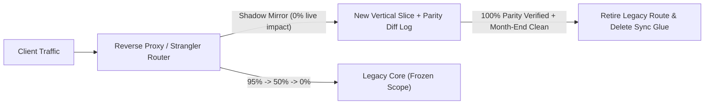

# 03. Strangler Fig vs Rewrite Coexistence TCO & Cutover Parity Playbook

## 1. Purpose & Activation Conditions
Use this playbook when building a **Modernization Business Case** comparing `STRANGLER_FIG_REFACTOR`, `PHASED_MODULARIZATION`, `ENCAPSULATE_RETAIN`, and `FULL_REWRITE` over a `3–5` year horizon, AND when designing safe **Shadow-Run Parity Cutover & Rollback Plans** with mandatory legacy slice retirement dates.

Activate this playbook when:
- Modeling realistic modernization TCO including **dual-run coexistence**, **data reconciliation**, and **risk-adjusted delay penalties** (`modernize_forensics_engine.py --evaluate-options`).
- Advising executives who assume a big-bang rewrite is "cheaper and cleaner" than incremental Strangler Fig modernization.
- Planning progressive traffic cutover (`Dark Launch -> Shadow Compare -> Canary -> 100% -> Legacy Decommission`).

## 2. Prerequisites
- Multi-dimensional risk vector and archaeological rule ledger from [`01-readonly-forensics-and-multidimensional-risk-vectors.md`](01-readonly-forensics-and-multidimensional-risk-vectors.md) and [`02-business-rule-archaeology-and-characterization-seams.md`](02-business-rule-archaeology-and-characterization-seams.md).
- Baseline annual legacy operations cost (`annual_legacy_ops_cost`), transition build estimates, and `horizon_years` (`3–5` years) logged with explicit `[ASSUMPTION]` vs `[EVIDENCE]` tags.

## 3. Technical Principles & Constraints
1. **Honest Coexistence Economics (Never Compare Build Cost Alone)**:
   - Multi-year modernizations run BOTH legacy and new stacks simultaneously while slices migrate. Omitting dual-run ops, CDC/sync glue, and risk-adjusted delay penalties artificially flatters Big-Bang Rewrites.
   - Canonical risk-adjusted TCO model in `modernize_forensics_engine.py`:
     $$\text{TCO}_{\text{Strangler}} = B_{\text{strangler}} + R_{\text{penalty}}(0.15 \cdot B_{\text{strangler}}) + C_{\text{dual}}(0.35 \cdot O_{\text{legacy}} \cdot Y)$$
     $$\text{TCO}_{\text{Rewrite}} = B_{\text{rewrite}} + R_{\text{penalty}}(0.45 \cdot B_{\text{rewrite}} \text{ when rule\_complexity=HIGH}) + C_{\text{dual}}(0.65 \cdot O_{\text{legacy}} \cdot Y)$$
   - Notice why Big-Bang Rewrites blow up: while the rewrite drags on for 12–24 months delivering zero retired legacy routes, `100%` of legacy maintenance continues alongside feature-parity chase ("moving target syndrome").
2. **Guardrail Against Big-Bang Rewrite on High-Complexity Untested Cores**:
   - Never recommend `FULL_REWRITE` when `business_rule_complexity == "HIGH"` AND `has_automated_tests == false` AND `production_stability_high == true`. Default to `STRANGLER_FIG_REFACTOR` backed by characterization tests.
3. **4-Stage Cutover Parity Gate (Zero Blind Flip)**:
   - Every strangled vertical slice MUST traverse:
     1. **Dark Launch / Shadow Compare**: Mirror live read/calculation requests asynchronously to the new slice and log exact output diffs (cents/Rupiah, status codes, permissions) with zero customer impact.
     2. **Canary Cohort (`5% -> 25% -> 50%`)**: Route bounded traffic via reverse proxy / API gateway with instant revert switch (`/shadow-release`).
     3. **Full Cutover (`100%`)**: Verify error rates, latency, and ledger reconciliation over a full business cycle (e.g., month-end).
     4. **Mandatory Slice Retirement (Decommission Date)**: Delete the replaced legacy route, dead tables/views, and sync bridge on a scheduled date — otherwise Strangler Fig degenerates into permanent dual-system bloat!
4. **Reversible Data Sync Boundaries**:
   - Prefer single-writer ownership per strangled entity (use Expand-Contract + CDC/Outbox via `/shadow-data` & `/shadow-concurrency`) over bidirectional active-active database writes, which create split-brain conflicts.

## 4. Architecture & Implementation
### Modernization TCO Input Profile (`modernize_forensics_engine.py --evaluate-options`)
```json
{
  "horizon_years": 3,
  "business_rule_complexity": "HIGH",
  "production_stability_high": true,
  "has_automated_tests": false,
  "annual_legacy_ops_cost": 1000000000,
  "strangler_build_cost": 1800000000,
  "rewrite_build_cost": 3000000000,
  "risk_dimensions": {
    "code_dependencies": { "score": 4.2, "confidence": "HIGH", "evidence_refs": ["package-lock.json", "php-7.4-eol"] },
    "data_integrity": { "score": 3.8, "confidence": "MEDIUM", "evidence_refs": ["sql/triggers.sql"] },
    "operations_slo": { "score": 2.5, "confidence": "LOW", "evidence_refs": [] }
  }
}
```

### Progressive Strangler Cutover & Retirement Flow


### Strict TypeScript Cutover Readiness & Retirement Gate
```typescript
export interface SliceCutoverMetrics {
  readonly sliceId: string;
  readonly shadowSamplesCompared: number;
  readonly parityMismatchCount: number;
  readonly rollbackSwitchTested: boolean;
  readonly retirementTargetDateIso: string | null;
}

export function evaluateSliceCutoverGate(
  metrics: SliceCutoverMetrics,
): { readonly readyForTrafficCutover: boolean; readonly blockers: readonly string[] } {
  const blockers: string[] = [];
  if (metrics.shadowSamplesCompared < 500) {
    blockers.push('Insufficient shadow-compare sample volume (< 500 compared requests).');
  }
  if (metrics.parityMismatchCount > 0) {
    blockers.push(`${metrics.parityMismatchCount} unresolved parity mismatch(es) against legacy output.`);
  }
  if (!metrics.rollbackSwitchTested) {
    blockers.push('Reverse-proxy / feature-flag instant rollback switch not yet verified.');
  }
  if (metrics.retirementTargetDateIso === null || metrics.retirementTargetDateIso.trim() === '') {
    blockers.push('Missing mandatory legacy slice retirement date (prevents permanent dual-run bloat).');
  }
  return {
    readyForTrafficCutover: blockers.length === 0,
    blockers,
  };
}
```

## 5. Platform / Vendor Variations
- **Public Sector / BUMN Fixed-Budget Multi-Year Modernization**: Align Strangler Slice 1..N deliverables directly to annual fiscal budget milestones (`Tahun Anggaran 1, 2, 3`) and connect commercial costing cleanly to `/shadow-presales` and schedule forecasting to `/shadow-pmo`.
- **High-Throughput SaaS**: Run read-only shadow mirroring first, then migrate write ownership one aggregate at a time using transactional outbox + CDC projection back to legacy read models until the final consumer migrates.

## 6. Decision Matrix & Trade-Offs
| Modernization Strategy | 3–5 Yr Risk Profile | Coexistence Overhead | When to Select |
| :--- | :--- | :--- | :--- |
| **`STRANGLER_FIG_REFACTOR`** | Lowest failure rate; continuous value delivery | Moderate (temporary gateway + CDC) | High-value, complex, untested legacy systems (**Default**) |
| **`PHASED_MODULARIZATION`** | Low–Medium; stays inside existing runtime | Low (shared DB/process initially) | Runtime still supported; main pain is internal spaghetti coupling |
| **`ENCAPSULATE_RETAIN`** | Lowest upfront cost | Minimal (API facade only) | Stable commodity core with infrequent rule changes |
| **`FULL_REWRITE`** | **Highest failure & overrun risk** | High (long dual-run while chasing legacy changes) | ONLY when runtime is dead/unpatchable AND rule surface is small & fully specified |

## 7. Real Production Scenario
**Context:** A regional bank evaluated a 24-month Big-Bang Rewrite of its loan-origination core (`rewrite_build_cost = Rp 6B`) versus a 3-slice Strangler Fig plan (`strangler_build_cost = Rp 3.8B`, `annual_legacy_ops_cost = Rp 1.5B`).
**Decision Impact:** Modeling coexistence TCO (`modernize_forensics_engine.py`) showed the Big-Bang Rewrite's risk-adjusted 3-year cost reached **`Rp 11.6B`** with zero production value for 24 months, whereas Strangler Fig reached **`Rp 5.95B`** while retiring Slice 1 (Retail Applications) at Month 5 with `0` parity mismatches across 12,000 shadow-compared applications.

## 8. Failure Modes & Edge Cases
- **WRONG (Starting Strangler Fig without retirement dates -> "Two Permanent Legacy Systems"):** Moving 60% of screens to a new stack and abandoning the remaining 40%, doubling forever the team's operational and cloud burden.
  **RIGHT:** Bind every strangled slice to an explicit decommission ticket and scheduled retirement date immediately after a clean full business cycle.
- **WRONG (Bidirectional active-active writes between legacy DB and new DB):** Triggers silent race overwrites and impossible-to-debug reconciliation loops.
  **RIGHT:** Enforce single source-of-write per entity during cutover with unidirectional CDC/outbox sync.

## 9. Testing & Verification
- Run `python shadow-modernize/scripts/modernize_forensics_engine.py --evaluate-options <system_profile.json>` and `--self-test` (`8/8` probes).
- Verify shadow-compare parity logs report `parityMismatchCount == 0` and instant proxy rollback is rehearsed in Staging before requesting `L4` production cutover approval.

## 10. Operational Considerations
- Track **% Legacy Routes Retired** and **Dual-Run Coexistence Burn Rate** (`/shadow-finops`) monthly so leadership funds decommission sprints instead of leaving old servers running indefinitely.

## 11. Authoritative References
- **Martin Fowler** — *Strangler Fig Application* & *Branch by Abstraction*.
- **Sam Newman (2019)** — *Monolith to Microservices* (Ch. 3–4 Splitting & Decommissioning).
- **Shadow Modernize Engine** — [`../scripts/modernize_forensics_engine.py`](../scripts/modernize_forensics_engine.py).

## 12. Limitations & When NOT to Use
- **Do NOT use** `/shadow-modernize` to execute live production traffic cutovers without explicit `L4` release governance (`/shadow-release`).
- **Do NOT use** for tender commercial BoQ/Perpres 46/2025 pricing — route commercial tender bids to `/shadow-presales`.
