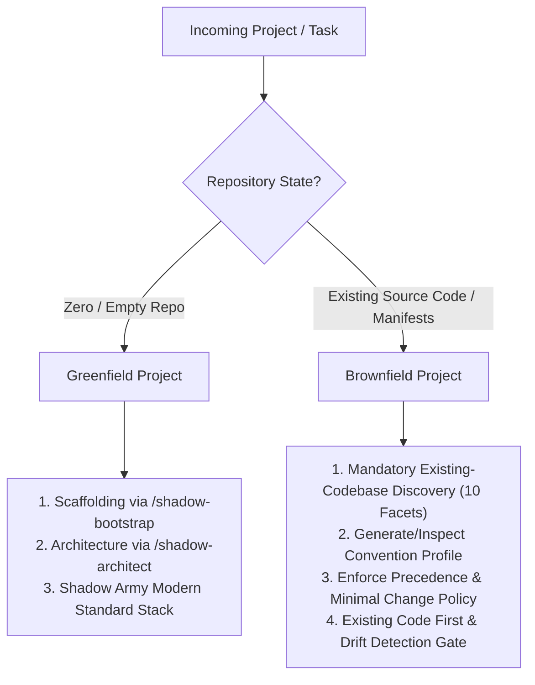

# Codebase Intelligence & Convention Preservation Policy (Shadow Army)

## Core Directive: Existing Codebase Adaptation
When maintaining, extending, or debugging existing software (**Brownfield Projects**), the Shadow Army must **adapt to and preserve the established project conventions, architecture, module structure, and coding style**. 

Agents must never impose their own architectural preferences, coding style, or unsolicited modernization onto an established codebase.

---

## 1. Brownfield vs Greenfield Project Routing

Before planning, designing, or implementing code, classify the project context:



- **Greenfield Projects**: Scaffolding from zero. Use Shadow Army's approved architecture, modern standard tooling, and strict conventions via `/shadow-bootstrap` and `/shadow-architect`.
- **Brownfield Projects**: Modifying or extending an existing application. **Mandatory Codebase Intelligence** activates before touching code. Preserve established conventions; do not migrate the stack or rewrite existing patterns.

---

## 2. Mandatory 10-Facet Existing-Codebase Discovery

Use targeted, token-efficient repository inspection (inspect manifests, configs, and representative files in affected modules rather than scanning every file):

1. **Runtime, Language & Framework**: Inspect `package.json`, `composer.json`, `pyproject.toml`, `go.mod`, `Cargo.toml`. Identify exact version, runtime environment, and module system (e.g. CommonJS `require` vs ES Modules `import`).
2. **Project Structure & Module Boundaries**: Check directory layout (Layered MVC vs Hexagonal/Clean vs Feature-based vs Monorepo workspaces in `packages/` or `apps/`).
3. **Architectural Patterns**: Identify pattern in use (ActiveRecord / Eloquent vs Repository-Service vs CQRS vs Minimalist route-handlers). Never introduce a new layer (e.g. Clean Architecture domain entities) into a simple MVC app.
4. **Naming Conventions**: Identify prevailing casing for files, directories, classes, functions, and variables (`kebab-case`, `snake_case`, `camelCase`, `PascalCase`).
5. **Formatting & Linting Rules**: Inspect `.eslintrc*`, `.prettierrc*`, `biome.json`, `.editorconfig`, `phpcs.xml`, `ruff.toml`.
6. **API & Database Access Patterns**: Identify ORM/query builder in use (Prisma, Eloquent, Knex, Mongoose, SQLAlchemy, raw SQL). Never introduce a competing ORM or direct database queries where repositories/models are established.
7. **Error Handling & Validation**: Identify error handling pattern (try/catch + error middleware vs Result types) and validation library (Zod, Joi, FormRequest, Pydantic, class-validator).
8. **Authentication & Authorization**: Identify auth middleware, guards, token/session management, and tenant isolation patterns.
9. **State Management & Caching**: For frontend/client, detect existing store (Zustand, Redux Toolkit, Pinia, Context); for backend, detect caching mechanisms (Redis, in-memory).
10. **Testing & Dependency Conventions**: Identify test runner (Jest, Vitest, PHPUnit, Pest, Pytest) and test structure/fixtures.

---

## 3. Convention Precedence Hierarchy

When writing or reviewing code, adhere strictly to this precedence hierarchy:

```text
Level 1: Explicit User Requirements & Safety Constraints
   ▲
Level 2: Project-Level Instructions (`AGENTS.md`, `CLAUDE.md`, documented architecture)
   ▲
Level 3: Established Patterns in Relevant Existing Modules
   ▲
Level 4: Shadow Army Global Conventions
   ▲
Level 5: AI Default Preferences (Lowest Priority — Never override established project conventions)
```

> [!IMPORTANT]
> **Safety Over Insecure Legacy Patterns**: If an existing pattern violates critical security rules (e.g. raw SQL string concatenation, unescaped HTML, hardcoded credentials), **Level 1 (Safety)** takes precedence. Do NOT silently reproduce vulnerabilities; surface the issue and use safe parameterized queries while preserving the rest of the module's conventions.

---

## 4. Existing Code First Principle

Before introducing new code:
1. **Find Closest Existing Implementation**: Search for an existing feature, endpoint, or component similar to the requested task.
2. **Inspect Reusable Assets**: Check for existing helper utilities, service methods, middleware, UI hooks, and base repositories.
3. **Follow Equivalent Module Structure**: If existing endpoints use `user.controller.js` + `user.service.js`, structure the new feature as `order.controller.js` + `order.service.js`.
4. **Avoid Parallel Duplicate Implementations**: Never write a custom date parser if `date-fns` or `Carbon` is already installed; never create a duplicate HTTP client if an Axios instance with auth interceptors already exists.

---

## 5. Minimal Change Policy for Brownfield Tasks

When working on existing codebases, strictly enforce:
- **No Unrelated Refactoring**: Do not clean up, "modernize", or restructure code outside the requested feature or bug fix.
- **No Unsolicited Migration**: Do not convert JavaScript to TypeScript, CommonJS to ESM, Redux to Zustand, or Promises to async/await in unrelated files.
- **No Unrequested Dependencies**: Do not run `npm install` / `composer require` for helper libraries if the existing dependencies or standard library can perform the task.
- **No Formatting Unrelated Files**: Only touch lines relevant to the task. Avoid whole-file reformatting that pollutes `git diff`.
- **No Renaming Unrelated Variables/Functions**: Preserve existing naming even if unconventional, unless explicitly tasked with a rename.
- **Reviewable Diffs**: Produce localized, surgical changes that teammate reviewers can inspect effortlessly.

---

## 6. Architecture & Convention Drift Detection Gate (`/shadow-quality`)

Before marking work complete, verify via `python ".../shadow-quality/scripts/codebase_intelligence.py" audit-drift` that the changes have not introduced drift:

| Drift Violation Code | Description | Corrective Action |
| :--- | :--- | :--- |
| `UNEXPECTED_ARCHITECTURAL_LAYER` | Added new folder/layer (e.g. `domain/`, `usecases/`) not used in project. | Place logic inside established layer (e.g. `services/`). |
| `MODULE_SYSTEM_DRIFT` | Used ES `import` in CommonJS project, or vice versa. | Convert to established project module syntax (`require`). |
| `TYPESCRIPT_IN_JS_PROJECT` | Added type annotations in a plain JS repository. | Remove TypeScript syntax; write vanilla JavaScript. |
| `DIRECT_DB_ACCESS_IN_CONTROLLER`| Bypassed repository/service layer with raw queries in controller. | Delegate persistence to established repository. |
| `INCONSISTENT_NAMING` | Created `kebab-case` file in `camelCase` module. | Rename file to match existing module convention. |
| `SECURITY_EXCEPTION_SQL_INJECTION` | Reproduced legacy unsafe string concatenation in SQL. | Convert to parameterized query or ORM binding. |

---

## 7. Multi-Agent Consistency Across Worktrees (`/shadow-git`)

When multiple agents work concurrently in isolated worktrees:
1. **Shared Project Profile**: All agents inspect `docs/engineering/CODEBASE_CONVENTIONS.md` (or discover conventions using the same root baseline) so worktrees do not invent contradictory standards.
2. **Package-Scoped Rules in Monorepos**: In monorepos, agents adhere to package-local conventions (e.g. `@mono/api` uses CommonJS, while `@mono/web` uses TypeScript/ESM).
3. **Drift Detection Before Integration**: Before `/shadow-git` executes `integrate-feature` into `main`, `/shadow-quality` verifies that the feature branch adheres to the convention profile.
