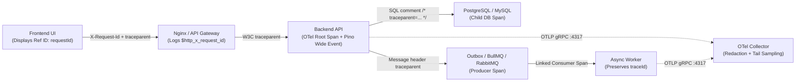

# 02 — OpenTelemetry Distributed Tracing & Semantic Conventions

## 1. Purpose & Activation Conditions
Instrument HTTP services, message queues, background workers, and database clients with vendor-neutral **OpenTelemetry (OTel)** distributed tracing using **W3C Trace Context (`traceparent`/`tracestate`)** and OTel Semantic Conventions so a single slow or failing user action maps end-to-end across every network hop. Activate when adding tracing to an application, fixing broken cross-service spans, or standardizing telemetry attributes.

## 2. Prerequisites
- Active service runtime (Node.js/TypeScript, Python, Go, or PHP/Laravel) and an OTLP-compatible collector/receiver (OTel Collector -> Tempo/Jaeger/SigNoz/Honeycomb).
- Established boundary between high-cardinality trace/span attributes (permitted, scrubbed) and low-cardinality Prometheus metric labels (strictly bounded).

## 3. Technical Principles & Constraints
- **W3C Trace Context Standard:** Propagate `traceparent` (`00-<32-hex-trace-id>-<16-hex-span-id>-<2-hex-flags>`) and `tracestate` across every synchronous HTTP call and asynchronous queue message header (`shadow-concurrency`).
- **Auto-Instrumentation + Targeted Business Spans:** Let official OTel SDK auto-instrumentation handle HTTP, DB drivers, and Redis spans; add manual spans ONLY around meaningful domain units (payment authorization, PDF rendering, RAG retrieval stage, external webhook call) — never wrap every tiny helper function in a span.
- **OTel Semantic Conventions (Stable):** Use standard attribute names (`http.request.method`, `http.route`, `http.response.status_code`, `db.system`, `db.operation.name`, `messaging.system`, `messaging.destination.name`, `enduser.id`) rather than ad-hoc conflicting keys.
- **Trace-to-Metric Exemplars & Trace-to-Log Correlation:** Inject `trace_id` and `span_id` into every structured JSON log line and attach trace exemplars to Prometheus latency histograms so clicking a p99 spike jumps straight into an actual slow trace.
- **Zero Secrets in Span Attributes:** Never put full SQL bind parameters with PII, raw `Authorization` headers, cookies, or credit card numbers onto spans.

## 4. Architecture & Implementation



```ts
// Strict TypeScript Manual Business Span Helper (OTel API pattern — 0 any, 0 casts)
export interface OTelSpan {
  setAttribute(key: string, value: string | number | boolean): void
  setStatus(status: { readonly code: 1 | 2; readonly message?: string }): void
  recordException(err: Error): void
  end(): void
}

export interface OTelTracer {
  startActiveSpan<T>(name: string, fn: (span: OTelSpan) => Promise<T>): Promise<T>
}

export interface SpanBusinessAttrs {
  readonly tenantId: string
  readonly operation: string
  readonly idempotencyKey?: string
}

export async function withDomainSpan<T>(
  tracer: OTelTracer,
  spanName: string,
  attrs: SpanBusinessAttrs,
  work: () => Promise<T>,
): Promise<T> {
  return tracer.startActiveSpan(spanName, async (span) => {
    span.setAttribute('app.tenant.id', attrs.tenantId)
    span.setAttribute('app.domain.operation', attrs.operation)
    if (attrs.idempotencyKey) {
      span.setAttribute('app.idempotency.key', attrs.idempotencyKey)
    }
    try {
      const result = await work()
      span.setStatus({ code: 1 }) // SpanStatusCode.OK
      return result
    } catch (err: unknown) {
      const errorObj = err instanceof Error ? err : new Error(String(err))
      span.recordException(errorObj)
      span.setStatus({ code: 2, message: errorObj.message }) // SpanStatusCode.ERROR
      throw err
    } finally {
      span.end()
    }
  })
}
```

### Queue / Async Context Propagation (Producer -> Consumer)
When enqueuing a Transactional Outbox row or BullMQ/Kafka job, serialize the current W3C `traceparent` + `requestId` into the job metadata column/header. On the worker side, extract `traceparent` and either create a **Child Span** (for 1:1 request-driven async jobs) or **Span Links** (for batch consumers processing 50 unrelated outbox messages in one worker tick so traces do not explode into unreadable 5,000-span mega-trees).

### SQL Commenter Correlation
Append non-PII trace correlation comments to database queries (`/* traceparent='00-4bf9...-01',req_id='req_01J9' */`) via OTel DB instrumentation (`enhancedDatabaseReporting: false` so raw bind parameters are NOT exposed) so PostgreSQL `pg_stat_activity` and slow query logs link directly to the originating API span.

## 5. Platform/Vendor Variations
- **Node.js / TypeScript:** Initialize `@opentelemetry/sdk-node` in a dedicated `--import ./instrumentation.mjs` preload BEFORE importing Express/Fastify/Next/pg/ioredis so ESM/CJS monkey-patching hooks register cleanly.
- **Python (FastAPI / Django / Celery):** Use `opentelemetry-instrumentation-fastapi`, `psycopg2`/`asyncpg`, and `celery`; always bind `trace_id` into `structlog.contextvars`.
- **Go:** Explicitly thread `ctx context.Context` through every HTTP handler, DB call (`QueryContext`), and outbound `http.NewRequestWithContext`; Go has no thread-local context magic.
- **Browser RUM -> Backend:** Only propagate `traceparent` to trusted first-party API origins (`propagateTraceHeaderCorsUrls`) and add `traceparent` to CORS `Access-Control-Allow-Headers` so browser preflight does not break.

## 6. Decision Matrix & Trade-Offs

| Instrumentation Layer | Approach | Span Volume | Best Use Case | Trade-Off |
| :--- | :--- | :--- | :--- | :--- |
| **Auto-Instrumentation** | Official OTel HTTP/DB/Redis hooks | Medium | 80% baseline topology & latency breakdown | Captures I/O automatically; may include noisy `/health` spans if unfiltered |
| **Targeted Manual Spans** | `withDomainSpan()` on critical domain steps | Low | Checkout payment step, RAG reranker, webhook dispatch | High diagnostic signal; requires small wrapper discipline |
| **Async Child Span vs Span Link** | Child span (1:1) vs Span Link (batch N:1) | Low–Medium | Outbox & queue workers | Span Links prevent unreadable mega-traces on batch consumers |
| **Full DB Bind Parameter Capture** | Avoid in prod (`false` default) | High risk | Local dev only | Leaks customer PII/NIK/passwords into tracing backend |

## 7. Real Production Scenario
A checkout endpoint jumped from 220ms to 2.1s p95 after a library upgrade. Application logs only showed `checkout completed 2100ms`. Enabling OTel spans with W3C `traceparent` propagation into PostgreSQL and the outbound shipping-rate HTTP client immediately showed 14 sequential `SELECT` spans (N+1 regression inside a newly added mapper) consuming 1,750ms while the payment gateway took only 95ms.

## 8. Failure Modes & Edge Cases
- **WRONG:** Importing `@opentelemetry/sdk-node` inside `app.ts` *after* `import express from 'express'` and `import pg from 'pg'` (instrumentation silently misses HTTP and DB spans).
  **RIGHT:** Load OTel instrumentation first via `--import` / entrypoint bootstrap before application modules are imported.
- **WRONG:** Exporting traces directly from every pod to a SaaS vendor with synchronous `SimpleSpanProcessor` on the hot request path (blocks responses when vendor endpoint stalls).
  **RIGHT:** Use `BatchSpanProcessor` exporting asynchronously over local OTLP gRPC to a sidecar/gateway **OTel Collector** with bounded memory queues (`memory_limiter`).
- **WRONG:** Setting `http.route` to `/api/v1/invoices/inv_982144` instead of `/api/v1/invoices/:id`.
  **RIGHT:** Normalize `http.route` to the framework's parameterized route template so span metrics and service graphs stay bounded.

## 9. Testing & Verification
- Use `InMemorySpanExporter` in integration tests to assert: (1) incoming `traceparent` is preserved, (2) error paths call `recordException` and set status `ERROR`, (3) `/health` spans are dropped, and (4) zero `Authorization`/PII values appear in span attributes.
- Verify collector pipelines with `otelcol validate --config=otel-collector.yaml`.

## 10. Operational Considerations
- Set `OTEL_SERVICE_NAME`, `OTEL_RESOURCE_ATTRIBUTES="deployment.environment=production,service.version=<git_sha>"` uniformly on every container so traces slice cleanly by release SHA.
- Always configure the `memory_limiter` processor first in the OTel Collector pipeline to prevent OOM during incident traffic spikes.

## 11. Authoritative References
- W3C Recommendation — *Trace Context* (`traceparent` & `tracestate` headers).
- OpenTelemetry Specification — *Semantic Conventions for HTTP, Database & Messaging* (opentelemetry.io/docs/specs/semconv/).
- OpenTelemetry Collector Documentation — *Processors (`memory_limiter`, `attributes`, `tail_sampling`)*.

## 12. Limitations & When NOT to Use
- Do NOT use distributed traces as a replacement for immutable financial/security audit logs (traces are sampled and ephemeral; audit trails belong in append-only relational storage under `/shadow-auth` and `/shadow-privacy`).
- Do NOT trace tight in-memory loops (e.g., 10,000 JSON parsing iterations); use continuous CPU profiling (`05-profiling-dashboards-as-code-and-synthetics.md`) instead.
