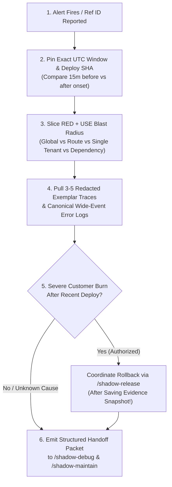

# 06 — Incident Telemetry Timelines, Triage Runbooks & Clean Handoff to Debugging

## 1. Purpose & Activation Conditions
Convert raw metrics, alerts, traces, and logs into a crisp, evidence-backed **Incident Telemetry Timeline** within the first 5–10 minutes of an outage, and execute clean ownership handoffs to `/shadow-debug` (root-cause falsification), `/shadow-maintain` (hotfix/postmortem/SLA), and `/shadow-release` (rollback). Activate when triaging a firing SLO burn-rate alert, customer-reported `Ref ID` failure, or unexplained latency/error spike.

## 2. Prerequisites
- Correlated telemetry (`X-Request-Id`, `traceId`, canonical wide events, deployment SHA markers) from Modules 01–05.
- Read-only (`L0`) access to Prometheus/Grafana, Loki/logs, and Tempo/tracing dashboards (any mutation, restart, or rollback requires explicit operational authorization per policy).

## 3. Technical Principles & Constraints
- **Observe First, Mutate Second (`L0` Triage Discipline):** Never restart pods, clear caches, or push speculative edits before capturing the evidence window (affected `route_template`, exemplar `traceId`, wide-event error cluster, DB/pool metrics) — restarting wipes volatile in-memory clues!
- **4-Dimension Blast-Radius Triangulation:** Immediately classify an anomaly along 4 axes:
  1. **When:** Exact UTC onset timestamp vs latest deployment SHA, cron schedule, or traffic shift.
  2. **Where:** Global across all routes/replicas, single `route_template`, single AZ/node, or single tenant/cohort.
  3. **What:** `5xx` error class, latency tail (`p95`/`p99` only vs `p50`), or saturation (DB pool wait, queue lag, OOMKill).
  4. **How Severe:** Current burn rate and affected user journey SLI.
- **Strict Ownership Boundary:** `shadow-observe` locates **where** and **when** the anomaly happens and compiles redacted evidence; **`shadow-debug`** forms and falsifies causal code/state hypotheses; **`shadow-maintain`** coordinates incident mitigation, hotfix regression tests, and blameless RCA postmortems.

## 4. Architecture & Implementation

### 5-Minute Structured Incident Triage Workflow


### Structured Incident Telemetry Handoff Packet (To `/shadow-debug` & `/shadow-maintain`)
```json
{
  "incident_window_utc": {
    "onset": "2026-11-22T02:11:00Z",
    "captured_at": "2026-11-22T02:18:30Z",
    "recent_deploy_sha": "9f2a1c4 (deployed 2026-11-22T02:04:00Z)"
  },
  "slo_impact": {
    "service": "checkout-api",
    "alert": "CheckoutErrorBudgetFastBurn",
    "burn_rate_1h": 18.2,
    "affected_route_templates": ["/api/v1/checkout/confirm"]
  },
  "blast_radius": {
    "scope": "single_route_all_replicas",
    "healthy_control_route": "/api/v1/orders/:id (p95=45ms, 0% 5xx)",
    "degraded_route": "/api/v1/checkout/confirm (p95=3820ms, 4.1% 504)"
  },
  "use_saturation_signals": {
    "db_pool_waiting": 48,
    "db_cpu_pct": 18,
    "redis_latency_ms": 2.1,
    "node_event_loop_lag_ms": 4.0
  },
  "exemplars_redacted": [
    {
      "requestId": "req_01J9X882A",
      "traceId": "4bf92f3577b34da6a3ce929d0e0e4736",
      "failing_span": "pg.query SELECT ... FOR UPDATE",
      "span_duration_ms": 3740,
      "error_code": "DB_POOL_ACQUIRE_TIMEOUT"
    }
  ],
  "next_owner": "shadow-debug",
  "hypotheses_to_falsify": [
    "Lock contention / unindexed FOR UPDATE introduced in SHA 9f2a1c4 holding pool connections while DB CPU remains low (18%)."
  ]
}
```

### Runbook Anatomy Standard (Linked From Every Paging Alert)
Every `runbook_url` referenced by a paging alert MUST contain 5 concise sections (under 1 page):
1. **Alert Meaning & User Impact:** Plain-language customer symptom + SLO affected.
2. **Immediate Read-Only Verification (`L0`):** Exact PromQL, LogQL, and trace filter queries pre-parameterized for the service.
3. **Common Failure Signatures:** Top 3–4 known patterns (e.g., recent deploy regression, downstream gateway timeout, DB lock/pool exhaustion, expired cert).
4. **Safe Mitigation Steps (Requires Authorization):** Rollback command, feature-flag kill switch, or traffic shed toggle — with explicit blast-radius warning.
5. **Escalation & Handoff:** Who owns the subsystem and how to export the redacted timeline packet.

## 5. Platform/Vendor Variations
- **Grafana Explore (Prometheus + Loki + Tempo Unified Stack):** Configure Derived Fields in Loki (`traceId` regex -> Tempo link) and Trace-to-Logs in Tempo so clicking a single `Ref ID` navigates across all three pillars with zero manual timestamp copying.
- **AWS CloudWatch / X-Ray / Managed OpenSearch:** Use CloudWatch Logs Insights pinned to `requestId` + X-Ray Service Map filtered by `response_time > 1` or `fault = true`.
- **Single-Host Docker Compose Apps (Small/Mid Indonesian Enterprise):** Even without Tempo/Grafana Cloud, combining Nginx JSON logs (`$http_x_request_id`), backend `pino` JSON stdout, and `pg_stat_activity` SQL comments lets an engineer reconstruct a full timeline in `< 3` minutes using `jq`.

## 6. Decision Matrix & Trade-Offs

| Incident Signal Combination | Strongest Layer Clue | Immediate Next Skill Handoff |
| :--- | :--- | :--- |
| **Onset `<= 10m` after deploy SHA + new error class on 1 route** | Code/migration regression | `/shadow-release` (rollback if burning fast) + `/shadow-debug` |
| **High DB pool wait + low DB CPU (`< 30%`)** | Lock contention, long TX, or leaked connection | `/shadow-debug` + `/shadow-db` (read-only lock inspection) |
| **Only 1 external span (`payment_gateway`) spiking 504** | Upstream 3rd-party outage / timeout cascade | `/shadow-integrate` (circuit breaker/fallback) + `/shadow-resilience` |
| **Event-loop lag + monotonic heap growth over hours** | Memory leak or CPU-blocking sync work | `/shadow-debug` + `/shadow-perf` (CPU/heap profile diff) |
| **Edge synthetic fails while backend metrics show `0` RPS** | DNS, TLS cert, CDN/WAF, or Nginx crash | `/shadow-ops` (infra/TLS/proxy recovery) |

## 7. Real Production Scenario
At 02:11 WIB, `CheckoutErrorBudgetFastBurn` paged on-call. Instead of blindly restarting containers, the SRE captured the 7-minute UTC window: `/api/v1/checkout/confirm` spiked to `3.8s` p95 with `48` waiting DB pool connections while PostgreSQL CPU sat at `18%`, starting `7` minutes after deploy `9f2a1c4`. The exemplar trace pointed directly to a lock wait on `inventory_locks`. Rolling back `9f2a1c4` stopped customer burn in 90 seconds, and the captured timeline packet enabled `/shadow-debug` to fix the transaction lock ordering the next morning with zero guesswork.

## 8. Failure Modes & Edge Cases
- **WRONG:** Immediately running `kubectl rollout restart` or `docker compose restart` on a noisy alert before exporting exemplar traces, error logs, and pool/lock snapshots (destroys forensic evidence and hides recurring memory/lock leaks).
  **RIGHT:** Capture a 2-minute read-only evidence snapshot first (timestamps, SHA, 3–5 redacted exemplars, USE saturation counters), THEN execute authorized mitigation/rollback.
- **WRONG:** Pasting raw unredacted customer logs containing JWTs, cookies, or `nik` into Slack/Jira incident channels.
  **RIGHT:** Always export redacted summaries using `requestId`/`traceId` references and verified `[REDACTED]` fields.
- **WRONG:** Triggering a live `k6` load test against production during an active incident to "reproduce the latency."
  **RIGHT:** Diagnose from live passive telemetry (`L0`), then reproduce safely in an isolated staging environment under explicit `/shadow-perf` approval.

## 9. Testing & Verification
- Run quarterly **GameDay Alert Drills** in staging: inject a controlled latency/5xx fault, verify the multi-window burn-rate alert fires within SLA, follow the linked `runbook_url` verbatim, and measure time to assemble a complete redacted handoff packet (`target < 10 minutes`).
- Audit every paging alert's `runbook_url` in CI (no broken links, no placeholder `"TBD"` runbooks).

## 10. Operational Considerations
- After incident resolution, feed every observability gap discovered during triage ("we lacked a metric for pool wait time", "worker dropped `traceparent`") directly into the `/shadow-maintain` blameless postmortem action backlog so the same blind spot never repeats.
- Keep all incident timestamps strictly in **UTC ISO-8601** (note local WIB/WITA/WIT alongside if needed) to avoid timezone offset errors across Nginx, Postgres, and cloud logs.

## 11. Authoritative References
- Google SRE Book — *Managing Incidents* & *Effective Troubleshooting* (sre.google/sre-book/).
- PagerDuty Incident Response Documentation — *Runbooks, Triage & Escalation Hygiene*.
- OpenTelemetry Observability Primer — *Correlating Signals (Metrics, Traces, Logs)*.

## 12. Limitations & When NOT to Use
- Do NOT perform invasive source-code refactoring or speculative bug fixes inside `shadow-observe` — once telemetry isolates the anomalous layer and exemplars, transfer investigation to `/shadow-debug`.
- Do NOT execute unapproved production rollbacks, DB kills, or infrastructure mutations (`L4`) without explicit incident commander / Monarch authorization.
