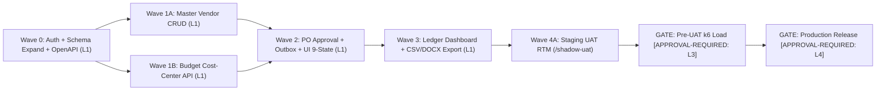

# 02. Acyclic Dependency DAGs, Execution Waves & Pre-Mortem Risk Analysis

## 1. Purpose & Activation Conditions
Use this playbook when ordering backlog tasks into parallelizable execution waves, identifying the critical path, eliminating circular dependencies, and running a **Pre-Mortem Risk Analysis (`Tigers | Paper Tigers | Elephants`)** before engineering waves launch.

Activate this playbook when:
- Sequencing multiple stories, teams, or parallel Shadow Army agents/worktrees (`/shadow-git`) so foundational contracts never deadlock downstream tasks.
- Generating a Mermaid `flowchart LR` delivery roadmap for stakeholders or sprint kickoffs.
- Diagnosing why previous sprints suffered mid-sprint blocking waits, merge conflicts, or surprise external API delays.

## 2. Prerequisites
- Vertical stories and `[DB]`/`[API]`/`[UI]`/`[QA]` tasks decomposed per [`01-vertical-thin-slicing-and-story-traceability.md`](01-vertical-thin-slicing-and-story-traceability.md).
- Known external dependencies (third-party payment/SSO sandboxes, DevOps provisioning, compliance sign-offs).

## 3. Technical Principles & Constraints
1. **Strict Acyclicity (True DAG)**: Every sprint plan MUST be a **Directed Acyclic Graph (DAG)**. Any circular dependency (`Task A -> Task B -> Task A`) or missing upstream reference indicates a broken decomposition boundary that MUST be split by extracting a shared interface/schema task (`Slice 0`) before coding starts.
2. **Standard 5-Wave Delivery Topology**: Organize multi-module systems into clear progressive waves:
   - **Wave 0 (Foundation)**: `/shadow-bootstrap` + `/shadow-auth` + core DB expand migrations (`/shadow-data`) + shared OpenAPI/type contracts.
   - **Wave 1 (Core Master Data & CRUD)**: Primary domain entities, tenant setup, and reference tables.
   - **Wave 2 (Core Transactions & Workflows)**: State machines, approval chains, queues/outbox (`/shadow-concurrency`), and third-party adapters (`/shadow-integrate`).
   - **Wave 3 (Reporting, Dashboards & Exports)**: Read models, Data Warehouse/ETL (`/shadow-db`), and formal exports (`/shadow-doc`).
   - **Wave 4 (Hardening, Staging UAT & Release)**: `/shadow-quality`, `/shadow-sec`, `/shadow-perf` (`[APPROVAL-REQUIRED: L3]`), `/shadow-uat`, `/shadow-release` (`[APPROVAL-REQUIRED: L4]`), `/shadow-handover`.
3. **Explicit Critical Path Visibility**: Calculate the longest dependency chain in duration so leadership knows which exact tasks have zero float and which parallel tracks can absorb variance safely.
4. **Pre-Mortem Before Wave 0 (`Tigers | Paper Tigers | Elephants`)**: Before writing code, ask *"It is launch day and this delivery failed—why?"* and categorize risks into:
   - **Tigers**: High-probability, high-impact threats requiring concrete pre-code mitigation and an owner.
   - **Paper Tigers**: Loud fears with minimal actual impact or already neutralized by existing controls.
   - **Elephants**: Unspoken organizational, legacy-data, or vendor truths teams hesitate to say aloud (e.g., *"Production legacy DB has duplicate NIKs despite what the manual says"*).

## 4. Architecture & Implementation
### Standard Acyclic Delivery Graph (`flowchart LR`)


### Kahn's Topological Wave Scheduler (Strict TypeScript)
```typescript
export interface PlanNode {
  readonly taskId: string;
  readonly dependsOn: readonly string[];
  readonly durationDays: number;
}

export interface DagScheduleResult {
  readonly isAcyclic: boolean;
  readonly waves: readonly (readonly string[])[];
  readonly cyclicOrBlockedNodes: readonly string[];
}

export function computeExecutionWaves(
  nodes: readonly PlanNode[],
): DagScheduleResult {
  const byId = new Map<string, PlanNode>();
  const inDegree = new Map<string, number>();
  const dependents = new Map<string, string[]>();

  for (const node of nodes) {
    byId.set(node.taskId, node);
    inDegree.set(node.taskId, 0);
    dependents.set(node.taskId, []);
  }

  for (const node of nodes) {
    for (const dep of node.dependsOn) {
      const list = dependents.get(dep);
      if (list !== undefined) {
        list.push(node.taskId);
        inDegree.set(node.taskId, (inDegree.get(node.taskId) ?? 0) + 1);
      }
    }
  }

  const waves: string[][] = [];
  let frontier: string[] = [];
  for (const [id, deg] of inDegree.entries()) {
    if (deg === 0) {
      frontier.push(id);
    }
  }
  frontier.sort();

  let visited = 0;
  while (frontier.length > 0) {
    waves.push(frontier);
    visited += frontier.length;
    const nextFrontier: string[] = [];
    for (const id of frontier) {
      for (const child of dependents.get(id) ?? []) {
        const remaining = (inDegree.get(child) ?? 0) - 1;
        inDegree.set(child, remaining);
        if (remaining === 0) {
          nextFrontier.push(child);
        }
      }
    }
    nextFrontier.sort();
    frontier = nextFrontier;
  }

  const cyclicOrBlockedNodes = [...inDegree.entries()]
    .filter(([, deg]) => deg > 0)
    .map(([id]) => id)
    .sort();

  return {
    isAcyclic: visited === nodes.length,
    waves,
    cyclicOrBlockedNodes,
  };
}
```

### Pre-Mortem Risk Register Table
| Risk ID | Category | Failure Hypothesis | Mitigation Before Execution | Owner |
| :--- | :--- | :--- | :--- | :--- |
| `PM-01` | **Tiger** | Payment gateway sandbox credentials arrive in Week 3, blocking Wave 2 | Build contract-tested mock adapter + wire HMAC verifier in Wave 0; escalate sandbox ticket Day 1 | Backend Lead |
| `PM-02` | **Elephant** | Legacy production customer table contains dirty duplicate emails & invalid UTF-8 | Run read-only profiling query on anonymized snapshot in Wave 0; add quarantine table in backfill | Data Engineer |
| `PM-03` | **Paper Tiger** | Worry that PostgreSQL won't handle 100k order rows without sharding | Standard B-tree composite index handles 10M+ rows easily; verify with `EXPLAIN ANALYZE` in Wave 1 | DB Specialist |

## 5. Platform / Vendor Variations
- **Single-Developer / Small Team Sprints**: Keep `1–2` active parallel tracks max; prioritize eliminating external blocker wait time (sandboxes, DNS, SSO credentials) in Wave 0.
- **Multi-Agent Parallel Worktrees (`/shadow-git`)**: Assign disjoint file/module ownership per Wave branch so parallel agents never touch overlapping migration timestamps or shared barrel exports simultaneously.
- **Multi-Vendor / Enterprise Integration Programs**: Represent every external vendor deliverable as an explicit external gate node (`EXT-VENDOR-*`) with a fallback stub strategy so internal waves never stall completely waiting on vendor delays.

## 6. Decision Matrix & Trade-Offs
| Dependency Conflict | Resolution Technique | Cost / Trade-Off |
| :--- | :--- | :--- |
| **Circular `A <-> B` dependency** | Extract shared contract/event interface into `Wave 0` (`A -> Contract <- B`) | Adds one lightweight interface task; unlocks true parallelism |
| **Shared hot file edited by 2 parallel tasks** | Serialize via explicit edge (`TASK-1 -> TASK-2`) or split module boundary first | Reduces merge-conflict risk to near zero |
| **Uncertain external vendor API timeline** | Introduce Anti-Corruption Layer (`ACL`) + deterministic mock in Wave 1; integrate live sandbox in Wave 2 | Small adapter overhead; protects sprint cadence |

## 7. Real Production Scenario
**Context:** A multi-tenant SaaS team scheduled three parallel sprints: Auth SSO (`T1`), Billing Subscriptions (`T2`), and Admin Audit Viewer (`T3`), assuming all three were independent.
**Failure:** Mid-sprint, `T2` blocked on `T1`'s tenant JWT claims format, `T1` blocked on `T3`'s audit event schema, and `T3` blocked on `T2`'s subscription status enum—a textbook 3-way circular dependency that wasted 4 engineering days in merge conflicts.
**Fix:** Running Kahn's DAG verification and extracting `T0: Shared Domain Contracts (JWT Claims, Audit Event Envelope, Subscription Enum)` into Wave 0 broke the cycle permanently and allowed `T1`, `T2`, and `T3` to finish in parallel on schedule.

## 8. Failure Modes & Edge Cases
- **WRONG (Invisible cycles & implicit "just coordinate in Slack" dependencies):** Drawing a flat bullet list of 25 tasks without checking upstream prerequisites or circular loops.
  **RIGHT:** Express every dependency explicitly, run `sprint_dag_verifier.py` to prove acyclicity (`is_acyclic: true`), and render the resulting execution waves in a Mermaid `flowchart LR`.
- **WRONG (Ignoring "Elephants" during sprint kickoff):** Listing only sanitized technical risks while omitting the unspoken truth that staging credentials or legacy data cleanup have no owner.
  **RIGHT:** Document every Tiger and Elephant candidly in the Pre-Mortem Risk Table with an explicit owner and Wave 0 mitigation before work begins.

## 9. Testing & Verification
- Execute `python shadow-plan/scripts/sprint_dag_verifier.py --check-plan <plan.json>` and verify `is_acyclic == true` and `0` `PLAN_UNKNOWN_DEPENDENCY` findings.
- Run `python shadow-plan/scripts/sprint_dag_verifier.py --self-test` (`7/7` probes) and `python -m unittest discover -s shadow-plan/tests -v`.
- Validate Mermaid diagram syntax (`flowchart LR` with quoted labels containing parentheses/brackets).

## 10. Operational Considerations
- Recompute execution waves whenever an external dependency slips or an emergency production hotfix pulls engineers off the critical path.
- Keep Wave 4 hardening gates visibly separated from feature waves so teams never compress UAT or security review into the final afternoon before release.

## 11. Authoritative References
- **A. B. Kahn (1962)** — *Topological sorting of large networks*, Communications of the ACM, 5(11), 558–562.
- **Gary Klein (2007)** — *Performing a Project Premortem*, Harvard Business Review.
- **Shadow Design PM Execution Pack** — `pm-execution/skills/pre-mortem/SKILL.md` & `pm-execution/skills/sprint-plan/SKILL.md`.

## 12. Limitations & When NOT to Use
- **Do NOT use** for probabilistic P50/P80/P90 schedule simulation (PERT + Monte Carlo) or contractual delay claims — route to `/shadow-pmo`.
- **Do NOT use** for low-level Git worktree branch-merge commands — route to `/shadow-git`.
