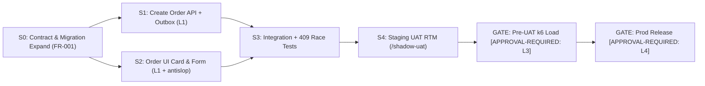

# Vertical Slicing, Dependency Graphs & Execution-Safe Sprint Planning

> Use this playbook when decomposing approved PRDs/ADRs into Epics, vertical User Stories, acyclic Sprint dependency DAGs, Definition of Ready/Done contracts, and permission-tagged task backlogs.

## 1. Core Concepts
Sprint plans fail when sliced horizontally by technical layer (week 1: all schemas, week 2: all endpoints, week 3: all UI) because integration defects hide until the final week:
- **Vertical Thin Slices:** Every completed story crosses UI -> API -> DB -> Test cleanly in `1–3` days so stakeholders can verify real runnable increments continuously.
- **Planning vs Execution Authority:** Decomposing a backlog (`shadow-plan`) is **`L0_READ_ONLY`**. Tasks requiring broad E2E (`L2`), Pre-UAT k6/AI eval surges (`L3`), or live prod deploys (`L4`) must carry explicit `[APPROVAL-REQUIRED]` gates rather than auto-running.

## 2. Technical Rules & Decision Matrix

| Decomposition Choice | Pattern to Pick | Required Story Artifacts |
| :--- | :--- | :--- |
| Feature spanning DB, API & UI | **End-to-End Vertical Slice** | Exact endpoint contract, DB migration, UI 5-state contract (`antislop`), negative tests (`400/401/403/404/409/422`) |
| Cross-team blocking dependency | **Acyclic Task DAG + Public Port First** | Define interface/OpenAPI contract in Slice 0 so frontend and backend develop in parallel safely |
| High-impact ops/load task in backlog | **Permission-Tagged Task (`[APPROVAL-REQUIRED: L3/L4]`)** | Target env, owner, abort threshold; NEVER execute automatically from plan generation |
| Scope change on active fixed contract | **Escalate to `/shadow-pmo` CR Triage** | Check contract precedence before adding sprint tasks |

## 3. Implementation Examples

### Acyclic Delivery Dependency Graph (`flowchart LR`)


### Executable Vertical Story & DoR/DoD Specification
```yaml
story_id: US-014
fr_ref: FR-012
slice_type: vertical
approval_tier: L1_SAFE_VERIFICATION
definition_of_ready:
  - OpenAPI 3.1 endpoint POST /api/v1/orders/{id}/approve agreed
  - Maker-checker rule and 409 version-conflict error schema confirmed
definition_of_done:
  - Backend route enforces server JWT actorId !== requesterId and structured logger redaction
  - Unit + DB integration tests cover 200, 403 maker-checker, 404, 409 stale version (0 leftover Docker containers)
  - UI renders theme-bound button with cursor-pointer, focus-visible ring, and 375px zero-overflow layout
  - Typecheck, lint, and shadow_gate.py pass after final edit
```

## 4. Best Practices
- Keep every User Story small enough to verify locally within a single engineering review cycle (`<= 3` days effort); split large multi-role forms by workflow milestone (Create Draft -> Submit -> Approve/Reject).
- Align story test checklists with concrete negative HTTP statuses (`400`, `401`, `403`, `404`, `409`, `422`) rather than generic "write unit tests".

## 5. Anti-Patterns (`WRONG` vs `RIGHT`)
- **WRONG (Horizontal slicing):** Creating separate epics for "Sprint 1: Create all 25 Postgres tables; Sprint 2: Build 40 endpoints; Sprint 3: Wire React screens".
  **RIGHT:** Ship thin vertical slices (`Auth Login Slice`, `Create Order Slice`, `Approve Order Slice`) runnable end-to-end every sprint.
- **WRONG (Omitting `[APPROVAL-REQUIRED]` on high-impact tasks or conflating sprint tasks with contractual Paid CRs):** Executing heavy stress tests (`L3`) unasked or hiding paid scope expansion inside normal sprint stories.
  **RIGHT:** Tag `L2`/`L3`/`L4` tasks explicitly and route contractual CR/PERT/EVM questions to `/shadow-pmo`.

## 6. Production Considerations
- **Clean Integration Exit:** Require passing automated tests, `320px/375px` mobile check when UI changes (`antislop`), lint/typecheck (`/shadow-quality`), and zero leaked Docker containers before marking any Sprint task `Done`.
