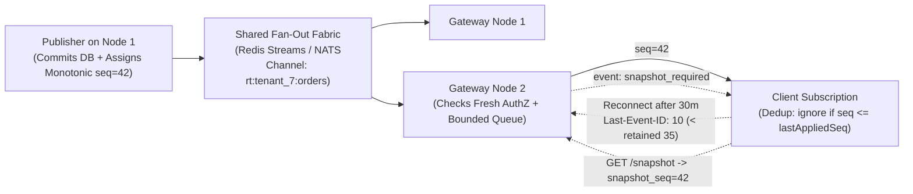

# 02 — Resumption Cursors, Idempotent Deduplication & Multi-Node Fan-Out

## 1. Purpose & Activation Conditions
Guarantee **gap-free, duplicate-safe realtime state synchronization** across mobile disconnects, server deploys, and horizontally scaled gateway replicas using monotonic per-stream sequence cursors (`Last-Event-ID`), expired-cursor `snapshot_required` resync, client-side deduplication, and Redis/NATS multi-node pub/sub fan-out — verified deterministically via `realtime_transport_verifier.py` (`trace_version: 2`). Activate when scaling realtime beyond 1 pod or fixing dropped/duplicate live updates after reconnects.

## 2. Prerequisites
- Stable logical `connection_id` persisted across transport reconnects for each subscription scope `(tenant_id, stream_id)`.
- Bounded durable/ring event log (Redis Streams `XADD MAXLEN ~`, Postgres append log, or NATS JetStream) for replay of missed events during short disconnects.

## 3. Technical Principles & Constraints
- **Monotonic Per-Stream Cursors (`seq` / `Last-Event-ID`):** Every emitted event inside a `(tenant_id, stream_id)` carries a strictly increasing integer sequence (`1, 2, 3...`). Never rely on wall-clock timestamps (`updated_at`) as a sole resumption cursor — clock skew and multiple events in the same millisecond silently drop updates!
- **Three Deterministic Reconnect Outcomes:** When a client reconnects presenting `last_applied_seq`:
  1. **Within Replay Window (`earliest_retained_seq - 1 <= last_applied_seq <= latest_seq`):** Verify fresh authorization grant FIRST, then replay `(last_applied_seq + 1 .. latest_seq)` in strict order before switching seamlessly to live tail delivery.
  2. **Cursor Expired (`last_applied_seq < earliest_retained_seq - 1`, e.g., 30-min offline or ring rolled over):** Do **NOT** silently resume from `earliest_retained_seq` (leaves permanent silent data gaps!). Emit `event: snapshot_required` -> client fetches an **authorized scoped full snapshot** carrying its exact `snapshot_seq` -> client resumes live stream from `snapshot_seq`!
  3. **Duplicate Frame Redelivery (`frame.seq <= client.lastAppliedSeq`):** Client MUST recognize already-applied sequence numbers and skip re-applying side effects (`applied: false` in observed trace!) so counters, chat messages, or toast notifications never double-render!
- **Multi-Node Fan-Out Architecture (Single-Node `EventEmitter` Breaks at 2 Replicas!):**
  - Sticky sessions keep Client B pinned to Node 2, NOT Client A's publisher! When Client A posts a message hitting Node 1, Node 1 MUST publish to a shared tenant-scoped pub/sub fabric (**Redis Pub/Sub**, **Redis Streams**, or **NATS**) so Node 2 receives and fans out to Client B's open socket!
  - In `realtime_transport_verifier.py` (`topology: "multi_node"`), at least one applied frame MUST genuinely cross a node boundary (`publisher_node != receiver_node`) to prove multi-node fan-out works!
- **Trace Honesty (`FAIL` vs `INCOMPLETE`):** Never fabricate `applied: true/false` or `blocked: true` fields from design assumptions — capture real redacted boundary events at broker, authz, and client boundaries (`tests/test_session_cli.py`).

## 4. Architecture & Implementation



```ts
// Strict TypeScript Client Deduplication & Reconnect Cursor State Machine (0 any, 0 casts)
export interface RealtimeEventEnvelope<T> {
  readonly tenantId: string
  readonly streamId: string
  readonly seq: number
  readonly payload: T
}

export type ApplyOutcome = 'APPLIED' | 'DUPLICATE_SKIPPED' | 'GAP_SNAPSHOT_REQUIRED'

export class MonotonicStreamConsumer<T> {
  private lastAppliedSeq: number

  public constructor(
    private readonly expectedTenantId: string,
    private readonly expectedStreamId: string,
    initialCursor = 0,
  ) {
    this.lastAppliedSeq = initialCursor
  }

  public getCursor(): number {
    return this.lastAppliedSeq
  }

  public resetFromAuthorizedSnapshot(snapshotSeq: number): void {
    if (!Number.isInteger(snapshotSeq) || snapshotSeq < 0) {
      throw new RangeError('snapshotSeq must be a non-negative integer')
    }
    this.lastAppliedSeq = snapshotSeq
  }

  public ingest(frame: RealtimeEventEnvelope<T>, applyEffect: (payload: T) => void): ApplyOutcome {
    if (frame.tenantId !== this.expectedTenantId || frame.streamId !== this.expectedStreamId) {
      throw new Error('TENANT_OR_STREAM_SCOPE_MISMATCH')
    }
    if (frame.seq <= this.lastAppliedSeq) {
      return 'DUPLICATE_SKIPPED'
    }
    if (frame.seq > this.lastAppliedSeq + 1) {
      return 'GAP_SNAPSHOT_REQUIRED'
    }
    applyEffect(frame.payload)
    this.lastAppliedSeq = frame.seq
    return 'APPLIED'
  }
}
```

### Multi-Node Fan-Out Backend Comparison

| Fan-Out Fabric | Replay History Built-In? | Throughput / Latency | Multi-Region / Ops | Best Fit |
| :--- | :--- | :--- | :--- | :--- |
| **In-Process `EventEmitter`** | No | Sub-ms | Single node ONLY | Single-replica dev/tiny internal tool |
| **Redis Pub/Sub + Ring Buffer** | Separate (`ZSET`/DB) | High (`< 1ms`) | Easy (already have Redis) | Medium scale chat, notifications, presence |
| **Redis Streams (`XADD` / `XREAD`)** | **Yes** (`MAXLEN ~`) | High (`1–2ms`) | Easy | SSE/WS resumption with bounded history replay |
| **NATS / NATS JetStream** | **Yes** (JetStream) | Ultra-high (`< 0.5ms`) | Native clustering & leaf nodes | High-fanout trading, telemetry, large multi-node fleets |
| **PostgreSQL `LISTEN/NOTIFY`** | Separate (table) | Moderate (`<= 8KB` payload) | Zero extra infra | Low-to-moderate volume (`< 500 evt/s`) Postgres-only apps |

## 5. Platform/Vendor Variations
- **PostgreSQL `LISTEN/NOTIFY` Pitfall:** `NOTIFY` only delivers after transaction `COMMIT`, has an `8,000-byte` payload limit, and does **NOT** work through PgBouncer in `transaction` pooling mode! Use a dedicated direct session connection for `LISTEN` (or publish lightweight `{ tenantId, streamId, seq }` pointers and read full rows on replay) and migrate to Redis Streams/NATS once fan-out exceeds a few hundred events/sec.
- **Buffer-Before-Tail Pattern (Zero Missed Gap During Live Handoff):** On reconnect: (1) subscribe to live pub/sub buffering incoming frames in a tiny temporary queue, (2) replay missed history `(last_applied_seq + 1 .. max_hist_seq)`, (3) drain buffered live frames skipping `seq <= max_hist_seq`, (4) switch to direct live delivery! That closes the subtle race window between reading history and subscribing to live events!

## 6. Decision Matrix & Trade-Offs

| Reconnect Policy | Bandwidth Cost | Consistency Guarantee | Complexity |
| :--- | :--- | :--- | :--- |
| **Blind Live Resume (No Replay)** | Minimal | **BROKEN** (silent dropped updates) | Trivial |
| **Full Snapshot on Every Reconnect** | High on flaky mobile | Strong | Low (great for tiny state `< 20KB`) |
| **Bounded Sequence Replay + `snapshot_required` Fallback** | **Optimal** | **Strong** (gap-free + dedup-safe) | Medium (production default!) |

## 7. Real Production Scenario
A live dispatch board scaled from 1 to 3 Node.js replicas behind an ALB with sticky sessions. Dispatchers on Node 2 stopped seeing live driver assignments created by operators hitting Node 1, AND drivers emerging from underground tunnels saw duplicate job alerts because reconnect replayed the last 5 minutes without sequence deduplication. Adding Redis Streams (`XADD rt:tenant:{id}:dispatch MAXLEN ~ 1000`), monotonic `seq` + `MonotonicStreamConsumer` dedup, `snapshot_required` fallback, and validating a `trace_version: 2` multi-node trace with `realtime_transport_verifier.py` resolved both lost cross-node messages and duplicate alerts.

## 8. Failure Modes & Edge Cases
- **WRONG:** Publishing to a global Redis Pub/Sub channel `events:all` and filtering `tenantId` inside every gateway node in JavaScript (every pod wastes CPU/bandwidth deserializing all tenants' events and risks cross-tenant filter bugs!).
  **RIGHT:** Partition pub/sub channels strictly by tenant + stream (`rt:tenant_{tenantId}:{streamId}`) and verify tenant authorization BEFORE subscribing!
- **WRONG:** Passing sparse non-contiguous global auto-increment DB IDs (`101, 105, 112`) into a contiguous-sequence gap detector (`frame.seq > lastAppliedSeq + 1` triggers endless false `snapshot_required` loops!).
  **RIGHT:** Assign dense per-stream monotonic sequences OR pair sparse global offsets with an explicit service-aware continuity adapter (documenting sparse offset semantics cleanly in the verifier trace!).

## 9. Testing & Verification
- Run `python shadow-realtime/scripts/realtime_transport_verifier.py --self-test` and `--verify-session path/to/v2_trace.json` verifying: (1) duplicate delivery has `applied: false`, (2) expired cursor enforces authorized snapshot with fresh cursor before live delivery, and (3) multi-node topology demonstrates cross-node delivery!
- Run `python -m unittest discover -s shadow-realtime/tests -v`.

## 10. Operational Considerations
- Bound replay retention explicitly (e.g., `MAXLEN ~ 5000` or `TTL 15 minutes`) so replay buffers never exhaust Redis memory during write surges — clients offline longer than retention fall back cleanly to `snapshot_required`.

## 11. Authoritative References
- Redis Streams Documentation (`XADD`, `XRANGE`, `XREAD` bounded history).
- `shadow-realtime/methodologies/WEBSOCKET-SSE-RESUMPTION-AND-BACKPRESSURE.md` & `scripts/realtime_transport_verifier.py`.

## 12. Limitations & When NOT to Use
- Do NOT use Redis Pub/Sub alone as a durable job queue (Redis Pub/Sub is fire-and-forget — if a node restarts, unbuffered messages vanish!). Combine durable DB/Streams persistence for business state (`shadow-concurrency`) with realtime pub/sub for live client notification.
