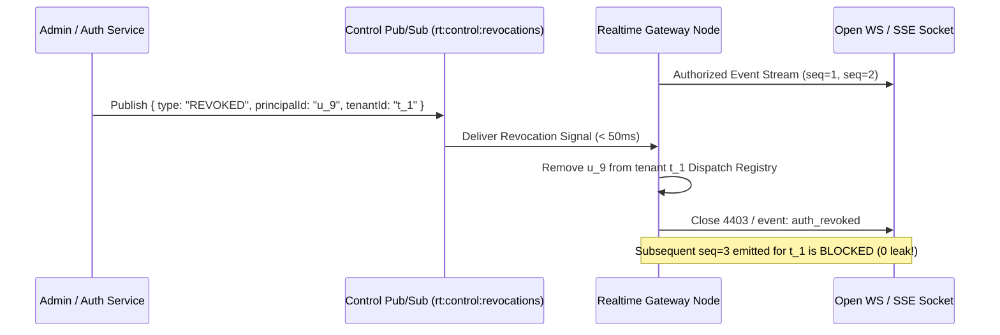

# 03 — Mid-Connection Auth Revocation, Honest Presence & Zombie Socket Pruning

## 1. Purpose & Activation Conditions
Close the #1 security hole in long-lived WebSocket/SSE services — **stale authenticated sockets continuing to stream confidential tenant data hours after logout, role downgrade, or account suspension** — while building **honest, lease-based presence** and **deterministic zombie-socket pruning**. Activate when implementing authenticated realtime subscriptions, online-user indicators, or connection lifecycle management.

## 2. Prerequisites
- Central identity/session revocation source (`/shadow-auth`) capable of publishing revocation events (`session_revoked`, `tenant_member_removed`, `role_downgraded`).
- Multi-node control channel (Redis Pub/Sub or NATS) reaching every active realtime gateway replica.

## 3. Technical Principles & Constraints
- **Mid-Connection Revocation Is Mandatory (Handshake Auth Alone Fails Security Audits!):**
  - Unlike stateless HTTP where every request carries a fresh short-lived JWT check, a WebSocket or SSE connection can remain open for **12+ hours** after initial upgrade!
  - Enforce **Three-Layer Realtime Authorization**:
    1. **Handshake / Subscription Grant:** Verify signature, expiry, `tenant_id`, and exact `stream_id` ACL BEFORE joining any channel or replaying history.
    2. **Push-Driven Instant Revocation Channel:** Subscribe every gateway node to `rt:control:revocations`. Whenever a user logs out, is removed from a tenant, or loses a permission scope, broadcast `{ principalId, tenantId, revokedAt }` — every node immediately disconnects or unsubscribes matching live connections (`WS close 4401/4403` or SSE `event: auth_revoked`) BEFORE dispatching the next event!
    3. **Bounded Token/Lease Re-Validation Timer:** Re-check session validity or require silent token refresh every `5–15 minutes` as defense-in-depth in case a control-channel pub/sub event was missed during a brief network blip!
- **Presence Honesty (TTL Leases, Not Illusionary "Instant Exact Counts"):**
  - TCP does NOT notify servers immediately when a phone loses signal in an elevator or a laptop lid snaps shut ("half-open" zombie socket!).
  - Maintain presence strictly via **explicit heartbeat leases** (e.g., client sends app heartbeat every `20s`; server sets Redis key `presence:{tenant}:{user}` with `EX 45` -> grace window `25s`). Document the exact staleness bound (`<= 45s`) honestly in product specs rather than promising instant 0ms online accuracy!
- **Active Zombie Socket Pruning:** Run a server-side ping/pong sweep (`20–30s` interval): mark each socket `alive = false`, send `ping`, mark `alive = true` on `pong`; any socket still `alive === false` on the next sweep is **hard-terminated (`socket.terminate()`)** to free OS file descriptors and memory immediately!

## 4. Architecture & Implementation



```ts
// Strict TypeScript Active Connection Registry with Instant Mid-Stream Revocation & Zombie Sweep (0 any, 0 casts)
export interface ActiveSubscription {
  readonly connectionId: string
  readonly principalId: string
  readonly tenantId: string
  readonly streamId: string
  isAlive: boolean
  revoked: boolean
  readonly closeWithReason: (code: number, reason: string) => void
  readonly sendFrame: (seq: number, payload: string) => void
}

export class RealtimeAuthzDispatcher {
  private readonly connections = new Map<string, ActiveSubscription>()

  public register(sub: ActiveSubscription): void {
    this.connections.set(sub.connectionId, sub)
  }

  public unregister(connectionId: string): void {
    this.connections.delete(connectionId)
  }

  /** Instant revocation across all live sockets matching principal + optional tenant scope. */
  public revokePrincipal(principalId: string, tenantId?: string): number {
    let closedCount = 0
    for (const [id, sub] of this.connections.entries()) {
      const matchesTenant = tenantId === undefined || sub.tenantId === tenantId
      if (sub.principalId === principalId && matchesTenant) {
        sub.revoked = true
        sub.closeWithReason(4403, 'ACCESS_REVOKED')
        this.connections.delete(id)
        closedCount += 1
      }
    }
    return closedCount
  }

  /** Guarded dispatch: refuses delivery to revoked or cross-tenant subscriptions. */
  public dispatchToStream(
    tenantId: string,
    streamId: string,
    seq: number,
    payload: string,
  ): { readonly delivered: number; readonly blocked: number } {
    let delivered = 0
    let blocked = 0
    for (const sub of this.connections.values()) {
      if (sub.tenantId !== tenantId || sub.streamId !== streamId) continue
      if (sub.revoked) {
        blocked += 1
        continue
      }
      sub.sendFrame(seq, payload)
      delivered += 1
    }
    return { delivered, blocked }
  }

  /** Prunes half-open zombie connections that missed the prior ping/pong heartbeat cycle. */
  public sweepZombies(sendPing: (connectionId: string) => void): number {
    let pruned = 0
    for (const [id, sub] of this.connections.entries()) {
      if (!sub.isAlive) {
        sub.closeWithReason(1001, 'HEARTBEAT_TIMEOUT')
        this.connections.delete(id)
        pruned += 1
      } else {
        sub.isAlive = false
        sendPing(id)
      }
    }
    return pruned
  }
}
```

## 5. Platform/Vendor Variations
- **Browser `WebSocket` Protocol Ping vs App-Level Ping:** Browsers automatically answer WebSocket RFC 6455 control `Ping` frames with `Pong`, yet browser JS cannot read RFC 6455 `Pong` events directly — send a tiny JSON/text app-level `{ "type": "ping" }` / `{ "type": "pong" }` frame too so the **client** also detects half-open server drops and initiates jittered reconnect!
- **SSE Heartbeat & Re-Auth:** SSE is unidirectional, so the server sends `: keepalive\n\n` every `20s` AND enforces a bounded stream TTL (e.g., `15 minutes` or instant push revocation via `RealtimeAuthzDispatcher`) so the client refreshes its auth session cleanly on reconnect with `Last-Event-ID`.
- **Presence at Large Room Scale (`> 1,000` Users in 1 Channel):** Never broadcast a full 1,000-user member array every time 1 person joins or leaves (`O(N^2)` bandwidth meltdown!). Emit **aggregated online count** (`onlineCount: 1423`) every `5–10s` (debounced) or paginated join/leave diffs strictly for small rooms (`<= 100` users).

## 6. Decision Matrix & Trade-Offs

| Auth Revocation Strategy | Revocation Latency | Complexity | Security Grade |
| :--- | :--- | :--- | :--- |
| **Handshake-Only JWT Check** | Hours (until tab closes!) | Trivial | **FAIL** (cross-tenant/revoked data leak!) |
| **Periodic Lease Re-Check (`5m`) Alone** | Up to `5 minutes` | Low | Acceptable only for low-sensitivity public feeds |
| **Push Revocation Channel + Periodic Lease Backup** | **`< 100ms`** | Low–Medium | **Production Standard** for multi-tenant & confidential streams |

## 7. Real Production Scenario
During a security penetration test of a B2B support desk, an auditor opened a ticket-activity WebSocket tab as Agent A, then had an admin deactivate Agent A's account and remove them from Tenant Alpha. HTTP API calls immediately returned `403`, yet the open WebSocket tab kept displaying live private customer tickets for another 4 hours! Wiring `RealtimeAuthzDispatcher.revokePrincipal()` onto Redis `rt:control:revocations` + 10-minute lease verification closed active sockets in `38ms` and passed re-test with a verified `realtime_transport_verifier.py` revocation trace.

## 8. Failure Modes & Edge Cases
- **WRONG:** Leaving presence keys in Redis without a TTL (`SET presence:u1 online`) relying solely on `socket.on('close')` to delete them (when a pod crashes or gets `SIGKILL`ed, 5,000 users stay "online" forever!).
  **RIGHT:** Always bind presence to a finite **TTL lease** (`EX 45` refreshed by heartbeat) so crashed pods and dead mobile networks expire deterministically.
- **WRONG:** Sending WS close code `4403` (Revoked) and having the frontend reconnect loop blindly retry connecting every 1 second forever!
  **RIGHT:** Client reconnect logic MUST inspect close codes (`4401`/`4403` = permanent auth failure -> stop reconnecting, redirect to login or refresh token first; `1001`/`1006` = transient -> jittered backoff reconnect!).

## 9. Testing & Verification
- Verify revocation end-to-end with `realtime_transport_verifier.py --verify-session`: trace MUST show valid grant + delivery -> effective revoke -> new emission -> observed `blocked` (zero post-revoke delivery!).
- Unit-test `RealtimeAuthzDispatcher`: verify `revokePrincipal` closes matching sockets with `4403`, subsequent `dispatchToStream` records `delivered === 0`, and `sweepZombies` terminates unresponsive sockets cleanly.

## 10. Operational Considerations
- Monitor `realtime_active_connections`, `realtime_zombie_pruned_total`, and `realtime_revocation_disconnects_total` in Prometheus (`/shadow-observe`).
- Never emit high-cardinality `connectionId` or `userId` as Prometheus metric labels!

## 11. Authoritative References
- OWASP WebSocket Security Cheat Sheet — *Authentication, Authorization & Session Termination*.
- RFC 6455 §5.5.2–5.5.3 — *WebSocket Ping/Pong Control Frames & Application Close Codes (`4000–4999`)*.
- `shadow-realtime/scripts/realtime_transport_verifier.py` & `tests/test_session_cli.py`.

## 12. Limitations & When NOT to Use
- Presence counts across cellular mobile networks always carry an inherent `heartbeat_interval + grace_window` lag — never use realtime socket presence as a security/attendance audit proof without explicit user actions.
