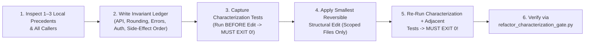

# 01 — Characterization Tests, Precedent Discovery & Invariant Ledgers

## 1. Purpose & Activation Conditions
Eliminate the #1 cause of refactor-induced production outages — **accidentally changing subtle legacy behavior in untested code** — by discovering local precedents first, locking observable semantics in an **Invariant Ledger**, and capturing passing **Characterization (Golden Master) Tests** BEFORE editing a single line of production logic. Activate at the start of EVERY legacy cleanup or module restructuring task.

## 2. Prerequisites
- Read-only (`L0`) access to the target module, its 1–3 closest comparable sibling modules in the repository, and all downstream callers/consumers.

## 3. Technical Principles & Constraints
- **Missing Tests = High Risk, NEVER Permission to Rewrite Blind!** When a 400-line legacy module has zero unit tests, every line you move could silently break an undocumented client expectation, rounding rule, or error envelope!
- **Capture What the Code ACTUALLY Does (Including Quirks!):** A characterization test (Michael Feathers, *Working Effectively with Legacy Code*) does NOT test what you *wish* the code did — it pins what the current production code **actually outputs** across normal inputs, boundary values, null/empty inputs, error codes, and side-effect calls so you get an instant alarm if your structural edit changes behavior!
  - If you spot a genuine bug while writing characterization tests (e.g., `Math.floor` rounding quirk or off-by-one), **keep the refactor 100% behavior-preserving first**, document the bug in the Invariant Ledger, and fix it in a **separate explicit commit/PR** with stakeholder confirmation!
- **1–3 Precedents + Convention Lock (`refactor_characterization_gate.py`):** Inspect the closest comparable well-written modules in the repository before extracting helpers. Match local file naming, error classes, export style (CJS vs ESM), and validation style — NEVER introduce a brand-new architecture layer without an explicit approved ADR!
- **Explicit Invariant Ledger (`playbooks/INVARIANT-LEDGER-AND-ROLLBACK.md`):** Document 6 locked invariants before editing: (1) Public function/HTTP input/output shapes, (2) Validation thresholds & error codes, (3) Rounding/date/locale semantics, (4) Auth/tenant guard checks, (5) Persisted DB state & side-effect call sequence, and (6) Exact 1-command rollback (`git checkout -- <scoped_files>`).

## 4. Architecture & Implementation



```ts
// Strict TypeScript Characterization (Golden Master) Test Locking Legacy Quirks Before Extraction (0 any, 0 casts)
import assert from 'node:assert/strict'

export interface LegacyDiscountCase {
  readonly label: string
  readonly subtotalCents: number
  readonly tier: 'VIP' | 'STANDARD'
  readonly isPromoDay: boolean
  readonly expectedDiscountCents: number
}

// Golden cases recorded directly against current production behavior BEFORE refactoring:
export const GOLDEN_DISCOUNT_CASES: readonly LegacyDiscountCase[] = [
  { label: 'VIP preserves legacy Math.floor on odd cents', subtotalCents: 10_005, tier: 'VIP', isPromoDay: false, expectedDiscountCents: 1_500 },
  { label: 'STANDARD promo day 5% floor', subtotalCents: 10_005, tier: 'STANDARD', isPromoDay: true, expectedDiscountCents: 500 },
  { label: 'Zero subtotal returns 0', subtotalCents: 0, tier: 'VIP', isPromoDay: true, expectedDiscountCents: 0 },
]

export function assertDiscountCharacterization(
  computeFn: (subtotalCents: number, tier: 'VIP' | 'STANDARD', isPromoDay: boolean) => number,
): void {
  for (const c of GOLDEN_DISCOUNT_CASES) {
    const actual = computeFn(c.subtotalCents, c.tier, c.isPromoDay)
    assert.equal(actual, c.expectedDiscountCents, `Invariant broken on case: ${c.label}`)
  }
  assert.throws(() => computeFn(-1, 'STANDARD', false), /INVALID_SUBTOTAL/)
}
```

## 5. Platform/Vendor Variations
- **Approval / Snapshot Characterization (`ApprovalTests` / `Vitest toMatchInlineSnapshot` / `pytest syrupy`):** For massive legacy report/HTML/JSON generators with 50 output fields, capture deterministic golden output snapshots across 10–20 representative real-like synthetic inputs (with frozen clock & scrubbed IDs) before refactoring internals!
- **Mixed Legacy Conventions (CJS + ESM, Mixed Validators):** Document the conflict explicitly in the Invariant Ledger and match the **target module's local convention** rather than migrating unrelated files.

## 6. Decision Matrix & Trade-Offs

| Refactor Pre-Condition | Safe Action | Unsafe Shortcut |
| :--- | :--- | :--- |
| **Module has thorough real-DB tests** | Verify tests cover exact edge cases/ordering -> refactor incrementally | Skipping test run before editing |
| **Module has ZERO tests** | Write characterization golden tests (`PASS` pre-edit) FIRST | "It looks simple, let's just rewrite it cleanly" |
| **Legacy quirk discovered during characterization** | Lock quirk in refactor commit -> file separate bug-fix commit | Mixing behavior change into a structural refactor diff |

## 7. Real Production Scenario
An engineer refactored a 380-line Indonesian payroll PPh21 helper into clean modular functions without characterization tests. Seeing `Math.floor(taxable / 1000) * 1000`, they assumed it was sloppy math and "cleaned" it to `Math.round`. Monthly tax filings disagreed with DJP rounding rules by Rp 1,000 across 1,400 employees! Adopting mandatory Golden Master characterization tests (`before_refactor_exit_code: 0` AND `after_refactor_exit_code: 0`) validated by `refactor_characterization_gate.py` prevented silent domain-rule drift on every subsequent refactor.

## 8. Failure Modes & Edge Cases
- **WRONG:** Writing characterization tests *after* finishing the refactor (only tests your new code — proves ZERO equivalence with legacy behavior!).
  **RIGHT:** Run characterization tests against the **unmodified original code (`exit 0`) FIRST**, then keep them green identically after refactoring!
- **WRONG:** Mixing a behavioral bug fix, Prettier reformatting of 20 files, and helper extraction in one PR.
  **RIGHT:** Separate pure structural refactors from behavioral bug fixes into distinct reviewable steps/commits.

## 9. Testing & Verification
- Run `python shadow-refactor/scripts/refactor_characterization_gate.py --verify-plan path/to/refactor-plan.json` proving `precedents_inspected`, `invariants_locked`, `before_refactor_exit_code == 0`, `after_refactor_exit_code == 0`, zero `silent_contract_changes`, and bounded `changed_files <= allowed_scope_files`.
- Run `python -m unittest discover -s shadow-refactor/tests -v`.

## 10. Operational Considerations
- Keep characterization tests permanently in the repository's test suite (`/shadow-test`) after refactoring so future contributors enjoy fast deterministic protection.

## 11. Authoritative References
- Michael Feathers — *Working Effectively with Legacy Code* (Ch. 13 "Characterization Tests").
- Martin Fowler — *Refactoring: Improving the Design of Existing Code (2nd Ed.)*.
- `shadow-refactor/methodologies/CHARACTERIZATION-AND-SEMANTIC-EQUIVALENCE.md` & `playbooks/INVARIANT-LEDGER-AND-ROLLBACK.md`.

## 12. Limitations & When NOT to Use
- Do NOT use `shadow-refactor` when the goal IS to fix a broken production bug (use `/shadow-debug` with Red-Before `FAIL` -> Green-After `PASS`) or redesign multi-service topology (`/shadow-architect`, `/shadow-modernize`).
