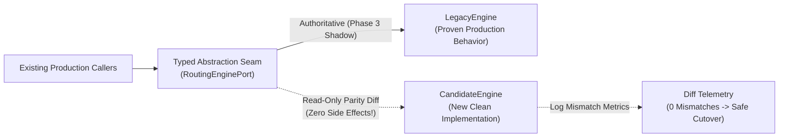

# 03 — Branch-by-Abstraction, Shadow Comparison & Incremental Strangler Seams

## 1. Purpose & Activation Conditions
Replace high-risk production algorithms, legacy ORM layers, or core internal engines **safely across multiple small releasable commits without long-lived diverging Git branches or risky big-bang cutovers** using **Branch-by-Abstraction**, **read-only Shadow Verification**, and **Module Strangler Seams**. Activate when refactoring hot paths (pricing, routing, search scoring, auth middleware, PDF/report engines) that cannot tolerate downtime or unverified cutovers.

## 2. Prerequisites
- Characterization test baseline (`01`) and narrow abstraction interface separating callers from the legacy implementation (`02`).
- Deterministic toggle/kill-switch mechanism (`/shadow-release`) if running phased production cutover.

## 3. Technical Principles & Constraints
- **Why Long-Lived Refactor Branches Fail:** Keeping a `refactor-billing-engine` Git branch open for 3 weeks while 15 PRs land on `main` creates massive merge-conflict pain and forces an all-or-nothing deployment!
- **The 5-Step Branch-by-Abstraction Protocol (Always Trunk-Releasable!):**
  1. **Step 1 — Introduce Narrow Abstraction:** Wrap the existing legacy engine behind a typed interface (`RoutingEnginePort`); route all callers through it -> merge cleanly (`0` behavior change!).
  2. **Step 2 — Implement Candidate Alongside Legacy:** Build `NewRoutingEngine` implementing `RoutingEnginePort` with full unit/property tests -> merge dark (`0` live traffic!).
  3. **Step 3 — Shadow Comparison (Read-Only Parity Verification):** For deterministic read/compute paths, run `LegacyEngine` (authoritative return value!) AND compare against `NewEngine` asynchronously or on representative replay fixtures — logging **exact diffs** (`mismatchCount`, field deltas) without affecting customers! (**Warning:** NEVER shadow-execute mutating writes/payments/emails twice!)
  4. **Step 4 — Progressive Cutover + Instant Kill-Switch:** Flip callers via deterministic cohort flag (`shadow-release` `1% -> 10% -> 50% -> 100%`) keeping instant fallback to `LegacyEngine` while verifying SLOs!
  5. **Step 5 — Clean Retirement:** Once `100%` stable past the rollback window, remove `LegacyEngine`, remove the toggle, and collapse unnecessary indirection if only one implementation remains!
- **Module-Level Strangler Seam:** When decomposing a sprawling legacy route/controller that touches 5 subsystems, place a thin strangler facade at the boundary preserving exact external routes, HTTP error envelopes, and SSO SDK hooks (`file:../sdk/sso-client`), migrating ONE sub-flow per PR instead of rewriting the whole file in one leap!

## 4. Architecture & Implementation



```ts
// Strict TypeScript Read-Only Shadow Parity Comparator (Branch-by-Abstraction — 0 any, 0 casts)
export interface PureComputePort<TInput, TOutput> {
  compute(input: TInput): TOutput
}

export interface ShadowDiffEvent<TOutput> {
  readonly matched: boolean
  readonly legacyOutput: TOutput
  readonly candidateOutput: TOutput
  readonly candidateError?: string
}

export function createShadowParityAdapter<TInput, TOutput>(opts: {
  readonly legacy: PureComputePort<TInput, TOutput>
  readonly candidate: PureComputePort<TInput, TOutput>
  readonly isEqual: (a: TOutput, b: TOutput) => boolean
  readonly onComparison: (ev: ShadowDiffEvent<TOutput>) => void
}): PureComputePort<TInput, TOutput> {
  return {
    compute(input: TInput): TOutput {
      // Legacy remains 100% authoritative; candidate failures NEVER break customer responses!
      const legacyOutput = opts.legacy.compute(input)
      try {
        const candidateOutput = opts.candidate.compute(input)
        opts.onComparison({
          matched: opts.isEqual(legacyOutput, candidateOutput),
          legacyOutput,
          candidateOutput,
        })
      } catch (err: unknown) {
        opts.onComparison({
          matched: false,
          legacyOutput,
          candidateOutput: legacyOutput,
          candidateError: err instanceof Error ? err.message : 'candidate_error',
        })
      }
      return legacyOutput
    },
  }
}
```

## 5. Platform/Vendor Variations
- **GitHub Scientist Pattern (Ruby `scientist` / JS / Python / Go):** Same principle as `createShadowParityAdapter` — ALWAYS swallow candidate exceptions, cap candidate latency timeout so shadow execution cannot slow the primary response, scrub PII from diff logs, and restrict shadow comparison strictly to **idempotent, pure, read-only** computations!
- **Stateful Write Migration:** Never shadow-write into production billing tables! Use transactional Expand-Contract dual-write (`/shadow-data`) with explicit reconciliation queries instead.

## 6. Decision Matrix & Trade-Offs

| Refactoring Mechanism | Trunk-Safe Incremental PRs? | Rollback Time | Best Trigger |
| :--- | :---: | :---: | :--- |
| **Long-Lived 3-Week Refactor Branch** | **No** (merge hell) | Hard | Avoid! |
| **In-File Pure Helper Extraction (`02`)** | Yes | Instant `git revert` | Low-to-medium risk single-module cleanup |
| **Branch-by-Abstraction + Read-Only Shadow** | **Yes** | **`< 5s` flag flip** | High-risk core algorithm/engine replacement |
| **Enterprise Strangler Fig vs Rewrite TCO** | Multi-quarter roadmap | Per-slice | Route business-case TCO analysis to `/shadow-modernize` |

## 7. Real Production Scenario
A logistics platform needed to replace a 900-line legacy shipping-rate calculator without mispricing any of 12,000 daily shipments. Using Branch-by-Abstraction + `createShadowParityAdapter` over 48 hours of read-only shadow comparison caught **3 subtle regional surcharge edge cases** (`0.4%` of shipments) that were undocumented in any spec! Fixing those 3 mismatches to `100.00%` parity before flipping the cohort flag delivered a zero-incident cutover with zero customer disputes.

## 8. Failure Modes & Edge Cases
- **WRONG:** Running shadow comparison on a method that sends an email, decrements stock, or calls a payment gateway (silently double-charges or double-emails every customer!).
  **RIGHT:** Run shadow parity ONLY on pure, read-only, zero-side-effect computations (or offline against isolated cloned fixtures!).
- **WRONG:** Leaving BOTH `LegacyEngine` and `NewEngine` + dead feature flags in the repo forever after cutover completes (doubles maintenance burden!).
  **RIGHT:** Complete Step 5 cleanly: remove `LegacyEngine`, remove the toggle, and remove obsolete indirection once stability is proven.

## 9. Testing & Verification
- Unit-test `createShadowParityAdapter` asserting: (1) legacy result is always returned even if `candidate.compute` throws, (2) mismatched outputs trigger `onComparison({ matched: false, ... })`, and (3) zero extra side effects occur.
- Verify `refactor_characterization_gate.py --verify-plan` stays green on every incremental step.

## 10. Operational Considerations
- Monitor `shadow_parity_mismatch_total` and `shadow_candidate_duration_ms` in `/shadow-observe`; never promote cutover while unexplained mismatches remain!

## 11. Authoritative References
- Paul Hammant — *Branch by Abstraction* (branchbyabstraction.com).
- Martin Fowler — *Strangler Fig Application* & GitHub *Scientist* Pattern.

## 12. Limitations & When NOT to Use
- Do NOT introduce Branch-by-Abstraction for trivial 20-line helper cleanups — reserve it for high-risk core replacements where incremental dark shipping and parity comparison justify the temporary seam.
- Do NOT use `shadow-refactor` for multi-year enterprise legacy modernization TCO comparisons — route business cases to `/shadow-modernize`.
