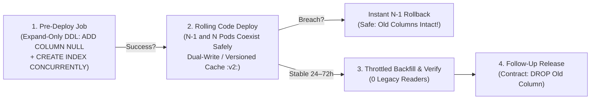

# 02 — Migration-Before-Code Ordering, Reader/Writer Skew & Multi-Release Expand-Contract

## 1. Purpose & Activation Conditions
Eliminate deployment downtime and broken rollbacks during database, cache, and queue schema changes by enforcing **Expand-Only Migration-Before-Code ordering** and verifying **N / N-1 reader-writer skew survival**. Activate whenever a release touches SQL tables, Redis key formats, serialized queue payloads, or API response shapes.

## 2. Prerequisites
- Audited migration SQL scripts (`/shadow-db` `sql_migration_safety_verifier.py` + `/shadow-data` `data_migration_plan_verifier.py`).
- Confirmed deployment topology (rolling container swap, blue-green, or multi-pod K8s where `N-1` and `N` run concurrently for minutes or hours).

## 3. Technical Principles & Constraints
- **The Rolling Skew Law (`N` and `N-1` ALWAYS Coexist):** During any zero-downtime deploy — AND during a rollback — old code (`N-1`) and new code (`N`) simultaneously read and write the **exact same database, Redis cluster, and message queue**!
- **Safe 3-Release Expand-Contract Choreography:**
  - **Release 1 (Expand — Safe to Roll Back):** Run Expand-Only DDL **BEFORE** deploying code (`ADD COLUMN new_col NULL`, `CREATE INDEX CONCURRENTLY`, `ADD CONSTRAINT ... NOT VALID`). New `N` code writes both `old_col` and `new_col` (dual-write), reads `COALESCE(new_col, old_col)`. Old `N-1` code ignores `new_col` cleanly -> **100% rollback-safe!**
  - **Between Releases (Backfill & Verify):** Run throttled resumable keyset backfill (`/shadow-data`), validate `VALIDATE CONSTRAINT`, and verify zero legacy nulls/readers remain.
  - **Release 2 (Switch Readers):** New code reads strictly from `new_col` while still writing `old_col` (or keeping `old_col` nullable so rollback still works cleanly!).
  - **Release 3 (Contract — After Rollback Window Elapses):** ONLY after `N-1` is permanently retired and rollback window has safely closed, drop `old_col` in a dedicated cleanup migration.
- **Versioned Redis Keys & Queue Envelopes:**
  - Never mutate the JSON shape of an existing Redis key (`prod:t1:user:v1:42`) in place — bump the key namespace to `:v2:` (`shadow-cache`) so `N-1` pods keep reading `:v1:` while `N` pods read `:v2:` with zero deserialization crashes!
  - Queue consumers MUST tolerate both `N-1` and `N` job payloads (deploy consumer capable of reading `v2` BEFORE deploying producer emitting `v2`!).
- **Strict Separation From App Container Boot:** Never run `prisma migrate deploy` or `alembic upgrade head` blindly inside the HTTP container entrypoint when `6` replicas boot simultaneously (causes migration lock races and partial crashes!). Execute migrations as a **dedicated pre-deploy one-shot job** (Kubernetes `Job` / CI pre-deploy step) BEFORE rolling out app containers.

## 4. Architecture & Implementation



### Rolling Skew Compatibility Matrix

| Change Type | `N-1` Reads `N` Writes? | `N` Reads `N-1` Writes? | Safe Inside 1 Release? | Required Choreography |
| :--- | :---: | :---: | :---: | :--- |
| **Add nullable column / optional JSON field** | Yes (ignores new col) | Yes (handles `NULL`) | **YES** | Expand DDL `before_code` -> Deploy `N` |
| **Add `NOT NULL` column with volatile default / rewrite** | Breaks `N-1` inserts! | Risky | **NO** | Add nullable -> backfill -> `NOT VALID` check -> `VALIDATE` |
| **Rename or `DROP COLUMN`** | **CRASHES `N-1`!** | **CRASHES rollback!** | **NO** | 3-release Expand -> Backfill -> Contract |
| **Change Redis JSON schema** | **CRASHES `N-1` parser!** | **CRASHES `N` parser!** | **NO** | Bump Redis key prefix `:v1:` -> `:v2:` (`shadow-cache`) |
| **New Queue Job Type / Field** | **CRASHES `N-1` worker!** | Yes if optional | **2-Step** | Deploy tolerant Consumer `N` FIRST -> Deploy Producer `N+1` |

```ts
// Strict TypeScript Skew-Safe Dual-Read / Dual-Write Adapter (N & N-1 Compatible, 0 any, 0 casts)
export interface LegacyAndExpandedOrderRow {
  readonly id: string
  readonly total_cents: number | null // legacy column still read by N-1
  readonly total_minor: number | null // new expanded column
}

export function readOrderTotalMinorSkewSafe(row: LegacyAndExpandedOrderRow): number {
  if (row.total_minor !== null) return row.total_minor
  if (row.total_cents !== null) return row.total_cents
  throw new Error(`CORRUPT_ORDER_ROW: order '${row.id}' missing both total_minor and total_cents`)
}

export function buildDualWriteOrderColumns(totalMinor: number): {
  readonly total_cents: number
  readonly total_minor: number
} {
  return { total_cents: totalMinor, total_minor: totalMinor }
}
```

## 5. Platform/Vendor Variations
- **Kubernetes Pre-Deploy Migrations:** Run migrations via a Helm `pre-upgrade` hook Job (`backoffLimit: 1`, `activeDeadlineSeconds: 300`) or ArgoCD `PreSync` hook — if migration fails, the Deployment rollout NEVER starts!
- **Docker Compose / VPS Deploys:** Run `docker compose run --rm api npm run db:migrate` as an explicit gated step BEFORE `docker compose up -d --no-deps api`.
- **PostgreSQL `lock_timeout` Guardrail:** Every migration script MUST set `SET lock_timeout = '3s'; SET statement_timeout = '30s';` so a migration waiting behind a busy query fails cleanly and retries instead of blocking all production traffic in a lock queue (`shadow-db`)!

## 6. Decision Matrix & Trade-Offs

| Migration Execution Model | Lock-Race Risk | Rollback Safety | Complexity |
| :--- | :--- | :--- | :--- |
| **App Startup Auto-Migrate (`N` pods simultaneously)** | **HIGH** (race + partial boot) | Low | Fragile |
| **Dedicated Pre-Deploy Expand-Only Job** | **Zero** (single runner + `lock_timeout`) | **100% Reversible** | Low–Medium (production default!) |
| **Destructive DDL Bundled With Feature Deploy** | High | **ZERO** (destroys rollback!) | **FORBIDDEN** |

## 7. Real Production Scenario
A payments team bundled `ALTER TABLE users RENAME COLUMN phone TO phone_e164` into release `v3.2.0`. Halfway through the 4-minute rolling deploy, all remaining `v3.1.9` pods crashed with `column "phone" does not exist` (`500` on 50% of traffic!), and when ops triggered rollback to `v3.1.9`, 100% of traffic went down! Adopting Gate 5 (`release_readiness_verifier.py` blocking `DROP`/`RENAME` in single releases) + 3-release Expand-Contract eliminated migration-induced outages completely.

## 8. Failure Modes & Edge Cases
- **WRONG:** Deploying new app code *before* running the Expand migration (`order: "after_code"` — new pods immediately crash querying columns that don't exist yet!).
  **RIGHT:** Always execute Expand-Only migrations **`before_code`** via a single pre-deploy step.
- **WRONG:** Executing `SELECT *` in application ORM queries when adding large columns or during Expand-Contract transitions (breaks strict tuple decoders and spikes memory).
  **RIGHT:** Explicitly enumerate projected column names in queries and dual-write until `N-1` is retired.

## 9. Testing & Verification
- Verify `N-1` binary compatibility against the newly migrated schema in staging/CI BEFORE deploying `N` (run `N-1`'s integration test suite against the migrated DB — proves rollback safety empirically!).
- Run `python shadow-release/scripts/release_readiness_verifier.py --check-release manifest.json` to block `after_code` or destructive DDL.

## 10. Operational Considerations
- Track legacy column/field read counters in observability so you know objectively when it is safe to schedule the follow-up Contract cleanup release (`shadow-observe`, `shadow-data`).

## 11. Authoritative References
- Pramod Sadalage & Martin Fowler — *Evolutionary Database Design (Expand-Contract Pattern)*.
- Kubernetes Documentation — *Jobs & Helm Pre-Upgrade Hooks*.
- `shadow-data/references/01-expand-contract-migrations-and-backfills.md`.

## 12. Limitations & When NOT to Use
- Only a brand-new greenfield pre-launch database with zero live users/traffic may skip multi-release Expand-Contract; once production users exist, skew safety is non-negotiable.
