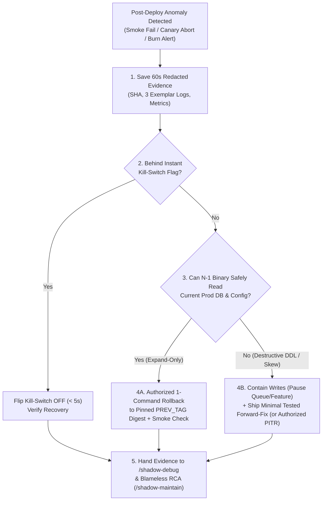

# 04 — Safe Rollback vs Forward-Fix Runbooks & `L0`/`L4` Release Governance

## 1. Purpose & Activation Conditions
Prevent panicked post-deploy rollbacks from turning a minor bug into a catastrophic data-loss outage by executing a disciplined **Rollback Compatibility Decision Tree**, maintaining **tested 1-command rollback scripts**, and strictly honoring **`L0_READ_ONLY` vs `L4_HIGH_IMPACT` authorization gates**. Activate during post-deploy degradation, release rollback planning, or Go/No-Go sign-off.

## 2. Prerequisites
- Pinned previous immutable artifact digest (`PREV_TAG`) and deployment revision history (`01`).
- Captured incident evidence window (`/shadow-observe`) BEFORE restarting/rolling back pods so forensic clues aren't erased blindly.

## 3. Technical Principles & Constraints
- **NEVER Blindly Roll Back Without Checking `N-1` Data & Config Compatibility!**
  - **Safe For Immediate Binary Rollback (`PREV_TAG`):** Stateless app bug, bad frontend bundle, Expand-Only migration where old columns/tables remain 100% intact, or config typo. Action: flip kill-switch (`< 5s`) OR roll back to `PREV_TAG` (`< 60s`) after explicit authorization.
  - **UNSAFE For Blind Binary Rollback (MUST Contain + Forward-Fix!):** A destructive DDL migration (`DROP COLUMN`, irreversible data transformation) already mutated production data, OR new `N` writes created a new enum/row format that crashes `N-1` readers! Blindly reverting to `N-1` turns a partial bug into a **100% outage**! Action: (1) Contain bad writes (read-only maintenance mode / kill-switch / pause affected worker queue), (2) Coordinate with incident owner & `/shadow-db` + `/shadow-maintain`, (3) Ship a minimal tested **Forward-Fix** patch (or execute a tested PITR restore under `/shadow-resilience` only if data integrity is unrecoverably corrupted).
- **Capture Forensic Snapshot Before Rollback:** Spend 60–90 seconds saving the exact failing `releaseSha`, 3–5 redacted exemplar `requestId`/`traceId` logs, and RED/USE saturation metrics (`/shadow-observe`) before rolling back so `/shadow-debug` can reproduce and fix the bug cleanly afterward!
- **Strict `L0` vs `L4` Execution Approval Boundary:**
  - **Auto-Allowed (`L0_READ_ONLY`):** Drafting `CHANGELOG.md`, validating SemVer bumps, running `release_readiness_verifier.py`, inspecting `.env.example` diff, checking `git log`, verifying SBOM/provenance receipts locally.
  - **REQUIRES EXPLICIT 7-PART MONARCH `L4` APPROVAL (`execution_approval_gate.py`):** Creating/pushing production Git tags (`git push --tags`), triggering live CI/CD production deploys, running production DB migrations, flipping live production traffic, or executing live production rollbacks!

## 4. Architecture & Implementation



### Rollback vs Forward-Fix Decision Matrix

| Post-Deploy Failure Condition | Kill-Switch? | Binary Rollback (`PREV_TAG`)? | Right Action |
| :--- | :---: | :---: | :--- |
| **Feature behind runtime flag throws 500** | **YES (Best)** | Not needed | Flip flag `enabled = false` (`< 5s`), verify metrics recover |
| **Stateless app / Expand-Only release breaches SLO** | N/A | **YES (Safe)** | Authorized 1-command rollback to pinned `PREV_TAG` digest + `< 2m` smoke check |
| **Bad config / missing env var crashing boot** | N/A | **YES** (or fix env) | Restore previous secret/config revision OR inject missing env + verify `/readyz` |
| **Destructive DDL or incompatible row format already written** | Contain writes | **NO (Crashes N-1!)** | Contain writes/pause consumers + minimal tested **Forward-Fix** (or authorized PITR) |

### Tested 1-Command Rollback Runbook Templates (Authorized `L4` Execution Only)
```bash
# 1. Docker Compose (Pinned Immutable Digest — NEVER :latest)
PREV_IMAGE="ghcr.io/org/api@sha256:999888777666..." \
  docker compose -f docker-compose.prod.yml up -d --no-build --force-recreate api

# 2. Kubernetes Deployment (Verify revision history first, then undo to exact revision)
kubectl rollout history deployment/checkout-api -n prod
kubectl rollout undo deployment/checkout-api -n prod --to-revision=41
kubectl rollout status deployment/checkout-api -n prod --timeout=120s
```

## 5. Platform/Vendor Variations
- **Systemd / PM2 Symlink Releases (VPS Non-Docker):** Maintain timestamped immutable release directories (`/srv/app/releases/v1.3.2`, `/srv/app/releases/v1.4.0`) with an atomic symlink `/srv/app/current`. Rollback is `ln -sfn /srv/app/releases/v1.3.2 /srv/app/current && systemctl reload app` (`< 3 seconds`!).
- **Managed Cloud PaaS (Cloud Run / ECS / Fly.io):** Keep the previous revision scaled cleanly (`0%` traffic, immutable image digest retained) so rolling back is a single traffic-split API call (`gcloud run services update-traffic ... --to-revisions=rev-0041=100`).
- **Database Down-Migrations (`migrate down`) Warning:** Never trust untested `down.sql` scripts on production! Almost all `down.sql` files are either destructive (`DROP TABLE` wiping transactions created during the last 10 minutes!) or broken in practice. Rely on **Expand-Only `N-1` compatibility** rather than `migrate down`!

## 6. Decision Matrix & Trade-Offs

| Recovery Mechanism | Data Loss Risk | Mean Time to Recover (MTTR) | Prerequisite |
| :--- | :--- | :--- | :--- |
| **Kill-Switch Flag Off** | **Zero** | `5 seconds` | Feature shipped behind runtime toggle |
| **Immutable Digest / Symlink Rollback** | **Zero** | `30–90 seconds` | Expand-Only DB + pinned `PREV_TAG` |
| **Emergency Forward-Fix Patch** | **Zero** | `15–45 minutes` | Fast CI + clear isolated root cause |
| **Point-In-Time DB Restore (PITR)** | Minutes (RPO) | `20–90 minutes` | Verified monthly restore drills (`/shadow-resilience`) |

## 7. Real Production Scenario
Ten minutes after deploying `v4.1.0`, checkout latency spiked `8x` due to an accidental ORM N+1 query introduced in a helper. Because the team had followed Gate 5 (Expand-Only schema) and Gate 7 (exact `PREV_TAG` digest `v4.0.9@sha256:...` pre-written in the release ticket), the incident commander approved the 1-command rollback after capturing 3 exemplar traces. Traffic returned to `35ms` p95 in `52 seconds` with zero lost orders, and the team fixed the N+1 calmly the next morning.

## 8. Failure Modes & Edge Cases
- **WRONG:** Running `prisma migrate reset` or an untested `down.sql` script dropping a newly created table that already accepted 150 real customer orders in the last 8 minutes!
  **RIGHT:** Never run destructive down-migrations in production; keep Expand-Only schema intact during `N-1` rollback or contain + forward-fix.
- **WRONG:** Executing `git push --tags` or production `docker compose up -d` automatically just because the user asked "siapkan release notes dan cek kesiapan rilis."
  **RIGHT:** Complete all `L0` checks and present the release manifest + 7-part `L4` approval request before executing any live release mutation.

## 9. Testing & Verification
- Rehearse the exact 1-command rollback procedure on **Staging** once per quarter (deploy `N` -> verify `/readyz` -> run rollback command -> verify `PREV_TAG` SHA serves cleanly within `< 2 min`).
- Run `python shadow-release/scripts/release_readiness_verifier.py --self-test` & `python -m unittest discover -s shadow-release/tests -v`.

## 10. Operational Considerations
- Every rolled-back or forward-fixed release automatically opens a blameless postmortem ticket (`/shadow-maintain`) identifying which Pre-Flight Gate (`1–8`) missed the defect so CI catches that class permanently next time.

## 11. Authoritative References
- Dave Farley & Jez Humble — *Continuous Delivery (Deployment Pipeline & Rollback Design)*.
- Google SRE Book — *Release Engineering & Rapid Rollback*.
- Shadow Monarch Execution Approval Protocol (`shadow-monarch/reference/EXECUTION-APPROVAL-PROTOCOL.md`).

## 12. Limitations & When NOT to Use
- Do NOT use `shadow-release` to configure underlying Nginx/K8s/Docker server hardening (`/shadow-ops`) or run root-cause code forensics (`/shadow-debug`) — `shadow-release` owns the change window, gates, promotion, and rollback readiness!
