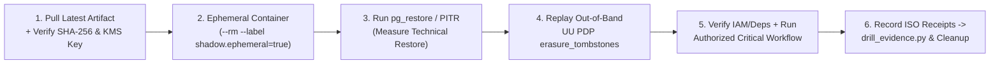

# 01 — Automated Ephemeral Backup Restore Drills, Honest RPO/RTO & Tombstone Rehydration

## 1. Purpose & Activation Conditions
Prove — rather than assume — that backups can actually be decrypted, restored, scrubbed of post-backup UU PDP/GDPR erasures, and validated end-to-end by an authorized business workflow within contractual **RPO** (Recovery Point Objective) and **RTO** (Recovery Time Objective). Activate when building monthly DR restore drills, auditing backup integrity, or verifying `drill_evidence.py` receipts.

## 2. Prerequisites
- Backup artifact store (`.dump` / `.sql.gz` / WAL archive) with `.sha256` integrity manifests and separately stored decryption keys (never stored inside the same backup bucket!).
- Isolated temporary container or disposable staging environment (`db_restore_drill_temp`) — **NEVER** a live production database!

## 3. Technical Principles & Constraints
- **An Untested Backup Does Not Exist:** A cron job printing `pg_dump exited 0` proves only that a file was written — it does NOT detect truncated dumps, rotated KMS keys you no longer have, broken extensions/roles, missing WAL segments, or 4-hour index rebuild times that violate a 30-minute RTO!
- **Technical Restore Time != Business RTO:**
  - **Technical Restore Time:** Wall-clock time for `pg_restore` / `mysql` to load bytes.
  - **True Business RTO (`disruption_at -> business_verified_at`):** Clock starts at the agreed disruption timestamp and stops ONLY after IAM, network, app config, data dependencies (`required_dependencies_verified: true`), and an authorized representative's real critical workflow (`consumer_workflow_passed: true`) succeed!
- **Honest RPO Measurement (`recovered_checkpoint_at` vs `disruption_at`):** Compare a known durable heartbeat/transaction sequence at disruption against the recovered checkpoint **in the same source timeline** (`checkpoint_verified_in_source_timeline: true`). Restoring an idle table supplies ZERO loss estimate — mark RPO as unmeasured when checkpoint coverage or decryption keys are missing (`drill_evidence.py` exits `1` on incomplete evidence!).
- **UU PDP / GDPR Erasure Tombstone Replay (Anti-Resurrection):** Restoring a 6-hour-old backup resurrects every customer who exercised their right to erasure (`UU PDP Pasal 43` / `GDPR Art. 17`) in the last 6 hours! Maintain an independent, immutable `erasure_tombstones` log (storing hashed/opaque subject IDs + deletion timestamps, NEVER resurrected PII) and automatically replay tombstones on the restored DB **BEFORE** opening production traffic (`test_restore_rehydration.py`)!
- **Zero Orphan Docker Leaks:** Always launch ephemeral drill containers with `--rm --label shadow.ephemeral=true` and guaranteed `try/finally` (`docker rm -f -v`), verified with `shadow_gate.py --check-docker-leaks`.

## 4. Architecture & Implementation



### Automated Leak-Proof Ephemeral Restore Drill & Evidence Verification (PowerShell)
```powershell
$ErrorActionPreference = "Stop"
$ContainerName = "restore-drill-pg-$PID"
try {
    # 1. Verify artifact checksum before restore
    $expectedHash = (Get-Content "backup.dump.sha256").Split(" ")[0].Trim().ToLower()
    $actualHash = (Get-FileHash "backup.dump" -Algorithm SHA256).Hash.ToLower()
    if ($expectedHash -ne $actualHash) { throw "BACKUP_CHECKSUM_MISMATCH" }

    # 2. Launch isolated ephemeral DB on loopback
    docker run -d --rm --label shadow.ephemeral=true `
        --name $ContainerName -p 127.0.0.1:0:5432 `
        -e POSTGRES_PASSWORD=drill_temp_only_pw -e POSTGRES_DB=drill_db `
        postgres:16-alpine | Out-Null
    if ($LASTEXITCODE -ne 0) { throw "Failed to start ephemeral restore container" }

    # 3. Restore dump, replay out-of-band erasure_tombstones, run critical business read/write probe
    # 4. Validate ISO-8601 receipts deterministically (exits 1 if incomplete!)
    python "shadow-resilience/scripts/drill_evidence.py" drill_receipt.json
    if ($LASTEXITCODE -ne 0) { throw "DRILL_EVIDENCE_INCOMPLETE_OR_FAILED" }
} finally {
    docker rm -f -v $ContainerName 2>$null | Out-Null
}
```

### Canonical `drill_receipt.json` Contract (`drill_evidence.py`)
```json
{
  "disruption_at": "2026-11-22T01:00:00+00:00",
  "recovered_checkpoint_at": "2026-11-22T00:55:12+00:00",
  "business_verified_at": "2026-11-22T01:18:45+00:00",
  "required_dependencies_verified": true,
  "consumer_workflow_passed": true,
  "checkpoint_verified_in_source_timeline": true,
  "tombstones_replayed_count": 14,
  "rpo_objective_sec": 900,
  "rto_objective_sec": 1800
}
```

## 5. Platform/Vendor Variations
- **PostgreSQL PITR (WAL-G / pgBackRest / Managed RDS/CloudSQL):** Logical `pg_dump` alone only gives RPO = dump interval (e.g., 24h); for RPO `< 5–15 minutes`, pair base backups with continuous WAL archiving (`archive_command`) and drill restoring to a specific `recovery_target_time`!
- **MySQL / MariaDB (`mysqldump --single-transaction` / Percona XtraBackup):** Always pass `--single-transaction --routines --triggers` for consistent InnoDB snapshots without locking tables; for DBs `> 50GB`, use physical snapshots (`XtraBackup`/LVM/cloud snapshots) so restore meets RTO.
- **3-2-1-1-0 Backup Rule (`/shadow-ops`):** 3 copies, 2 different media/regions, 1 offsite, 1 **immutable/air-gapped (Object Lock WORM)** against ransomware deletion, and **0 unverified restore errors**.

## 6. Decision Matrix & Trade-Offs

| Backup Tier | Typical RPO | Typical RTO (50GB DB) | Ransomeware Defense | Restore Verification Requirement |
| :--- | :--- | :--- | :--- | :--- |
| **Nightly `pg_dump` / `mysqldump`** | `<= 24 hours` | `20–90 minutes` | Only if WORM-copied offsite | Monthly ephemeral container restore + tombstone replay |
| **Base Backup + Continuous WAL PITR** | `1–5 minutes` | `15–45 minutes` | Object Lock WORM bucket | Monthly PITR target-time restore + heartbeat RPO proof |
| **Warm Standby Replica (Delayed / Cross-Region)** | Seconds–Minutes | `2–10 minutes` | Delayed replica (`+4h`) guards accidental `DROP` | Quarterly failover + DNS/app-cutover + rollback drill |

## 7. Real Production Scenario
An enterprise HRIS passed ISO 27001 paperwork showing daily `pg_dump` cron logs for 18 months. During its first real automated restore drill, `pg_restore` failed immediately: the production DB had enabled `pgcrypto` and `pg_trgm` extensions in a custom schema not included in the dump script, AND the backup encryption passphrase had been rotated 6 months earlier without updating the DR runbook. Fixing extension pre-seeding, storing KMS recovery keys in break-glass vaults, automating monthly ephemeral drills with `drill_evidence.py`, and replaying `erasure_tombstones` closed both catastrophic recovery gaps before an actual disk failure hit 4 months later.

## 8. Failure Modes & Edge Cases
- **WRONG:** Running a restore drill directly into the live staging or production database (`pg_restore --clean -d prod_db`).
  **RIGHT:** Always restore into a brand-new isolated ephemeral container or dedicated disposable DB (`db_restore_drill_temp`), never overwriting live data.
- **WRONG:** Submitting naive timestamps without timezone offsets (`"2026-11-22T01:00:00"`) or marking RPO as `"0 minutes"` when no write heartbeat occurred during the test window.
  **RIGHT:** Use offset-aware ISO-8601 UTC timestamps (`+00:00`/`Z`) and require verified source-timeline heartbeat coverage (`drill_evidence.py` exits `1` otherwise).
- **WRONG:** Leaving stopped restore-drill containers or 40GB anonymous volumes behind after a failed drill.
  **RIGHT:** Pass `--rm --label shadow.ephemeral=true` and tear down inside `finally` (`docker rm -f -v`), verified by `shadow_gate.py --check-docker-leaks`.

## 9. Testing & Verification
- Run `python -m unittest discover -s shadow-resilience/tests -v` (verifies `test_drill_evidence.py` AND `test_restore_rehydration.py`).
- Run `python shadow-resilience/scripts/drill_evidence.py path/to/drill_receipt.json` on every completed drill and archive the markdown report (`docs/ops/restore-drill-YYYY-MM.md` — compatible with `/shadow-doc` monthly maintenance deliverables!).

## 10. Operational Considerations
- Schedule automated monthly restore drills for Tier-1 databases and attach signed `drill_evidence.py` receipts to quarterly GRC/audit evidence packages (`/shadow-grc`, `/shadow-maintain`).
- Never store raw backup decryption keys inside Git or the same bucket as the backup files.

## 11. Authoritative References
- NIST SP 800-34 Rev. 1 — *Contingency Planning Guide for Federal Information Systems (RPO/RTO)*.
- ISO/IEC 22301 & ISO/IEC 27001:2022 Annex A.8.13 (Information Backup Verification).
- UU No. 27/2022 (UU PDP) Pasal 43 — Erasure Compliance Across Backup Restores.

## 12. Limitations & When NOT to Use
- Do NOT use `shadow-resilience` to provision cloud backup buckets/Terraform/cron infrastructure — coordinate infra setup with `/shadow-ops`.
- A passing database restore drill does NOT prove DNS failover, CDN origin switch, or external SaaS vendor continuity — test full application dependency recovery explicitly.
