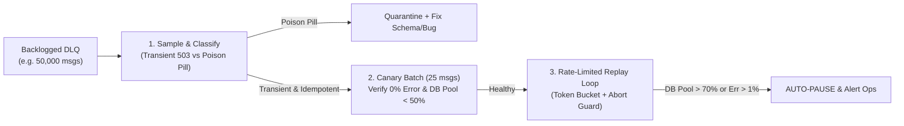

# 04 — Scoped Staging Fault Injection, Safe DLQ Replay & GameDay Governance

## 1. Purpose & Activation Conditions
Validate that circuit breakers, bulkheads, outbox workers, and operators actually behave as designed under failure using **strictly scoped staging/local fault injection** and **rate-limited, poison-filtered Dead-Letter Queue (DLQ) replay** — with ironclad `L3`/`L4` safety guardrails so chaos experiments never cause unapproved production outages. Activate when designing staging chaos tests, recovering large backlogged DLQs after an outage, or planning a GameDay readiness exercise.

## 2. Prerequisites
- Explicit scope-specific authorization (`L1` for isolated local test-harness fault stubs; **`L3`/`L4` 7-part approval MANDATORY** before injecting faults into any shared staging or production environment!).
- Working observability dashboards (`shadow-observe`) and an explicit **Abort Switch / Kill Owner** ready before any shared fault experiment starts.

## 3. Technical Principles & Constraints
- **Blast-Radius Progression (Never Start Chaos in Production!):**
  1. **Level 1 (`L1` Local Unit/Integration Fault Stubs):** Deterministic HTTP `503`/`429`/timeout stubs, Redis disconnect mocks, and DB lock-timeout tests in CI (`0` risk, run on every PR).
  2. **Level 2 (`L3` Approved Staging Fault Injection):** Scoped Toxiproxy / WireMock latency injection, single non-critical pod kill, or broker disconnect in isolated staging with pre-defined steady-state hypothesis and automated abort threshold.
  3. **Level 3 (`L4` Explicitly Authorized GameDay):** Only after Level 1 + Level 2 pass consistently, with business/ops sign-off, rollback owner, and immediate abort command.
- **Safe DLQ Replay Protocol (Preventing Self-Inflicted Secondary Outages):**
  - After a 2-hour downstream outage fills a DLQ with `50,000` messages, dumping all `50,000` straight back into the live queue instantly crashes DB pools and trips downstream rate limits (`429`) all over again!
  - Always execute **4-Step Controlled DLQ Recovery**:
    1. **Inspect & Classify Sample (`L0`):** Separate **transient outage casualties** (downstream `503` — safe to replay) from **permanent poison pills** (malformed JSON, schema error, deleted foreign key — MUST quarantine/fix, never blindly replay!).
    2. **Verify Consumer Idempotency:** Confirm replaying messages will NOT send duplicate charges or emails (`/shadow-concurrency`, `/shadow-cache`).
    3. **Canary Replay (`10–50` messages):** Verify end-to-end processing, error rate `0%`, and DB pool usage stays `< 50%`.
    4. **Rate-Limited Batched Replay With Abort Guard:** Replay at bounded throughput (e.g., `20–50 msg/sec`, pausing automatically whenever DB pool wait or error rate crosses threshold).

## 4. Architecture & Implementation



```ts
// Strict TypeScript Rate-Limited DLQ Replay Controller with Health Abort Guard (0 any, 0 casts)
export interface DlqMessage {
  readonly id: string
  readonly failureReason: string
  readonly payloadJson: string
}

export interface ReplayHealthSnapshot {
  readonly dbPoolUtilizationRatio: number
  readonly recentErrorRatio: number
}

export interface ReplaySummary {
  readonly replayedCount: number
  readonly quarantinedPoisonCount: number
  readonly pausedByHealthGuard: boolean
}

const POISON_REASONS = new Set<string>(['SCHEMA_VALIDATION_ERROR', 'MALFORMED_JSON', 'INVALID_TENANT'])

export async function runBoundedDlqReplay(opts: {
  readonly messages: readonly DlqMessage[]
  readonly batchSize: number
  readonly maxDbPoolRatio: number
  readonly maxErrorRatio: number
  readonly checkHealth: () => Promise<ReplayHealthSnapshot>
  readonly requeue: (msg: DlqMessage) => Promise<void>
  readonly quarantine: (msg: DlqMessage) => Promise<void>
  readonly sleepMs: (ms: number) => Promise<void>
  readonly interBatchDelayMs: number
}): Promise<ReplaySummary> {
  let replayedCount = 0
  let quarantinedPoisonCount = 0

  for (let i = 0; i < opts.messages.length; i += opts.batchSize) {
    const health = await opts.checkHealth()
    if (health.dbPoolUtilizationRatio > opts.maxDbPoolRatio || health.recentErrorRatio > opts.maxErrorRatio) {
      return { replayedCount, quarantinedPoisonCount, pausedByHealthGuard: true }
    }
    const batch = opts.messages.slice(i, i + opts.batchSize)
    for (const msg of batch) {
      if (POISON_REASONS.has(msg.failureReason)) {
        await opts.quarantine(msg)
        quarantinedPoisonCount += 1
      } else {
        await opts.requeue(msg)
        replayedCount += 1
      }
    }
    if (i + opts.batchSize < opts.messages.length && opts.interBatchDelayMs > 0) {
      await opts.sleepMs(opts.interBatchDelayMs)
    }
  }
  return { replayedCount, quarantinedPoisonCount, pausedByHealthGuard: false }
}
```

### Fault Injection Tooling by Layer

| Layer | Local / CI Tool (`L1`) | Approved Staging Tool (`L3`) |
| :--- | :--- | :--- |
| **HTTP Outbound / 3rd-Party API** | `MSW` / `nock` / `wiremock` (`503`, `429`, `timeout`) | Toxiproxy / Envoy fault filter (`delay`, `abort`) |
| **Database / Redis TCP Link** | Ephemeral Toxiproxy sidecar (`--rm --label shadow.ephemeral=true`) | Toxiproxy latency/bandwidth/reset toxic |
| **Browser UI Network Faults** | Playwright `page.route()` (`shadow-browser`) | Staging fault proxy + Playwright check |
| **Container / Process Crash** | Local disposable compose stop/start (`try/finally` cleanup) | Controlled Chaos Mesh / LitmusChaos with abort SLA |

## 5. Platform/Vendor Variations
- **BullMQ / Redis Queues:** Never call bulk `retryJobs()` blindly on 100k failed jobs without pausing/throttling worker concurrency (`limiter: { max: 30, duration: 1000 }`) and inspecting `failedReason` first.
- **RabbitMQ / AWS SQS Redrive:** AWS SQS DLQ Redrive supports explicit `maxNumberOfMessagesPerSecond` velocity limits — always set a conservative rate matching downstream DB pool capacity!
- **Kafka Consumer Lag Recovery:** After a long consumer outage, tune `max.poll.records` and DB batch write size so catch-up doesn't exceed `max.poll.interval.ms` (triggering endless rebalance loops!) or saturate PostgreSQL IOPS.

## 6. Decision Matrix & Trade-Offs

| Experiment / Action | Approval Level | Blast Radius | Expected Artifact |
| :--- | :--- | :--- | :--- |
| **Local CI Fault Stubs (Redis down, HTTP 503)** | `L1` (auto in task scope) | Zero (local sandbox) | Deterministic passing unit/integration test |
| **Isolated Ephemeral Restore Drill** | `L1` (local container) | Zero (disposable container) | `drill_evidence.py` verified receipt + 0 Docker leaks |
| **Shared Staging Toxiproxy / Pod Kill** | **`L3`** (explicit approval) | Shared staging users | GameDay hypothesis, steady-state vs fault metrics, action items |
| **Production Chaos / Live Failover / DLQ Replay** | **`L4`** (explicit 7-part approval) | Live customers & data | Signed change record, abort owner, post-incident review |

## 7. Real Production Scenario
After a 90-minute third-party payment webhook outage, 38,000 failed jobs sat in the settlement DLQ. An engineer clicked "Retry All" in the BullMQ dashboard; all 8 workers spun up simultaneously, firing 400 DB queries/sec plus 400 webhook calls/sec, which immediately tripped the payment gateway's `429` rate limiter AND maxed out PostgreSQL connections — causing a second 40-minute live outage! Adopting `runBoundedDlqReplay` (poison filtering + 25-message canary + `25 msg/sec` throttle + auto-pause when DB pool `> 65%`) drained the next 42,000-message backlog safely in 28 minutes with `0%` customer impact.

## 8. Failure Modes & Edge Cases
- **WRONG:** Injecting random latency or killing containers in shared staging/production without a written steady-state hypothesis, explicit `L3`/`L4` approval, or an automated abort trigger.
  **RIGHT:** Define exact steady-state SLOs, obtain explicit approval, start small in `L1` local fixtures first, and pre-arm an instant abort switch.
- **WRONG:** Replaying poison messages (`SCHEMA_VALIDATION_ERROR`) back into the live queue indefinitely (burns CPU, fills logs, and loops forever back into the DLQ).
  **RIGHT:** Classify & quarantine non-retryable poison pills separately from transient `503`/timeout casualties before replaying.

## 9. Testing & Verification
- Unit-test `runBoundedDlqReplay` covering: (1) poison messages quarantined without requeue, (2) auto-pause triggers immediately when `dbPoolUtilizationRatio > maxDbPoolRatio`, and (3) healthy batches drain cleanly.
- After any Docker-based local Toxiproxy fault test, run `python shadow-quality/scripts/shadow_gate.py --repo . --check-docker-leaks`.

## 10. Operational Considerations
- Run quarterly **GameDay** drills on staging (e.g., simulate Redis loss or payment 503) pairing `/shadow-observe` runbooks with `/shadow-resilience` degradation paths, feeding any discovered blind spots into `/shadow-maintain`.

## 11. Authoritative References
- Principles of Chaos Engineering (principlesofchaos.org) — *Steady-State Hypothesis & Minimize Blast Radius*.
- Nora Jones & Casey Rosenthal — *Chaos Engineering: System Resiliency in Practice*.
- AWS SQS Documentation — *Dead-Letter Queue Redrive Velocity Control*.

## 12. Limitations & When NOT to Use
- Do NOT run chaos experiments on a system that lacks basic observability (`/shadow-observe`) or working backups (`01`) — you will only discover failure modes you already knew existed while flying blind!
- Do NOT use `shadow-resilience` to design core queue/outbox schemas from scratch — coordinate durable messaging architecture with `/shadow-concurrency`.
