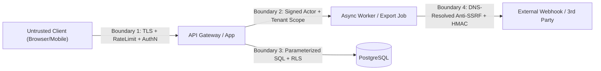

# 01. STRIDE Threat Modeling & Trust Boundaries

## 1. Purpose & Activation Conditions
Conduct structured, architecture-grounded **STRIDE** threat modeling across trust boundaries, multi-hop authorization chains, and PR attack-surface diffs before shipping high-risk features. Load when reviewing system designs, new APIs/integrations, or security-sensitive PR diffs.

## 2. Prerequisites
- Data-flow architecture or PR diff showing entry points, trust boundaries (Internet -> Edge/WAF -> App -> Internal Workers -> DB/3rd-Party), and data sensitivity classes.

## 3. Technical Principles & Constraints
- **Model Every Trust Boundary Crossing:** Threats materialize whenever data crosses a trust boundary (browser -> API, webhook -> backend, gateway -> internal worker, LLM -> tool, app -> external URL). Draw explicit boundaries before listing mitigations.
- **Complete 6-Category STRIDE Evaluation:**
  - **S (Spoofing):** Forged identity, unsigned webhooks, untrusted `X-Username`/`X-Forwarded-For`, JWT `alg: none` -> coordinate with `/shadow-auth`.
  - **T (Tampering):** Mass assignment (`role`, `price`, `tenant_id`), unvalidated client calculations, unverified artifacts -> enforce strict DTOs & server recalculation.
  - **R (Repudiation):** Missing immutable `security_audit_logs` on approvals, role edits, exports, deletions.
  - **I (Information Disclosure):** Cross-tenant IDOR, stack/SQL leaks, exposed internal endpoints in client JS bundles, unredacted PII logs (`/shadow-privacy`).
  - **D (Denial of Service):** Unbounded pagination, regex ReDoS, GraphQL depth bombs, unthrottled auth/upload/AI routes.
  - **E (Elevation of Privilege):** Missing server AuthZ guards, **multi-hop confused deputy** (Gateway validates JWT -> internal worker queries arbitrary tenant!), SSRF to cloud metadata IAM role.
- **PR Attack-Surface Diff Discipline:** On every high-risk PR, explicitly audit: (1) new routes/endpoints, (2) auth middleware changes, (3) raw SQL/shell/HTML/egress sinks, (4) new dependencies/secrets, and (5) newly serialized response fields.

## 4. Architecture & Implementation

Structured Threat-Model Entry Schema (verifiable via `appsec_control_verifier.py --check-finding-report`):
```typescript
export type StrideCategory = 'Spoofing' | 'Tampering' | 'Repudiation' | 'InformationDisclosure' | 'DenialOfService' | 'ElevationOfPrivilege';

export interface ThreatModelEntry {
  readonly id: string;
  readonly boundary: string;
  readonly stride: StrideCategory;
  readonly severity: 'CRITICAL' | 'HIGH' | 'MEDIUM' | 'LOW';
  readonly controlId: string; // e.g. 'ASVS-5.0 v5.0.0-8.2.1' or 'UNVERIFIED'
  readonly exploitScenario: string;
  readonly mitigationOwnerSkill: 'shadow-sec' | 'shadow-auth' | 'shadow-api' | 'shadow-db' | 'shadow-privacy';
  readonly verificationTest: string;
}
```

## 5. Platform / Vendor Variations
| Architecture Pattern | Dominant STRIDE Blind Spot | Mandatory Check |
| :--- | :--- | :--- |
| **SPA + REST/GraphQL Backend** | Exposed internal URLs/flags in client JS bundle + BOLA/BOPLA | Audit build bundle + test every route without frontend |
| **Microservices / Async Workers** | Multi-hop Confused Deputy (worker drops `tenant_id` check!) | Require explicit `(actorId, tenantId)` assertion inside every job handler |
| **GenAI / MCP Agent App** | Indirect prompt injection -> `ElevationOfPrivilege` via tool calls | Pair with `/shadow-eval` (`LLM01`/`LLM06`) + deterministic server RBAC |

## 6. Decision Matrix & Trade-Offs
| Change Scope | Threat Modeling Depth | Timebox |
| :--- | :--- | :---: |
| **UI Copy / Styling PR** | Skip heavy STRIDE (standard CSP/XSS guard suffices) | 0 min |
| **New Authenticated Endpoint / Webhook / Upload** | Focused 6-row STRIDE + PR Attack-Surface Diff | 15–30 min |
| **New Auth System, Payment Flow, Multi-Tenant Core, AI Agent** | Full DFD + Trust-Boundary STRIDE + ASVS 5.0 Control Matrix | 1–2 hrs |

## 7. Real Production Scenario
During a routine architecture review, the API Gateway enforces JWT authentication cleanly, so engineers mark internal service routes `"safe"`. STRIDE modeling Boundary 2 (Gateway -> Export Worker) uncovers that the worker accepts `{ tenantId }` from a message queue payload constructed from an unvalidated query parameter — allowing any authenticated tenant to export another tenant's data via **Multi-Hop Confused Deputy**. Binding `tenantId` strictly from the verified JWT into the job envelope AND re-validating ownership in the worker closes the hole before launch.

## 8. Failure Modes & Edge Cases
- **WRONG:** Treating STRIDE as a vague boilerplate essay (`"Use HTTPS and strong passwords"`) detached from actual endpoints, tables, and trust boundaries.
- **RIGHT:** Tie every STRIDE entry to a concrete `file:line`/boundary, realistic attacker path, owning skill, and executable regression test.
- **WRONG:** Assuming `"internal"` routes referenced in frontend code are secret because they aren't linked in the navbar.
- **RIGHT:** Anything shipped in browser JavaScript or mobile binaries is **100% public**; enforce server AuthN/AuthZ on every reachable endpoint!

## 9. Testing & Verification
- Validate structured finding reports with `python shadow-sec/scripts/appsec_control_verifier.py --check-finding-report <report.json>`.
- Run `python -m unittest discover -s shadow-sec/tests -v` (`test_tenant_export_and_controls.py` enforces two-tenant boundary assertions with versioned control IDs).

## 10. Operational Considerations
- Update the threat model whenever adding a new external integration, auth provider, file upload flow, or AI tool — stale threat models create false confidence.

## 11. Authoritative References
- Adam Shostack — *Threat Modeling: Designing for Security* (STRIDE methodology).
- OWASP Threat Modeling Cheat Sheet (`https://cheatsheetseries.owasp.org/cheatsheets/Threat_Modeling_Cheat_Sheet.html`).
- NIST SP 800-218 (SSDF) — `PW.1` Design Software to Meet Security Requirements (`https://csrc.nist.gov/pubs/sp/800/218/final`).

## 12. Limitations & When NOT to Use
- Threat modeling identifies architectural risk; it does NOT replace automated SAST, dependency reachability checks (`07`), or concrete negative integration tests (`shadow-auth`, `shadow-test`).
