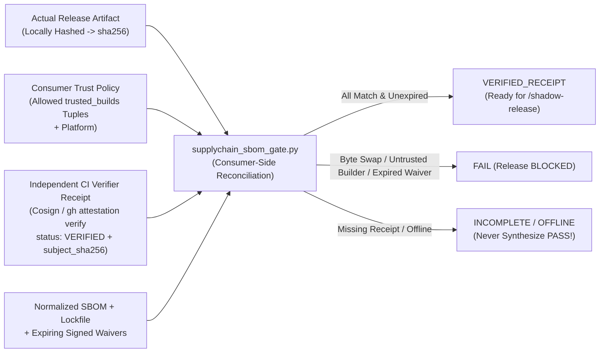

# 04 — SLSA v1.2 Provenance Verification, Cosign Receipts & Expiring CVE Waivers

## 1. Purpose & Activation Conditions
Enforce cryptographic **end-to-end artifact integrity** using the **SLSA v1.2 Consumer Verification Model** (verifying locally hashed artifact bytes against an independent consumer-controlled CI verifier receipt matching allowed `trusted_builds` tuples), **honest offline/`NOT_RUN` status reporting**, and **time-bounded signed CVE waivers** validated by `supplychain_sbom_gate.py`. Activate before every production release handoff (`/shadow-release`) or enterprise security/BAST delivery (`/shadow-handover`).

## 2. Prerequisites
- Actual built release artifact file (`release.bin` / OCI digest), normalized manifest JSON, consumer trust policy (`consumer-policy.json`), independent verifier receipt (`verifier-result.json`), and explicit `--as-of-date YYYY-MM-DD`.

## 3. Technical Principles & Constraints
- **Separate Producer Claims From Consumer Trust (SLSA v1.2 Core Rule):**
  - A release author's manifest or editable PR file claiming `"provenance": { "signer_verified": true }` is **UNTRUSTED** and yields **`INCOMPLETE`** in `supplychain_sbom_gate.py`!
  - Trust is established ONLY by reading an independent cryptographic verifier receipt (e.g., `cosign verify-attestation` / `gh attestation verify`) from a **consumer-controlled CI channel** and verifying ALL 5 bindings:
    1. Receipt `status === "VERIFIED"`.
    2. Receipt `(issuer, builder_id, build_type, verifier)` tuple is explicitly listed in the consumer policy's `trusted_builds` array (never verify `issuer` alone without `builder_id` & `build_type`!).
    3. Locally computed lowercase hex `sha256` of the actual release artifact bytes **matches** `receipt.subject_sha256` (catches same-filename byte swaps!).
    4. Original upstream signature, verifier version, CI run ID, and policy revision are preserved for audit review.
    5. Reported verified dimension is honestly labeled **`VERIFIED_RECEIPT`** (noting SLSA build-level isolation, external parameters, and runtime reachability require their own evidence!).
- **Strict Offline / Unreachable Honesty:** When Rekor, Sigstore Fulcio, or vulnerability feeds are unreachable in an air-gapped network, record **`OFFLINE`** or **`NOT_RUN`** — **NEVER** synthesize a fake `VERIFIED` receipt!
- **Expiring Signed CVE Waivers (Zero Permanent Ignores!):**
  - Every temporary vulnerability exception MUST specify `cve_id`, `purl`, `scope`, `reason`, `compensating_control`, `owner`, `expires_on` (`YYYY-MM-DD`), and `signed_approval_ref`.
  - Compare `expires_on >= --as-of-date` (expiry day inclusive). An expired waiver immediately **FAILS** the release gate!
  - Note: Date validity alone grants NO authority — verify the organization's signed exception record, subject, scope, and owner separately!

## 4. Architecture & Implementation



### Independent Consumer Verification CLI & Expiring Waiver Schema
```bash
# 1. Independent cryptographic signature & SLSA provenance verification (consumer CI channel)
cosign verify-attestation \
  --type slsaprovenance \
  --certificate-oidc-issuer "https://token.actions.githubusercontent.com" \
  --certificate-identity-regexp "^https://github\\.com/org/repo/\\.github/workflows/release\\.yml@refs/tags/v" \
  "ghcr.io/org/service@sha256:0123456789abcdef0123456789abcdef0123456789abcdef0123456789abcdef"
```

```powershell
# 2. Reconcile local artifact bytes + consumer policy + verifier receipt + waiver expiry date
python "shadow-supplychain/scripts/supplychain_sbom_gate.py" `
  --verify manifest.json `
  --policy consumer-policy.json `
  --artifact release.bin `
  --receipt verifier-result.json `
  --as-of-date 2026-11-23
```

```json
{
  "cve_id": "CVE-2026-0042",
  "purl": "pkg:npm/docs-yaml-lint@1.4.2",
  "scope": "dev",
  "reason": "Vulnerable parser executes only during static docs lint; never bundled into production image.",
  "compensating_control": "CI rejects untrusted frontmatter; package upgrade tracked in SEC-219.",
  "owner": "platform-security",
  "expires_on": "2026-12-31",
  "signed_approval_ref": "sec-board/waivers/2026-041"
}
```

## 5. Platform/Vendor Variations
- **GitHub Artifact Attestations (`gh attestation verify`):** Native Sigstore-backed SLSA v1.0/v1.2 provenance verification for builds emitted via `actions/attest-build-provenance` — verify both `--owner <org>` AND exact workflow signer path (`--signer-workflow`) so a rogue PR workflow in another repo cannot forge a trusted release!
- **Air-Gapped / Sovereign Government Environments:** Use a locally mirrored Cosign public key + offline TUF root bundle (`cosign verify --key cosign.pub --offline`) instead of skipping verification or faking Rekor checks — and label offline status explicitly!

## 6. Decision Matrix & Trade-Offs

| Verification Outcome | Meaning | Release Decision |
| :--- | :--- | :--- |
| **`VERIFIED_RECEIPT`** | Local artifact SHA-256 matches consumer-verified trusted `(issuer, builder_id, build_type, verifier)` + SBOM parity + unexpired waivers | **Eligible** for `/shadow-release` Gate 8 |
| **`INCOMPLETE` / `OFFLINE`** | Manifest-only self-claim, missing receipt, or verifier unreachable | **Hold / Escalate** — NEVER claim verified! |
| **`FAIL`** | Artifact byte mismatch, untrusted builder tuple, missing runtime SBOM component, or expired waiver | **HARD BLOCK** release immediately |

## 7. Real Production Scenario
A release pipeline checked only that `release.tar.gz` existed and carried a producer JSON file stating `"signer_verified": true`. During an adversarial simulation (`test_supplychain_cli.py`), swapping `release.tar.gz` bytes with identical filename bypassed the naive check completely! Adopting `supplychain_sbom_gate.py` with local byte hashing (`subject_sha256`), strict `trusted_builds` 4-tuple policy matching, and consumer-controlled `cosign` receipt ingestion caught byte swaps, untrusted forked builders, and expired waivers with 100% precision.

## 8. Failure Modes & Edge Cases
- **WRONG:** Allowing any certificate from `https://token.actions.githubusercontent.com` without pinning `--certificate-identity-regexp` to your exact organization, repository, workflow file, and `refs/tags/v*` (any attacker with a free GitHub account can sign a malicious artifact with GitHub's OIDC issuer!).
  **RIGHT:** Bind ALL FOUR `trusted_builds` fields (`issuer`, `builder_id`, `build_type`, `verifier`) to your exact release workflow identity!
- **WRONG:** Hardcoding today's clock inside a waiver audit test or granting permanent undated CVE ignores.
  **RIGHT:** Pass an explicit `--as-of-date YYYY-MM-DD` and enforce finite expiry + signed approval reference on every waiver.

## 9. Testing & Verification
- Run `python shadow-supplychain/scripts/supplychain_sbom_gate.py --self-test` and `python -m unittest discover -s shadow-supplychain/tests -v` (`test_supplychain_cli.py` exercises valid binding, swapped bytes, untrusted issuer/builder pairing, missing receipt, offline status, and expired waivers!).

## 10. Operational Considerations
- Hand verified SBOM + provenance digest + waiver register to `/shadow-release` (Gate 8) and `/shadow-handover` (client BAST artifact inventory).

## 11. Authoritative References
- SLSA v1.2 Specification — *Verifying Artifacts* (slsa.dev/spec/v1.2/verifying-artifacts).
- Sigstore / Cosign Documentation — *Keyless OIDC Verification & Offline Verification*.
- `shadow-supplychain/playbooks/SBOM-RISK-REGISTER-AND-ATTESTATION.md` & `tests/test_supplychain_cli.py`.

## 12. Limitations & When NOT to Use
- `supplychain_sbom_gate.py` hashes local artifact bytes and reconciles consumer policy + verifier receipts; the actual asymmetric cryptographic signature verification MUST still be executed by an independent verifier (`cosign` / `gh attestation verify`) in a consumer-controlled channel!
