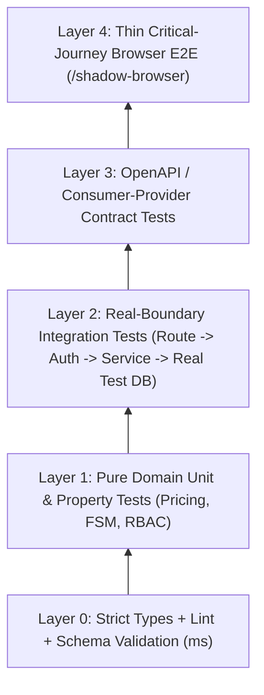

# 01 — Risk-Based Test Pyramid, 8-Point Endpoint Surface & Red-Green Regression

## 1. Purpose & Activation Conditions
Allocate automated testing investment where business, financial, and security risk is highest — favoring **real-boundary API/component integration tests** and **pure domain unit tests** over brittle mock-heavy unit tests or slow flaky end-to-end suites. Activate when designing a test plan for a new feature, fixing a bug, or auditing an under-tested backend/frontend module.

## 2. Prerequisites
- Authoritative API/domain contract (status codes, auth/tenant rules, persistence side effects) discovered from the owning service.
- Local or sandboxed test runner (`Vitest`/`Jest`, `pytest`, `go test`, `Pest`/`PHPUnit`, `JUnit 5`, `xUnit`, `cargo test`, `flutter_test`) respecting `L1_SAFE_VERIFICATION` scope boundaries.

## 3. Technical Principles & Constraints
- **Testing Trophy / Risk-Based Pyramid:**
  1. **Static & Strict Type Gates (Floor):** Compiler strict mode (`0 any`, `0 as Type` casts, `0 !`) + linter eliminate whole classes of typo/shape errors in milliseconds.
  2. **Pure Domain Unit Tests (Fast & Exhaustive):** Table-driven/parameterized + property-based tests for pricing, taxes, state machines, parsers, and RBAC/ABAC evaluators. Zero network, zero DB, `< 5ms` each.
  3. **Component / Route Integration Tests (Highest Backend ROI):** Execute the real HTTP router -> schema validator -> auth/tenant middleware -> service -> real test database transaction (PostgreSQL/MySQL/SQLite in ephemeral test container) and assert **both** HTTP response contract AND persisted DB/outbox state. Never mock internal repositories/ORMs for CRUD/transactional paths!
  4. **Contract & Selective Browser E2E Tests (Top):** Verify schema compatibility (`/shadow-api`, `/shadow-compat`) and reserve live browser E2E (`/shadow-browser`) strictly for critical cross-page user journeys.
- **Universal 8-Point HTTP Failure Surface:** Every authenticated state-mutating or tenant-scoped HTTP endpoint test suite MUST evaluate applicable cases across all 8 surfaces (document explicit `not_applicable` for public read-only routes):
  1. Happy path (`200`/`201`) + persisted DB/queue state.
  2. Validation & schema failure (`400`/`422`): missing fields, wrong types, negative amounts, bad enums.
  3. Unauthenticated (`401`): missing, malformed, or expired credentials.
  4. Forbidden / Cross-Tenant IDOR (`403`/`404`): Tenant A principal attempting to read/mutate Tenant B's resource.
  5. Resource Not Found (`404`): valid UUID/ID absent from DB.
  6. Idempotency & Conflict (`409`): duplicate unique key, reused `Idempotency-Key` with mismatched payload, or stale optimistic lock version.
  7. Boundary & edge values: `0`, `-1`, `[]`, `max + 1`, Unicode/emoji, UTC midnight/month-end, minor-unit currency rounding.
  8. State & container clean teardown: zero leaked rows, processes, or Docker containers/volumes.
- **Red-Before (`FAIL`) -> Green-After (`PASS`) Bug Discipline:** Never declare a bug fixed until a targeted regression test fails on the unpatched code and passes after the minimal fix.

## 4. Architecture & Implementation



```ts
// Strict TypeScript Typed Test Data Factory & 8-Point Assertion Helper (0 any, 0 casts)
export interface InvoiceFixture {
  readonly id: string
  readonly tenantId: string
  readonly amountMinor: number
  readonly status: 'DRAFT' | 'ISSUED' | 'PAID'
  readonly version: number
}

let seq = 0

export function buildInvoiceFixture(overrides: Partial<InvoiceFixture> = {}): InvoiceFixture {
  seq += 1
  return {
    id: `inv_test_${seq}`,
    tenantId: 'tenant_alpha',
    amountMinor: 150_000,
    status: 'DRAFT',
    version: 1,
    ...overrides,
  }
}
```

### Targeted Feedback Loop (Fast -> Full)
Run impacted tests first for sub-second feedback (`vitest related`, `pytest --lf`, `go test ./internal/billing/...`), then execute the module/suite integration run before claiming `VERIFIED-LOCAL`.

## 5. Platform/Vendor Variations
- **Backend APIs (Express/Fastify/Nest/FastAPI/Go/Laravel):** Test against an in-process app instance (`supertest(app)`, `httpx.AsyncClient(transport=ASGITransport(app=app))`, `httptest.NewRecorder()`, Laravel `$this->actingAs(...)`) backed by a single real test DB with per-test `SAVEPOINT` rollback.
- **Frontend Components (`@testing-library/react` / Vue Test Utils):** Test observable user behavior (`getByRole`, `getByLabelText`, `userEvent.click`) and stub network strictly at the HTTP boundary (`MSW`) rather than mocking internal React hooks or asserting component state internals.
- **Legacy / Brownfield Modules:** Pair with `/shadow-refactor` characterization tests capturing current observable behavior BEFORE modifying legacy internals.

## 6. Decision Matrix & Trade-Offs

| Test Layer | Speed | Bug-Catching ROI (SQL/Auth/Wiring) | Maintenance Fragility | Best Fit |
| :--- | :--- | :--- | :--- | :--- |
| **Mock-Heavy Service Unit Test** | Very Fast (`< 2ms`) | Low (misses SQL/ORM/Auth bugs) | High (breaks on internal refactors) | Avoid for thin CRUD services |
| **Pure Domain Unit + Property Test** | Very Fast (`< 5ms`) | Very High for logic/math | Very Low | Pricing, taxes, parsers, state transitions, RBAC rules |
| **Real-DB Route Integration Test** | Fast (`20–150ms`) | **Highest** for backend APIs | Low (tests stable HTTP contract) | Default for every HTTP endpoint & async worker |
| **Live Browser E2E (`/shadow-browser`)** | Slow (`2–15s`) | High for UI integration | Medium | Only critical user journeys & responsive/a11y checks |

## 7. Real Production Scenario
An invoicing service achieved `94%` line coverage by mocking Prisma repositories in every unit test. On launch day, two severe bugs hit production: a missing `tenant_id` predicate in `UPDATE invoices WHERE id = $1` allowed cross-tenant modification, and a `NOT NULL` column constraint rejected draft saves. Replacing repository mocks with real-DB route integration tests covering the 8-point failure surface caught both bugs in 400ms and dropped test maintenance churn by 60% during subsequent refactors.

## 8. Failure Modes & Edge Cases
- **WRONG:** Chasing `100%` line coverage with tautological tests (`expect(mockRepo.save).toHaveBeenCalledTimes(1)`) that break every time you rename a helper while letting SQL/IDOR bugs ship.
  **RIGHT:** Test observable public contracts (HTTP status, response schema, persisted DB state, emitted outbox events) across all 8 failure surfaces.
- **WRONG:** Writing a bug-fix regression test *after* applying the patch without verifying it actually fails on the buggy code.
  **RIGHT:** Run the new test against the unpatched behavior (`FAIL`), apply the minimal fix, and verify it turns green (`PASS`).
- **WRONG:** Using `as any` or `as Order` casts in test fixtures, hiding breaking interface changes from TypeScript.
  **RIGHT:** Build strictly typed factory helpers (`buildInvoiceFixture(overrides?: Partial<InvoiceFixture>)`).

## 9. Testing & Verification
- Run `python shadow-test/scripts/suite_hygiene_verifier.py --check-test-suite manifest.json` to verify 8-point surface coverage and strict TS test hygiene.
- Consult `references/vendor/GoldbergYoni_JS_Testing_Best_Practices.md` for AAA structure (Arrange-Act-Assert), flat test readability, and black-box assertions in JS/TS suites.

## 10. Operational Considerations
- Keep PR fast-gate unit + integration suites under `3–5 minutes` via parallel workers and single-container DB reuse (`06-ephemeral-test-containers-and-leak-free-teardown.md`).
- Never silently delete or `.skip()` failing tests to unblock a deploy without filing a tracked issue and documenting why.

## 11. Authoritative References
- Yoni Goldberg — *JavaScript Testing Best Practices* (`references/vendor/GoldbergYoni_JS_Testing_Best_Practices.md`).
- Kent C. Dodds — *The Testing Trophy and Testing Classifications*.
- Martin Fowler — *The Practical Test Pyramid*.

## 12. Limitations & When NOT to Use
- Do NOT use `shadow-test` for RAG/LLM faithfulness & prompt red-teaming (`/shadow-eval`), Pre-UAT `k6` load testing (`/shadow-perf`), or live Playwright browser viewport QA (`/shadow-browser`).
- A scoped unit-test request (`L1`) NEVER authorizes running broad unrequested E2E (`L2`) or stress (`L3`) suites.
