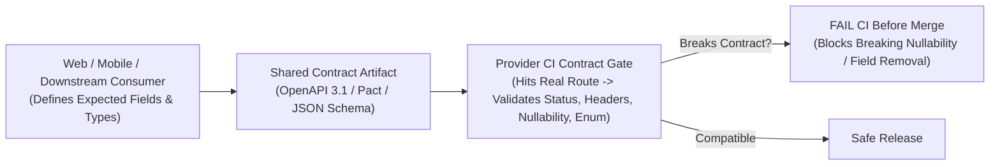

# 04 — Consumer-Provider Contract Testing & API/Event Boundary Compatibility

## 1. Purpose & Activation Conditions
Prevent silent breaking changes between backend services, frontend SPAs, mobile clients, and asynchronous event consumers using **OpenAPI schema validation tests**, **Consumer-Driven Contract Tests (Pact / Buf / JSON Schema)**, and **backward-compatibility fixture replays**. Activate when modifying API response payloads, webhook envelopes, event schemas, or integrating multi-team services alongside `/shadow-api` and `/shadow-compat`.

## 2. Prerequisites
- Authoritative API specification (OpenAPI 3.1, GraphQL SDL, Protobuf `.proto`, or AsyncAPI/JSON Schema) owned by the service (`shadow_api` MCP `discover_api_artifacts`).
- Real serialized response fixtures captured from both provider handlers and consumer parsers.

## 3. Technical Principles & Constraints
- **Derive Contracts From Authoritative Service Code — Never Invent Fields:** Validate actual HTTP/event output produced by the running provider router against the verified contract spec; never test against hand-copied mock JSON that quietly drifts from production!
- **Breaking vs Additive Compatibility Rules (`/shadow-compat`):**
  - **Safe Additive (Non-Breaking):** Adding an optional response field, adding a new optional request field with a safe default, adding a new endpoint.
  - **Breaking (MUST FAIL Contract Gate):** Removing or renaming a response field, narrowing a nullable field or turning a non-nullable field `null`, changing field type (`string -> number`), adding a new *required* request field, removing an enum value used by consumers, or changing success HTTP status codes (`201 -> 200`).
- **Tolerant Reader vs Strict Producer:** Producers MUST emit strictly valid contracts (zero undocumented missing required fields or wrong types); consumers SHOULD ignore unknown additive fields so forward upgrades don't crash older mobile/web clients.
- **Event & Webhook Envelope Contracts:** Version async events (`event_version: 1`) and test deserialization of **historical N-1 event fixtures** on every CI build so rolling deploys never poison in-flight queue messages!

## 4. Architecture & Implementation



```ts
// Strict TypeScript Contract Compatibility Validator (Producer Output vs Consumer Expectations, 0 any, 0 casts)
export interface ContractFieldSpec {
  readonly name: string
  readonly type: 'string' | 'number' | 'boolean' | 'object' | 'array'
  readonly nullable: boolean
  readonly required: boolean
}

export interface ContractViolation {
  readonly field: string
  readonly reason: string
}

export function validateResponseAgainstContract(
  payload: Record<string, unknown>,
  contract: readonly ContractFieldSpec[],
): readonly ContractViolation[] {
  const violations: ContractViolation[] = []
  for (const spec of contract) {
    if (!(spec.name in payload)) {
      if (spec.required) {
        violations.push({ field: spec.name, reason: 'REQUIRED_FIELD_MISSING' })
      }
      continue
    }
    const val = payload[spec.name]
    if (val === null) {
      if (!spec.nullable) {
        violations.push({ field: spec.name, reason: 'UNEXPECTED_NULL_VALUE' })
      }
      continue
    }
    const actualType = Array.isArray(val) ? 'array' : typeof val
    if (actualType !== spec.type) {
      violations.push({ field: spec.name, reason: `TYPE_MISMATCH: expected ${spec.type}, got ${actualType}` })
    }
  }
  return violations
}
```

### Contract Testing Toolchain by Protocol

| Protocol | Schema / Contract Gate Tool | Breaking-Diff Detector |
| :--- | :--- | :--- |
| **REST / OpenAPI 3.x** | `vitest` + `ajv`/`zod` / `schemathesis` / `jest-openapi` / `Pact` | `oasdiff breaking`, `shadow_api` `compare_openapi_drift` |
| **GraphQL** | GraphQL Inspector / Apollo Rover schema checks | `graphql-inspector diff` |
| **gRPC / Protobuf** | `buf lint` + `buf breaking` | `buf breaking --against '.git#branch=main'` |
| **Async Events / Webhooks** | JSON Schema + N-1 golden payload replay tests | Compatibility check (`BACKWARD` / `FULL` in Schema Registry) |

## 5. Platform/Vendor Variations
- **Single-Repo Fullstack (Monorepo / Next.js + API):** Share Zod/OpenAPI-generated TypeScript types directly AND still run runtime provider response contract tests so DB nullability or JSON serialization (`Date`, `BigInt`, `Decimal`) cannot violate the declared schema at runtime.
- **Mobile Clients (iOS/Android/Flutter):** Mobile users stay on old app versions for months! Pair contract tests with golden N-1/N-2 response compatibility fixtures so backend deploys never break older mobile binaries (`/shadow-mobile`, `/shadow-compat`).
- **Third-Party Webhooks (`Midtrans`/`Xendit`/`Stripe`):** Store sanitized real provider webhook samples as frozen fixtures (with synthetic test HMAC signatures) and run contract deserialization tests so SDK upgrades never break webhook parsing.

## 6. Decision Matrix & Trade-Offs

| Approach | Setup Cost | Cross-Team Safety | Catches Runtime Serialization Bugs? | Best Fit |
| :--- | :--- | :--- | :--- | :--- |
| **Static TypeScript Types Only** | Minimal | Weak (no runtime check) | **No** (DB `null` / `string` slips through) | Insufficient alone for external APIs |
| **Provider OpenAPI Runtime Validation** | Low | High | **Yes** | Default for REST APIs with single or multiple consumers |
| **Consumer-Driven Pact Broker** | Medium–High | Very High | **Yes** | Independent multi-repo microservices & mobile teams |
| **Event N-1 Golden Fixture Replay** | Low | Very High | **Yes** | Queues, Kafka/RabbitMQ, Outbox & webhook handlers |

## 7. Real Production Scenario
A backend refactor switched an ORM column `discount_amount` from `DEFAULT 0` to nullable `NULL`, returning `"discount_amount": null` on `/api/v1/orders/:id`. All backend unit tests passed, yet the Android app crashed on launch with `NullPointerException` for 35% of users. Adding a runtime OpenAPI response validator (`validateResponseAgainstContract` / `oasdiff breaking`) inside the provider's integration suite caught subsequent nullability and enum regressions locally in 200ms before PR review.

## 8. Failure Modes & Edge Cases
- **WRONG:** Writing consumer tests against a hand-written mock JSON stub that is NEVER verified against the real provider service (both consumer and provider tests stay green while production fails!).
  **RIGHT:** Generate or verify mock stubs directly from the provider's tested OpenAPI/Pact contract so drift fails CI automatically.
- **WRONG:** Testing only `200 OK` response schemas while ignoring `4xx`/`5xx` RFC 9457 error envelopes (frontend error parser crashes when error shape changes).
  **RIGHT:** Validate error envelopes (`status`, `code`, `message`, `requestId`) in the contract suite too.
- **WRONG:** Treating an unknown extra JSON property in a consumer test as a failure (`toStrictEqual` on entire external provider webhook).
  **RIGHT:** Use tolerant assertions on consumer inputs (`toMatchObject` / strip-unknown validation) while keeping provider output assertions strict.

## 9. Testing & Verification
- Run `shadow_api` `compare_openapi_drift` / `validate_openapi_spec` alongside route contract integration tests.
- Keep at least one N-1 historical event/webhook fixture test per versioned queue consumer.

## 10. Operational Considerations
- Wire breaking-change diffs (`oasdiff breaking`, `buf breaking`) into PR CI gates so breaking contract changes require an explicit version bump (`/v2/`) and deprecation timeline (`/shadow-compat`).

## 11. Authoritative References
- Pact Foundation — *Contract Testing & Can-I-Deploy Specification*.
- OpenAPI Initiative — *OpenAPI Specification v3.1 & `oasdiff` Breaking Change Rules*.
- Martin Fowler — *Tolerant Reader & Consumer-Driven Contracts*.

## 12. Limitations & When NOT to Use
- Contract tests prove **interface shape and semantics**, NOT internal business correctness or multi-user concurrency — pair with integration (`01`) and property/state tests (`03`).
- Do NOT introduce a full Pact Broker infrastructure for a single small monolith where provider OpenAPI runtime validation + shared schema types already provide 100% coverage with zero ops overhead.
